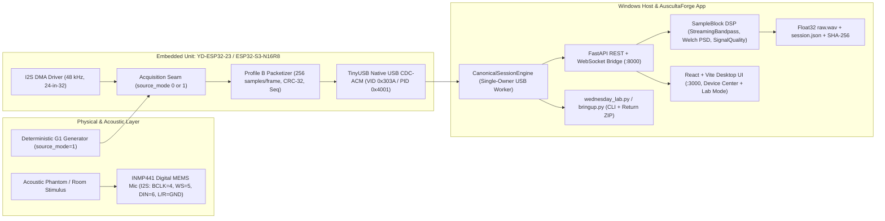

# AuscultaForge — Smart Digital Stethoscope (`EEE495 / EEE496`)

**Heart Sound Acquisition, Signal Processing and Quality Assessment**

Department of Electrical and Electronics Engineering — Senior Design Project (`SDP4`)
Authoritative Showcase Branch: `main`

> [!NOTE]
> **Engineering Prototype & Non-Clinical Notice:**
> AuscultaForge is an undergraduate engineering instrumentation platform focused on phonocardiographic (**PCG**, `20–500 Hz`) acquisition, deterministic embedded transport, and signal-quality metrology. It is **not** a certified medical device, makes **no** diagnostic claims, excludes lung sounds and human clinical trials, and separates **verified software / G1 hardware evidence** from **pending physical microphone / phantom measurements**.

---

## 1. Project Scope & Purpose

AuscultaForge investigates a complete, reproducible digital stethoscope pipeline from physical acoustic transduction to quantitative quality control:

- **Acoustic Modality:** Cardiac phonocardiography (**PCG**) centered on `20–500 Hz` characterization (`20–600 Hz` extended development filter preset).
- **Embedded Acquisition (`ESP32-S3-N16R8`):** Native **USB CDC-ACM** binary Profile B streaming (`48 kHz`, mono, signed 24-bit in 32-bit PCM slot, `CRC-32`, monotonic sample index, 72-byte firmware telemetry) with both deterministic **G1 (`source_mode=1`)** and live **I²S INMP441 (`source_mode=0`)** paths.
- **Windows Host & Desktop App:** Single-owner bidirectional USB engine (`CanonicalSessionEngine`), peak-preserving 25 Hz display decimation (`DisplayAggregator`), causal stateful SOS Butterworth DSP (`StreamingBandpass`), Welch PSD spectrogram, float32 WAV + SHA-256 sidecar persistence (`SessionRecorder`), `pcg_core.metrology` automation, and **Wednesday Lab Mode** orchestration.
- **Physical Testing Philosophy:** All acoustic characterization uses controlled laboratory stimuli and an acoustic phantom (exciter + amplifier + compliant coupling + rigid frame), never patient subjects.

---

## 2. End-to-End Architecture (`ESP32-S3 + INMP441 + USB CDC + Windows`)



---

## 3. Team Members, Official Modules & Verifiable Contributions

Per EEE495 module structure (`A`, `B`, `C`), official responsibility and verifiable repository activity as of **2026-11-17** are recorded transparently:

| Module | Official Owner | Official Course Scope | Verifiable Repository Status (2026-11-18) |
| :--- | :--- | :--- | :--- |
| **Module A** | **Kaan** | Transducer selection (`INMP441`, `KECG2740PBJ`), analog front-end, chestpiece, phantom assembly & physical lab measurements | Breadboard physical integration of INMP441 (SCK->GPIO4, WS->GPIO5, SD->GPIO6, L/R->GND) and acoustic excitation feasibility completed on 18 Nov 2026. **Multimeter display photo and acoustic port macro photo missing; phantom physical measurements are `PENDING` (Week 10).** |
| **Module B** | **Ozan** | Embedded acquisition, DMA buffering, timestamps, device–PC protocol specs & throughput/latency | Breadboard electrical continuity check, 3.3V power rail measurement (3.28V via Agilent U1232A, attested), firmware flashing on COM4, and physical execution of zero-loss G1/G2 sessions completed on 18 Nov 2026. Real C/FreeRTOS firmware & USB CDC authored by Ege. |
| **Module C** | **Ege Çağın Tepe** | Windows/Python host backend, React UI, DSP, recording library, quality assessment, automated test suites & integration orchestration | C firmware architecture, dual-mode G1/G2 runtime, TinyUSB CDC protocol, FastAPI/React UI, Welch PSD & quality pipelines, independent verification of 18 Nov lab returns, and conditional acceptance reporting. |

> Full branch audit confirming zero unmerged changes across all 49 remote branches: [`docs/engineering/BRANCH_CONSOLIDATION_AUDIT.md`](docs/engineering/BRANCH_CONSOLIDATION_AUDIT.md).

---

## 4. Verified Evidence vs. Pending Physical Experiments

AuscultaForge strictly separates reproducible **software & G1 hardware evidence** from **unexecuted physical microphone/phantom experiments**:

| Category / Experiment | Status | Observed Evidence & Provenance |
| :--- | :---: | :--- |
| **Physical ESP32-S3 USB G1 (`source_mode=1`)** | **PASS** *(2026-10-26 & 2026-11-16)* | Native USB CDC (`COM10`, `VID:303A PID:4001`, UID `0xb1aa7cc4`): `480,000` samples, `1,875` frames, `0` dropped samples, `0` CRC errors. Also verified end-to-end via FastAPI/React Device Center (`raw.wav`: `194,304` samples, `4.048 s`, `48 kHz`, strictly `physical_deterministic_g1`). Evidence: [`laptop_20261116_g1_and_wav_summary.json`](firmware/evidence/laptop_20261116_g1_and_wav_summary.json). |
| **ESP-IDF v5.5.1 G1 & Staged G2 Builds** | **PASS (Build Verified)** | Separate clean `esp32s3` builds: [`g1_release_20261117`](firmware/releases/g1_release_20261117/README.md) (`COMPILED_BUT_NOT_FLASHED`) and [`g2_candidate_20261117`](firmware/releases/g2_candidate_20261117/README.md) (`PREPARED_NOT_AUTHORIZED_FOR_FLASH`). Immutable 2026-10-23 rollback intact in [`g1_rollback_backup`](firmware/g1_rollback_backup/README.md). |
| **Firmware Host C Unit Suite (`firmware/tests`)** | **PASS** | Compiles real C sources (`g1.c`, `acquisition.c`, `packet_framing.c`, `bridge.c`) via WinLibs GCC `16.2.0` into `g1.dll` — `16 passed`. |
| **Protocol Laboratory (`tools/protocol_lab/python`)** | **PASS** | Profile A/B wire codecs, CRC-32, defragmentation, RFC-3550 sequence gates — `59 passed, 1 skipped` (`g1_sim_runner.exe` optional). |
| **Backend, DSP, Metrology & Orchestration (`software/tests`)** | **PASS** | FastAPI routes, WAV/sidecar integrity, Welch PSD, Springer/CirCor tools, controlled artifact benchmark (`5/5`), 10 fault-injection & acceptance tests for `wednesday_lab.py` & `windows_setup.ps1` (post-flash G1 re-run + `INCONCLUSIVE` stimulus check) — **`597 passed, 4 skipped`** (`672` total across Python/Protocol/C suites). |
| **Desktop Frontend (`software/frontend`)** | **PASS** | TypeScript `tsc --noEmit` (`0` errors) + `9` `tsx` suites + production Vite bundle (`dist/`, `4.03 s`, includes Device Center `Wednesday Lab Mode`). |
| **Physical INMP441 G2 (`source_mode=0`)** | **CONDITIONAL PASS** *(2026-11-18)* | Breadboard wiring (GPIO 4, 5, 6, GND), 3.28V VDD rail, 48 kHz, 24-bit in 32-bit slot over native USB CDC (`COM3`). 4 sessions (`091909_9e6baa63`, `093225_19cde788`, `094939_4888e670`, `100102_4e58ac08`) totaling `1,920,000` samples with **0 in-stream drops**. 23.2 dB acoustic response verified. Report: [`PHYSICAL_G2_ACCEPTANCE_REPORT.md`](experiments/hardware/team_2026-11-18/PHYSICAL_G2_ACCEPTANCE_REPORT.md). |
| **Acoustic Phantom PCG Feasibility (Week 9 Gate)** | **`PREPARED / PENDING LAB`** | Automated playback + acquisition runner ready (`run_phantom_pcg_experiment.py`), BOM & BTL wiring checklist audited ([`PHANTOM_BOM_AND_WIRING_CHECKLIST.md`](docs/engineering/hardware/PHANTOM_BOM_AND_WIRING_CHECKLIST.md)), lab runbook ready ([`W09_PHYSICAL_PCG_FEASIBILITY_RUNBOOK.md`](docs/engineering/hardware/W09_PHYSICAL_PCG_FEASIBILITY_RUNBOOK.md)). Physical trial pending chestpiece & phantom assembly. Current firmware session limit: `G1_TARGET_SAMPLES=480000U` (`10.0 s` @ `48 kHz`) and `40 s` hard timer (`g1.h` / `g1.c`). |
| **Phantom FRF, 50 Hz Mains, Repeatability (≥10), 30-Min Stress** | **`NOT_EXECUTED`** | Physical phantom swept frequency response and 30-minute continuous run pending physical phantom assembly and firmware continuous-streaming protocol update. |

---

## 5. Software Setup & Running on Windows (Git Clone or GitHub Download ZIP)

You do **not** need Git installed or an ESP-IDF download to run the Windows desktop app or the pre-built G1/G2 hardware workflow:

### Quick Setup (One Command)
Open PowerShell inside the extracted project folder (spaces/Turkish paths work for Python/staged flows; use `C:\pcg_starter` if planning ESP-IDF firmware rebuilds):

```powershell
# Automatically detects or installs user-scope Python 3.11+ & Node LTS (if missing),
# creates .venv, installs Python/frontend packages, and skips ESP-IDF download when staged binaries exist:
.\scripts\handoff\windows_setup.ps1

# Passive environment + SHA-256 manifest verification (works offline & without .git):
.\scripts\handoff\windows_preflight.ps1
```

### Launch AuscultaForge Desktop App (Backend `:8000` + React UI `:3000`)
```powershell
.\scripts\dev.ps1
```
Then open `http://127.0.0.1:3000` in your browser (**Device Center** includes USB Discovery, live G1/G2 mode control, **Lab Mode**, and **Build Return ZIP**).

### Run Automated Verification Suites
```powershell
.\.venv\Scripts\python.exe -m pytest firmware/tests -v
.\.venv\Scripts\python.exe -m pytest tools/protocol_lab/python -v
.\.venv\Scripts\python.exe -m pytest software/tests -q
Push-Location software/frontend; npm.cmd run lint; npm.cmd test; npm.cmd run build; Pop-Location
```

---

## 6. Wednesday `2026-11-18` Physical Lab Handoff (Zero-Git Workflow)

For **Kaan** (Module A) and **Ozan** (Module B) running physical bench integration without Ege:

1. **Human Quickstart (Turkish):** [`docs/handoff/START_HERE_2026-11-18.md`](docs/handoff/START_HERE_2026-11-18.md)
2. **Agent Autonomous Runbook:** [`docs/handoff/AGENT_WEDNESDAY_2026-11-18.md`](docs/handoff/AGENT_WEDNESDAY_2026-11-18.md)
3. **Electrical Safety & G1 Rollback:** [`docs/handoff/HARDWARE_GATES_AND_ROLLBACK.md`](docs/handoff/HARDWARE_GATES_AND_ROLLBACK.md)
4. **Release Hashes & Test Evidence Index:** [`docs/handoff/RELEASE_AND_EVIDENCE_INDEX_2026-11-17.md`](docs/handoff/RELEASE_AND_EVIDENCE_INDEX_2026-11-17.md)

**Single Autonomous Lab Command:**
```powershell
# Runs preflight -> hash check -> USB discovery -> HELLO -> resumable G1 -> H0/G2 gates -> return ZIP:
.\.venv\Scripts\python.exe tools/hardware/wednesday_lab.py --skip-g2-captures

# After H0 photos/3.3V verified, authorize-g2 + human-confirmed ROM flash complete:
.\.venv\Scripts\python.exe tools/hardware/wednesday_lab.py --assume-g2-flashed

# Standalone one-click ZIP delivery to Ege (no Git required):
.\scripts\handoff\pack_wednesday_results.ps1 -Operator "Kaan_Ozan"
```

---

## 7. Weekly Academic Progress Reports & Tracked Evidence

| Deliverable | Scope & Period | Direct Link |
| :--- | :--- | :--- |
| **Advisor Progress Report (Weeks 1–6, EN Word/PDF)** | Formal English academic report (`21 Sep – 1 Nov` core period + `18 Nov` post-period appendix, 5 pages) | [`EEE495_AuscultaForge_Weeks01-06_Progress_Report_2026-11-18.docx`](docs/sdp/reports/EEE495_AuscultaForge_Weeks01-06_Progress_Report_2026-11-18.docx) · [PDF](docs/sdp/reports/EEE495_AuscultaForge_Weeks01-06_Progress_Report_2026-11-18.pdf) |
| **Advisor Progress Draft (Markdown)** | Historical Weeks 1–6 tables + 18 Nov physical lab measurement addendum | [`docs/sdp/SDP4_WEEK01_06_DRAFT_PROGRESS_REPORT.md`](docs/sdp/SDP4_WEEK01_06_DRAFT_PROGRESS_REPORT.md) |
| **Overall Semester Matrix (As-Of 2026-11-17)** | Module A/B/C status across Weeks 1–14 + 16–17 Nov verification | [`docs/sdp/PROGRESS_ASOF_2026-11-17.md`](docs/sdp/PROGRESS_ASOF_2026-11-17.md) |
| **Weeks 02–06 (Pre-Midterm)** | Team setup, requirements freeze, procurement ledgers, Week 6 G1 & audio acceptance | [`week-02`](docs/sdp/week-02/) · [`week-03`](docs/sdp/week-03/README.md) · [`week-04`](docs/sdp/week-04/README.md) · [`week-05`](docs/sdp/week-05/README.md) · [`week-06`](docs/sdp/week-06/README.md) |
| **Weeks 07–09 (Midterm Break & Physical G2)** | Software playback, metrology CLI, 18 Nov physical G2 INMP441 capture (`CONDITIONAL PASS`; phantom/calibration `PENDING`) | [`week-07`](docs/sdp/week-07/README.md) · [`week-08`](docs/sdp/week-08/README.md) · [`week-09`](docs/sdp/week-09/README.md) · [`Acceptance Report`](experiments/hardware/team_2026-11-18/PHYSICAL_G2_ACCEPTANCE_REPORT.md) |
| **Week 9 Feasibility Preparation & Runbook** | Audit, BOM, safety wiring checklist, lab runbook, and automated PCG runner for acoustic phantom gate | [`Readiness Audit`](docs/engineering/hardware/W07_W09_READINESS_AUDIT.md) · [`Phantom BOM`](docs/engineering/hardware/PHANTOM_BOM_AND_WIRING_CHECKLIST.md) · [`Lab Runbook`](docs/engineering/hardware/W09_PHYSICAL_PCG_FEASIBILITY_RUNBOOK.md) · [`Automation Plan`](docs/engineering/hardware/W09_EXPERIMENT_AUTOMATION_PLAN.md) |
| **Weeks 10–14 (`PLANNED`)** | Multi-transducer, repeatability, 50 Hz mains, interim report & final integration (`NOT_EXECUTED`) | [`week-10`](docs/sdp/week-10/README.md) · [`week-11`](docs/sdp/week-11/README.md) · [`week-12`](docs/sdp/week-12/README.md) · [`week-13`](docs/sdp/week-13/README.md) · [`week-14`](docs/sdp/week-14/README.md) |
| **Tracked COM10 G1 & WAV Summary** | SHA-256 verified 2026-11-16 COM10 G1 + Device Center WAV session metadata | [`firmware/evidence/laptop_20261116_g1_and_wav_summary.json`](firmware/evidence/laptop_20261116_g1_and_wav_summary.json) |

---

## 8. Firmware Releases, Repository Layout & Technical Index

- **Firmware Overview & Pinned Toolchain (`ESP-IDF v5.5.1`):** [`firmware/README.md`](firmware/README.md)
- **Immutable G1 Rollback Backup (`2026-10-23`):** [`firmware/g1_rollback_backup/README.md`](firmware/g1_rollback_backup/README.md)
- **Staged G1 Release (`2026-11-17`):** [`firmware/releases/g1_release_20261117/README.md`](firmware/releases/g1_release_20261117/README.md)
- **Staged G2 Candidate (`2026-11-17`, Provisional `BCLK=4, WS=5, DIN=6, L/R=GND`):** [`firmware/releases/g2_candidate_20261117/README.md`](firmware/releases/g2_candidate_20261117/README.md)
- **Hardware Engineering Checklists:** [`docs/hardware/`](docs/hardware/) · [`docs/engineering/hardware/`](docs/engineering/hardware/WINDOWS_LAPTOP_SETUP.md)
- **Wire Protocol & System Architecture:** [`docs/protocol/`](docs/protocol/) · [`docs/architecture/`](docs/architecture/) · [`docs/knowledge-base/`](docs/knowledge-base/)
- **Branch Consolidation Audit (All 49 Remote Refs):** [`docs/engineering/BRANCH_CONSOLIDATION_AUDIT.md`](docs/engineering/BRANCH_CONSOLIDATION_AUDIT.md)
