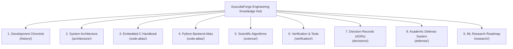

# AuscultaForge — Engineering Intelligence & Defense Knowledge Base
**Repository:** `egecagintepe/ausculta-forge`  
**Course Context:** EEE495 / EEE496 Senior Design Project — Digital Stethoscope  
**Department:** Electrical and Electronics Engineering  
**Primary Documentation Owner:** Ege Çağın Tepe (Module C Owner)  
**Baseline Git Commit:** `fa4b75a80d29aab04875534234574db9f6c0af43` (Master Integration Gate Merge)  
**Classification:** `CODE_VERIFIED` / `TEST_VERIFIED`

---

## 1. Mission and Navigational Overview

The AuscultaForge Engineering Intelligence & Defense System is a comprehensive, technically rigorous knowledge base and academic reference. It is designed to enable an engineering student to:
1. Reconstruct the complete development history and procurement pivots.
2. Navigate the low-level embedded C, Python, and React architectures.
3. Understand the mathematical foundations of real-time causal filtering, spectral density, and system identification.
4. Defend technical decisions before an academic senior design examination panel.
5. Reproduce all verification results from a clean repository checkout.

---

## 2. Master Navigation Directory

### Phase 1: Project History & Evolution
* [Development Chronicle](history/DEVELOPMENT_CHRONICLE.md) — Comprehensive narrative from inception (`c7751bf`) to Master Integration Gate (`fa4b75a`).
* [Commit & PR Evidence Index](history/COMMIT_PR_EVIDENCE_INDEX.md) — Exact mapping of all PRs, commits, authors, and evidence.
* [Requirements Evolution](history/REQUIREMENTS_EVOLUTION.md) — Evolution of scope, 48 kHz baseline, and procurement changes.
* [Decision Timeline](history/DECISION_TIMELINE.md) — Chronological log of major architectural milestones.

### Phase 2: Complete System Architecture
* [System Architecture Reference](architecture/SYSTEM_ARCHITECTURE.md) — End-to-end physical and logical architecture.
* [Data Flow & Signal Transformation](architecture/DATA_FLOW.md) — Step-by-step transformation from acoustic pressure to pixels.
* [Component Map & Dependency Graph](architecture/COMPONENT_MAP.md) — Complete inventory of classes, packages, and coupling rules.
* [Device Runtime Lifecycle](architecture/RUNTIME_LIFECYCLE.md) — Authoritative 8-state hardware finite state machine.
* [Failure Recovery & Edge Cases](architecture/FAILURE_RECOVERY.md) — Fault tolerance, disconnect recovery, and backpressure.

### Phase 3 & 4: Code Atlas (C, Python, TypeScript)
* [C Language Foundations](code-atlas/C_LANGUAGE_FOUNDATIONS.md) — Fixed-width integers, two's-complement arithmetic, and sign extension.
* [Embedded C Walkthrough](code-atlas/EMBEDDED_C_WALKTHROUGH.md) — Line-by-line breakdown of core C functions with worked examples.
* [ESP32-S3 Runtime Architecture](code-atlas/ESP32_RUNTIME_ARCHITECTURE.md) — Xtensa dual-core model, I2S DMA ping-pong, and FreeRTOS timing.
* [PCM Binary Representation](code-atlas/PCM_BINARY_REPRESENTATION.md) — S32_LE container layout, bit alignment, and normalization.
* [USB Protocol Engineering](code-atlas/USB_PROTOCOL_ENGINEERING.md) — CDC-ACM transport, endpoints, and proposed 40-byte framing.
* [Buffering & Real-Time Queues](code-atlas/BUFFERING_AND_REALTIME.md) — Sizing queues, latency decomposition, and backpressure.
* [Python Runtime Walkthrough](code-atlas/PYTHON_RUNTIME_WALKTHROUGH.md) — Asynchronous engine, DeviceRuntime, and StreamManager.
* [FastAPI API Reference](code-atlas/FASTAPI_API_REFERENCE.md) — Complete documentation of all 57 registered routes.
* [Recording & Session Internals](code-atlas/RECORDING_AND_SESSION_INTERNALS.md) — Lossless WAV + SHA-256 sidecars and tamper rejection.
* [Frontend Desktop Architecture](code-atlas/FRONTEND_ARCHITECTURE.md) — React 18, Vite, and high-performance HTML5 canvas.
* [Cross-Language Data Contracts](code-atlas/CROSS_LANGUAGE_DATA_CONTRACTS.md) — Type governance across C, Python, and TypeScript.

### Phase 5: Mathematical & Scientific Algorithms
* [PCG Signal Foundations](science/PCG_SIGNAL_FOUNDATIONS.md) — Anatomy of heart sounds ($S_1, S_2$) and the $20\text{--}500\text{ Hz}$ band.
* [DSP Mathematics Handbook](science/DSP_MATHEMATICS.md) — Sampling theorem, SOS filters, RMS, crest factor, and TKEO.
* [Spectral Analysis Handbook](science/SPECTRAL_ANALYSIS.md) — FFT, Hann window leakage, Welch PSD, and 50 Hz mains hum.
* [Segmentation Models](science/SEGMENTATION_MODELS.md) — Springer LR-HSMM duration-dependent model and CirCor validation.
* [SISO System Identification](science/SYSTEM_IDENTIFICATION.md) — Phantom transfer function $H_1(f)$, delay, and coherence $\gamma^2(f)$.
* [Measurement Uncertainty](science/MEASUREMENT_UNCERTAINTY.md) — Repeatability across $\ge 10$ runs, variance, and error budgets.

### Phase 6: Verification & Test Evidence
* [Test Evidence Atlas](verification/TEST_ATLAS.md) — Master inventory of 394 automated pytest tests, frontend tests, and C fixtures.
* [Requirements Traceability Matrix](verification/REQUIREMENTS_TRACEABILITY.md) — Requirement $\to$ Source $\to$ Test $\to$ Result $\to$ Limitation.
* [Software Evidence vs Hardware Reality](verification/SOFTWARE_VS_HARDWARE_EVIDENCE.md) — Honest demarcation of physical vs simulated progress.
* [System Reproducibility Guide](verification/REPRODUCIBILITY_GUIDE.md) — Step-by-step clean machine execution guide for Windows.

### Phase 7: Architectural Decision Records (ADRs)
* [ADR Catalog Index](decisions/README.md) — Master index of all 18 consequential project decisions (ADR-0001 through ADR-0018).

### Phase 8 & 9: Academic Defense & Presentation System
* [Academic Defense Handbook](defense/DEFENSE_HANDBOOK.md) — Examination structure, principles, and grading criteria.
* [Defense Question Bank (105 Qs)](defense/QUESTION_BANK.md) — 105 deeply technical questions across 10 subject domains.
* [Code Reading Exercises](defense/CODE_READING_EXERCISES.md) — 6 code-level analysis challenges for exam whiteboard review.
* [Live Debugging Scenarios](defense/LIVE_DEBUGGING_SCENARIOS.md) — 6 real-time failure diagnoses and immediate live fixes.
* [Quick Reference Cheatsheet](defense/QUICK_REFERENCE.md) — Dense 2-page pre-exam formula and numbers guide.
* [Oral Exam Simulations](defense/ORAL_EXAM_SIMULATIONS.md) — 3 word-for-word professor interrogation transcripts.
* [EEE495 Presentation Plan](defense/EEE495_PRESENTATION_PLAN.md) — 3-min pitch, 10-min slides, and 25-min academic defense plan.
* [EEE496 Presentation Proposal](defense/EEE496_PRESENTATION_PLAN.md) — Proposed future roadmap for Semester II capstone.
* [Live Demonstration Runbook](defense/DEMO_RUNBOOK.md) — Minute-by-minute operational runbook for live demos.
* [Failure Fallback Plan](defense/FAILURE_FALLBACK_PLAN.md) — Immediate emergency pivot procedures if hardware fails.

### Phase 10 & 11: Research Roadmap & Legal Provenance
* [Semester II AI Research Roadmap](research/SEMESTER_II_AI_ROADMAP.md) — 5 tightly scoped research directions in signal quality.
* [ML Experiment Design Protocol](research/ML_EXPERIMENT_DESIGN.md) — Standardized 8-stage scientific ML protocol.
* [Academic Publication Feasibility](research/ACADEMIC_PUBLICATION_FEASIBILITY.md) — Honest novelty analysis and paper concept.
* [Dependency & License Audit](DEPENDENCY_AND_LICENSE_AUDIT.md) — Full legal review of Python, React, datasets, and algorithms.

### Phase 12: Infrastructure & Maintenance
* [Engineering Glossary](GLOSSARY.md) — Comprehensive technical terminology definitions.
* [Knowledge Coverage Matrix](KNOWLEDGE_COVERAGE_MATRIX.md) — Audit mapping of all course requirements to docs.
* [Documentation Maintenance Guide](DOCUMENTATION_MAINTENANCE.md) — Lightweight workflow for updating docs after future PRs.
* [Documentation Templates](templates/) — Standardized templates for PRs, algorithms, experiments, and ADRs.
