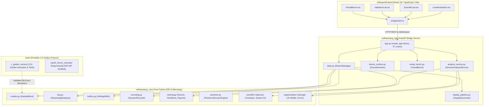

# AuscultaForge — Component Map & Software Dependency Graph
**Document ID:** `AF-ARCH-COMPONENTS-V01`  
**Classification:** `CODE_VERIFIED`  
**Course Context:** EEE495 / EEE496 Senior Design Project — Digital Stethoscope  
**Baseline Git Commit:** `fa4b75a80d29aab04875534234574db9f6c0af43`

---

## 1. High-Level Subsystem Organization

AuscultaForge is divided into four distinct operational subsystems:
1. **`pcg_core` (Core Scientific & DSP Library):** Pure, framework-agnostic mathematical algorithms, data structures, filter models, and metrology runners. Operates without any dependency on FastAPI or React.
2. **`pcg_app` (Application & Bridge Runtime):** FastAPI HTTP REST endpoints, WebSocket streaming bridge, device lifecycle state machines, display decimators, and local service coordination.
3. **`frontend` (React Desktop User Interface):** Interactive real-time workstation, live waveform canvas, spectrogram, metrology lab, and research benchmark visualizers.
4. **`tools` (Portable C Tools & Experimental Scaffolds):** C11 golden vector generators and experimental ESP-IDF bench examples.

---

## 2. Core Component Directory & Interface Specifications

### 2.1 `software/pcg_core` Components

| Module / Class | File Location | Primary Purpose | Inputs | Outputs | Key Dependencies |
|---|---|---|---|---|---|
| `SampleBlock` | `pcg_core/models.py` | Universal streaming container dataclass | `samples`, `sample_rate`, `timestamp`, `sequence_number` | Immutable block object | `numpy`, `dataclasses` |
| `StreamingBandpass` | `pcg_core/dsp.py` | Stateful causal IIR filter using SOS representation | `np.ndarray` (chunk) | Filtered `np.ndarray` | `scipy.signal` |
| `RollingBuffer` | `pcg_core/buffers.py` | Thread-safe circular FIFO buffer | Continuous blocks | Latest $T$-second slice | `numpy`, `threading` |
| `StreamQualityMonitor` | `pcg_core/streaming.py` | Tracks sequence continuity & dropped blocks | `sequence_number` | Drop counts, gap history | Pure Python |
| `SessionRecorder` | `pcg_core/recording.py` | Dual persistence: WAV audio + JSON metadata sidecar | Streaming blocks | `.wav` + `.meta.json` | `wave`, `hashlib`, `json` |
| `MetrologyRunner` | `pcg_core/metrology/runner.py` | Orchestrates 6 mandatory advisor measurements | Measurement config | CSV/Markdown reports | `scipy`, `pcg_core.scientific` |
| `PhantomStimulusEngine` | `pcg_core/phantom.py` | SISO transfer function $H_1(f)$ and delay estimation | Reference & capture signals | Gain, delay, coherence | `scipy.signal` |
| `SpringerHSMM` | `pcg_core/segmentation/springer_hsmm.py` | Duration-dependent Hidden Semi-Markov Model | Extracted audio features | State sequence ($S_1, \text{sys}, S_2, \text{dia}$) | `numpy`, `scipy.stats` |

---

### 2.2 `software/pcg_app` Components

| Module / Class | File Location | Primary Purpose | Inputs | Outputs | Key Dependencies |
|---|---|---|---|---|---|
| `create_app` | `pcg_app/app.py` | Application factory registering 57 routes | `sessions_dir` | `FastAPI` instance | `fastapi`, `starlette` |
| `DeviceRuntime` | `pcg_app/device_runtime.py` | Authoritative 8-state hardware lifecycle machine | UI / API poll & stream commands | State enum, telemetry | `pyserial` (optional), `asyncio` |
| `StreamManager` | `pcg_app/state.py` | Coordinates active audio sources and subscribers | Blocks from hardware or VirtualBench | Broadcast to queues | `asyncio`, `pcg_core` |
| `DisplayDecimator` | `pcg_app/display_pipeline.py` | Compresses 48 kHz blocks into $\le 600$ peak points | Raw block (512 samples) | Decimated array | `numpy` |
| `VirtualBench` | `pcg_app/virtual_bench.py` | Simulates 8 deterministic known-answer test scenarios | Scenario name | Timed `SampleBlock` streams | `numpy`, `asyncio` |
| `SessionAnalysisService` | `pcg_app/analysis_service.py` | Executes offline spectral & quality analysis on sessions | Session ID | Structured analysis JSON | `pcg_core.scientific` |

---

### 2.3 `software/frontend` Components

| Component | File Location | Role & User Experience | Primary Interactivity |
|---|---|---|---|
| `App.tsx` | `frontend/src/App.tsx` | Main navigation shell & mode switcher | Switches between Live Workstation, Scientific Lab, Validation Lab, and Virtual Bench |
| `LiveWorkspace.tsx` | `frontend/src/components/LiveWorkspace.tsx` | Real-time oscilloscope, metrics & recording | Canvas waveform drawing, connect/stream buttons, recording controls |
| `ScientificLab.tsx` | `frontend/src/components/ScientificLab.tsx` | Offline session inspection & metrology | Welch PSD, STFT spectrogram, H1 transfer function viewer |
| `ValidationLab.tsx` | `frontend/src/components/ValidationLab.tsx` | Springer segmentation benchmark viewer | Confusion matrices, error tolerance matching, event charts |
| `VirtualBench.tsx` | `frontend/src/components/VirtualBench.tsx` | Automated testing control panel | Scenario selector (100 Hz sine, counter ramp, boundary stress, etc.) |
| `bridgeClient.ts` | `frontend/src/bridgeClient.ts` | Typed WebSocket and HTTP client | Manages reconnect loops, deserializes JSON WebSocket frames |

---

## 3. Coupling & Architectural Separation Guarantees

1. **Zero UI Coupling in Core DSP:** `pcg_core` contains zero references to web frameworks, HTTP protocols, or WebSockets. It can be executed inside embedded headless Python scripts, CI runners, or offline Jupyter notebooks.
2. **Asynchronous Ingestion Decoupling:** Hardware ingestion runs inside a dedicated thread / asynchronous task. Slow WebSocket clients or heavy React rendering cannot block or delay audio ingestion.
3. **Decimated Display Safety:** The React canvas receives at most $\approx 36,000 \text{ points/minute}$ ($\le 600 \text{ points/frame} \times 60 \text{ FPS}$), whereas raw recording writes $2,880,000 \text{ samples/minute}$ ($48,000 \text{ samples/s}$). This enforces strict memory bounding.
