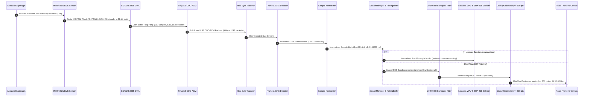

# AuscultaForge — End-to-End Data Flow & Signal Transformation
**Document ID:** `AF-ARCH-DATAFLOW-V01`  
**Classification:** `CODE_VERIFIED` / `TEST_VERIFIED`  
**Course Context:** EEE495 / EEE496 Senior Design Project — Digital Stethoscope  
**Baseline Git Commit:** `fa4b75a80d29aab04875534234574db9f6c0af43`

---

## 1. End-to-End Signal Transformation Pipeline

A heart sound begins as mechanical acoustic pressure fluctuations at the chest wall and ends as normalized mathematical features, decimated graphical waveforms, and spectral density plots. Every stage in this transformation adheres to strict numerical and timing boundaries.



---

## 2. Stage-by-Stage Mathematical and Data Representation

### Stage 1: Acoustic Pressure to Electric Charge ($p(t) \to q(t)$)
* **Physical Domain:** Acoustic pressure waves generated by myocardial valve closure ($S_1, S_2$) propagate through the chest cavity and acoustic coupling chamber.
* **Transducer Interaction:** The compliant capacitive diaphragm of the INMP441 deflects in response to pressure differential $\Delta p(t)$.
* **Sensitivity Constant:** Nominal sensitivity is $S_a = -26 \text{ dBFS}$ at $94 \text{ dB SPL}$ ($1 \text{ Pa}$ RMS at $1 \text{ kHz}$).
* **Dynamic Range:** Acoustic overload point (AOP) is $120 \text{ dB SPL}$.

### Stage 2: Sigma-Delta Modulation & I2S Serialization ($q(t) \to \text{Bits}$)
* **ADC Topology:** Fourth-order $\Sigma\Delta$ modulator operating at high oversampling frequency ($f_{\text{mod}} \approx 3.072 \text{ MHz}$).
* **Decimation Filter:** On-chip digital decimation filter produces 24-bit two's complement integer samples at $f_s = 48,000 \text{ Hz}$.
* **Bit Layout on I2S Bus:**
  * Transmitted during the LOW phase of Word Select (`WS = 0`, Left Channel).
  * Data bit transitions on the falling edge of Serial Clock (`SCK`), sampled on the rising edge.
  * Standard I2S protocol delays MSB by exactly 1 SCK period following WS edge.
  * Word format: 24 active data bits followed by 8 padding bits ($0\text{x}00$) inside a 32-bit slot:
    $$\text{I2S Slot} = [B_{23}, B_{22}, \dots, B_0, 0, 0, 0, 0, 0, 0, 0, 0]$$

### Stage 3: DMA Buffering & Little-Endian Container ($x[n] \in \mathbb{Z}$)
* **Memory Placement:** Hardware DMA copies 32-bit words directly into ESP32-S3 internal SRAM.
* **Container Representation:** Stored as `int32_t` in Little-Endian byte order (`S32_LE`).
* **Endianness Byte Layout:** A 32-bit word with hexadecimal value `0x12345600` is stored in physical RAM across four contiguous bytes:
  $$\text{Byte } 0: 0\text{x}00 \quad | \quad \text{Byte } 1: 0\text{x}56 \quad | \quad \text{Byte } 2: 0\text{x}34 \quad | \quad \text{Byte } 3: 0\text{x}12$$

### Stage 4: Wire Transmission & USB CDC-ACM
* **Block Pacing:** FreeRTOS acquisition task gathers 512 samples ($512 \times 4 = 2048 \text{ bytes}$).
* **USB Transfer:** TinyUSB CDC-ACM stack fragments the 2048-byte buffer into 32 standard USB Full-Speed packets ($64 \text{ bytes/packet}$).
* **Lossless Pacing:** If the host application is slow to read, the CDC-ACM FIFO absorbs packets; if the queue saturates, dropped bytes are explicitly counted in telemetry.

### Stage 5: Host Ingestion & Normalization ($x[n] \to y[n] \in \mathbb{R}$)
* **Code Reference:** `software/pcg_app/device_runtime.py` and `software/pcg_core/models.py`.
* **Normalization Logic:** Converts signed integer samples to IEEE-754 floating-point values bounded within $[-1.0, +1.0)$:
  * **For 24-bit MSB-Aligned Data (INMP441 Native):**
    $$y[n] = \frac{x_{\text{raw}}[n]}{2^{31}} = \frac{x_{\text{raw}}[n]}{2147483648.0}$$
  * **For 24-bit LSB-Aligned Data (Sign-Extended):**
    $$y[n] = \frac{x_{\text{raw}}[n]}{2^{23}} = \frac{x_{\text{raw}}[n]}{8388608.0}$$
* **Container Output:** Wrapped in `SampleBlock`:
  ```python
  @dataclass(slots=True)
  class SampleBlock:
      sequence: int             # Monotonic continuous packet/block index
      timestamp_s: float        # Hardware or host timestamp in seconds
      sample_rate_hz: int       # Acquisition rate (e.g. 48000 Hz)
      samples: np.ndarray       # 1D float32 array in [-1.0, 1.0]
      source: str = "unknown"   # Source identifier (e.g. "device", "virtual_bench")
  ```

### Stage 6: Causal DSP Filtering ($y[n] \to y_{\text{filt}}[n]$)
* **Code Reference:** `software/pcg_core/dsp.py` (`StreamingBandpass`).
* **Topology:** 4th-order Butterworth bandpass filter configured with cutoff frequencies $f_{\text{low}} = 20 \text{ Hz}$, $f_{\text{high}} = 500 \text{ Hz}$ at $f_s = 48,000 \text{ Hz}$.
* **Realization:** Second-Order Sections (SOS) matrix of size $(N_{\text{sections}}, 6)$:
  $$H(z) = \prod_{k=1}^K \frac{b_{0k} + b_{1k}z^{-1} + b_{2k}z^{-2}}{1 + a_{1k}z^{-1} + a_{2k}z^{-2}}$$
* **State Preservation:** Uses `scipy.signal.sosfilt(sos, x, zi=self._zi)`, updating the filter state $z_k$ across block boundaries to guarantee continuous phase and zero edge transients.

### Stage 7: Peak-Preserving Decimation ($y_{\text{filt}}[n] \to \text{Display}$)
* **Code Reference:** `software/pcg_app/display_pipeline.py`.
* **Problem:** Transmitting 48,000 points per second over JSON WebSocket overwhelms browser UI rendering.
* **Algorithm:**
  1. Input: Block of $N = 512$ samples.
  2. Bucket Sizing: Partition samples into $M \le 300$ buckets of size $B = \lceil N / M \rceil$.
  3. In each bucket $b_j$, compute:
     $$y_{\min}[j] = \min_{i \in b_j} y[i], \quad y_{\max}[j] = \max_{i \in b_j} y[i]$$
  4. Interleave into display array: $[y_{\min}[0], y_{\max}[0], y_{\min}[1], y_{\max}[1], \dots]$ ($\le 600$ points total).
* **Benefit:** Clicks and murmurs are never hidden; display bandwidth drops by $> 98\%$.
