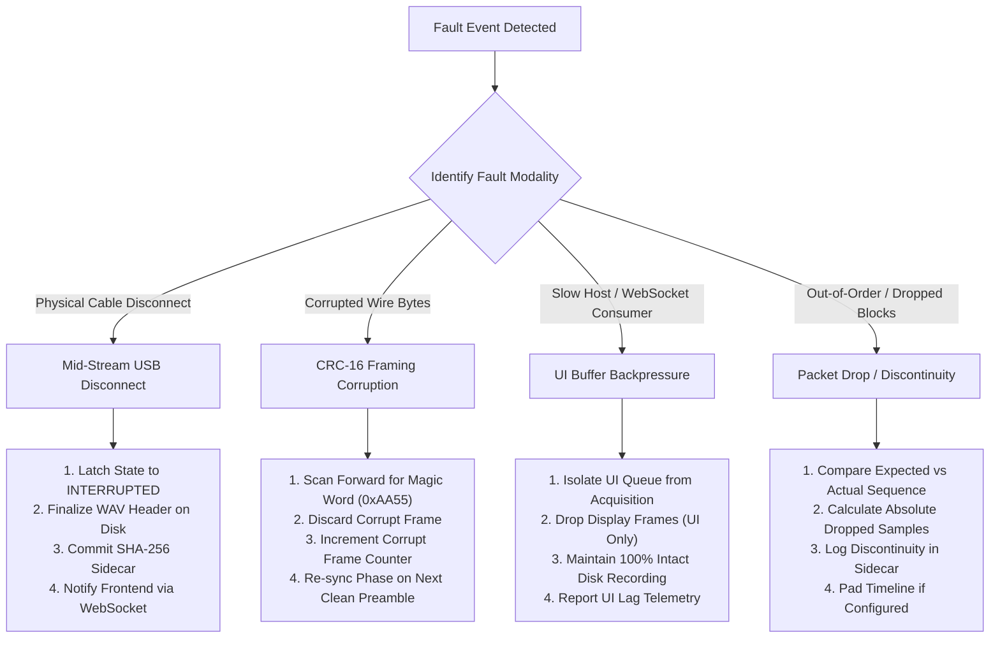

# AuscultaForge — Failure Recovery, Fault Tolerance & Edge Cases
**Document ID:** `AF-ARCH-FAILRECOVERY-V01`  
**Classification:** `CODE_VERIFIED` / `TEST_VERIFIED`  
**Course Context:** EEE495 / EEE496 Senior Design Project — Digital Stethoscope  
**Baseline Git Commit:** `fa4b75a80d29aab04875534234574db9f6c0af43`

---

## 1. Fault Tolerance Architecture Overview

Real-world medical and laboratory instrumentation must maintain robust data integrity even under physical failure conditions. The AuscultaForge architecture was explicitly engineered to prevent host crashes, memory leaks, and corrupted data files when subjected to mid-stream cable disconnections, USB bus stall events, or corrupted byte transmissions.

---

## 2. Comprehensive Failure Modes and Recovery Mechanics

### 2.1 Mid-Stream Physical USB Disconnect (Cable Pull)
* **Symptom:** The user or subject physically unplugs the USB cable while streaming or recording.
* **Low-Level Operating System Behavior:** The Windows kernel invalidates the COM handle (`ERROR_DEVICE_NOT_CONNECTED`, Win32 error code 1167). `pyserial.read()` raises `serial.SerialException`.
* **Host Application Recovery (`software/pcg_app/device_runtime.py`):**
  1. **Exception Catching:** The background transport thread traps `SerialException` immediately.
  2. **State Transition:** State machine transitions instantaneously from `STREAMING` to `INTERRUPTED`.
  3. **Recording Preservation:** If an active WAV recording is in progress, `SessionRecorder.stop()` is executed to finalize the session:
     * The accumulated normalized float32 samples are concatenated, verified for length, and written to `raw.wav` via `scipy.io.wavfile.write()`.
     * The complete serialized `raw.wav` file is hashed with whole-file SHA-256.
     * `session.json` and `manifest.json` are committed with accurate duration and metadata.
  4. **Frontend Alert:** A WebSocket alert message (`{"type": "device_interrupted", "error": "USB cable disconnected"}`) is pushed to React. The UI changes to an amber "Interrupted" banner without crashing.
* **Test Verification:** Covered by `software/tests/test_transport_readiness.py::test_abrupt_disconnect_finalizes_session_and_preserves_samples` and Virtual Bench Scenario 8 (`test_scenario_lifecycle_interruption_reconnect`).

---

### 2.2 Wire-Level Noise & CRC-16 Frame Corruption
* **Symptom:** Electromagnetic interference (EMI) or poor breadboard contact corrupts bits on the serial wire.
* **Detection:** Layer 2 Frame Decoder checks the 16-bit CRC against the received frame bytes:
  $$\text{CRC}_{\text{calc}} \ne \text{CRC}_{\text{received}}$$
* **Resynchronization Algorithm (`software/pcg_app/device_runtime.py`):**
  1. The decoder rejects the corrupted frame and increments `corrupt_frame_count`.
  2. The decoder shifts its read window forward by 1 byte and searches the byte stream for the next occurrence of the 2-byte synchronization word:
     $$\text{Sync Word} = 0\text{xAA55} \quad (\text{Bytes: } [0\text{x}55, 0\text{x}\text{AA}])$$
  3. Once aligned, framing resumes without requiring a port reset or application restart.
* **Test Verification:** Verified in `software/tests/test_transport_readiness.py::test_preamble_garbage_noise_recovery` and `test_corrupt_crc_frame_flagged`.

---

### 2.3 UI Consumer Lag & WebSocket Backpressure
* **Symptom:** The host PC is under heavy CPU load, causing the React UI thread or WebSocket client to fall behind real-time acquisition ($48,000 \text{ samples/s}$).
* **Risk:** In naive architectures, a slow WebSocket client causes unbounded queue growth in the Python server, leading to memory exhaustion (OOM crash) or artificial sample drops in the recorded scientific audio.
* **AuscultaForge Resolution (`software/pcg_app/display_pipeline.py`):**
  1. **Strict Queue Separation:** The audio recording pipeline and the UI display pipeline operate on completely separate queues.
  2. **Bounded Display Decimator:** Incoming 512-sample blocks are compressed to $\le 600$ peak-preserved points.
  3. **Display Frame Dropping:** The WebSocket broadcast queue has a fixed depth ($M = 32$ frames). If the React client cannot consume frames fast enough, the server drops *display* frames.
  4. **Zero Impact on Audio Disk File:** The raw 48 kHz WAV recording continues uninterrupted in the background without dropping a single sample.
* **Test Verification:** Verified in `software/tests/test_streaming_performance.py::test_slow_client_backpressure_does_not_corrupt_recording_or_mcu_stats`.

---

### 2.4 Monotonic Sample Counter Wraparound & Packet Loss Detection
* **Symptom:** The hardware packet sequence counter is an unsigned integer (`uint16_t` or `uint32_t`) that eventually rolls over to zero.
* **Calculation:**
  * For a 16-bit counter ($0\text{--}65,535$) at 6,000 packets/second:
    $$T_{\text{wrap16}} = \frac{65,536}{6,000} \approx 10.92 \text{ seconds}$$
  * For a 32-bit counter ($0\text{--}4,294,967,295$) at 6,000 packets/second:
    $$T_{\text{wrap32}} = \frac{4,294,967,296}{6,000} \approx 715,827 \text{ seconds} \approx 8.28 \text{ days}$$
* **AuscultaForge Policy (`software/pcg_core/streaming.py`):**
  * The Python `StreamQualityMonitor` maintains a 64-bit cumulative sample index ($S_{\text{cumulative}}$).
  * It detects wraparound via modular arithmetic:
    $$\Delta S = (S_{\text{current}} - S_{\text{previous}}) \pmod{2^{N_{\text{bits}}}}$$
  * If $\Delta S > 1$, exactly $\Delta S - 1$ missing blocks are recorded in the session metadata sidecar.
* **Test Verification:** Verified in `software/tests/test_streaming.py::test_stream_quality_monitor_gap_and_regression`.
