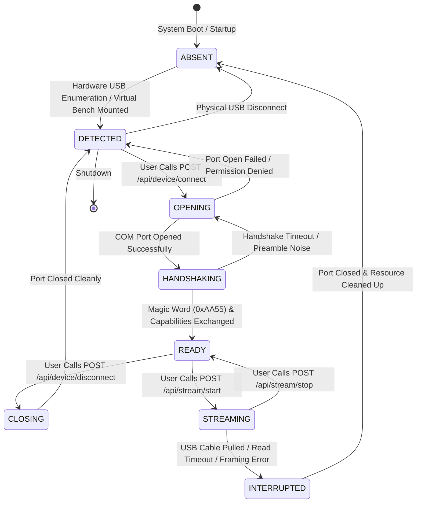

# AuscultaForge — Device Runtime Lifecycle & State Machine
**Document ID:** `AF-ARCH-LIFECYCLE-V01`  
**Classification:** `CODE_VERIFIED` / `TEST_VERIFIED`  
**Course Context:** EEE495 / EEE496 Senior Design Project — Digital Stethoscope  
**Baseline Git Commit:** `fa4b75a80d29aab04875534234574db9f6c0af43`  
**Source Implementation:** `software/pcg_app/device_runtime.py`

---

## 1. Architectural Philosophy: Truth in Hardware Telemetry

A foundational requirement established in Sprint 01 (`feature/ege-s01-device-runtime-truth`) is **truthful hardware reporting**. 

In early prototypes, web interfaces often simulated connectivity by flipping a local toggle or generating synthetic waves while claiming a hardware stethoscope was attached. In AuscultaForge, this is strictly prohibited. The host software maintains an authoritative state machine (`DeviceRuntime`) that reflects the genuine physical or virtual connection state. If hardware is absent, the UI explicitly reports `ABSENT` and refuses to enter streaming mode.

---

## 2. The 8-State Hardware Lifecycle State Machine

---

## 3. Formal State Definitions & Transition Table

| State Name | Hardware Condition | Host Software Invariants | Permitted Next States |
|---|---|---|---|
| **`ABSENT`** | No matching USB CDC-ACM COM port detected in Windows Device Manager. | Port closed; streaming disabled; UI displays "No Device Connected". | `DETECTED` |
| **`DETECTED`** | USB port with VID `0x303A` (Espressif) enumerated in OS, but not yet opened by application. | Port identified (`COMx`); serial handles unallocated. | `OPENING`, `ABSENT` |
| **`OPENING`** | Host attempts to acquire Windows OS file handle to the COM port. | `pyserial.Serial` instantiation in progress; timeout timer active. | `HANDSHAKING`, `DETECTED` |
| **`HANDSHAKING`** | Port open; DTR asserted; host actively listening for sync preambles. | Reading initial bytes; scanning for packet synchronization magic word (`0xAA55`). | `READY`, `OPENING`, `INTERRUPTED` |
| **`READY`** | Capabilities verified ($48\text{ kHz}, 1\text{ channel}, 32\text{-bit}$ container); device is idle. | Communication verified; stream queues initialized; awaiting user start command. | `STREAMING`, `CLOSING`, `INTERRUPTED` |
| **`STREAMING`** | Continuous audio acquisition active; DMA buffers actively filling and streaming. | Reader thread actively parsing packets; `SampleBlock` emitted; UI canvas receiving frames. | `READY`, `INTERRUPTED`, `CLOSING` |
| **`CLOSING`** | Graceful stream shutdown initiated by host application. | DTR de-asserted; flushing pending USB buffers; joining background reader thread. | `DETECTED`, `ABSENT` |
| **`INTERRUPTED`** | Unexpected mid-stream fault (cable pulled, frame corruption, serial IO error). | Active session file emergency-finalized; error telemetry recorded; state latched. | `ABSENT`, `DETECTED` |

---

## 4. State Transition Triggers & Invariant Enforcement

### 4.1 Transition: `ABSENT` $\to$ `DETECTED`
* **Trigger:** Invocation of `POST /api/device/poll` or background OS polling loop.
* **Guard Conditions:**
  * Enumerated USB ports must match VID `0x303A` (Espressif Systems) or match a configured Virtual Bench simulation target.
  * Port must not be locked in exclusive mode by another application.

### 4.2 Transition: `HANDSHAKING` $\to$ `READY`
* **Trigger:** Receipt of valid device capability descriptor packet.
* **Validated Fields:**
  * Sample rate must be $48,000 \text{ Hz}$.
  * Channel count must be 1.
  * Container format must be `S32_LE`.
* **Timeout Guard:** If valid capabilities are not received within $2.0 \text{ seconds}$, state transitions to `OPENING` retry or aborts to `DETECTED`.

### 4.3 Transition: `READY` $\to$ `STREAMING`
* **Trigger:** API call to `POST /api/stream/start`.
* **Side Effects:**
  * Sequence counter initialized to 0.
  * Total dropped samples initialized to 0.
  * Rolling buffer cleared.
  * Active session recorder opened (if recording is requested).
  * WebSocket broadcast pump started.

### 4.4 Transition: `STREAMING` $\to$ `INTERRUPTED` (Fault Handling)
* **Trigger:**
  * Physical cable disconnect (`serial.SerialException: ClearCommError failed`).
  * Read timeout exceeding 3 consecutive block durations ($\Delta t > 35 \text{ ms}$).
  * Severe unrecoverable CRC-16 failure storm.
* **Emergency Invariant:**
  * If an active recording session is open, it MUST NOT be corrupted.
  * The session file header is finalized with the actual written sample count.
  * Metadata sidecar records `termination_reason: "device_interrupted"`.
