# AuscultaForge — Real-Time Buffering, Queues & Latency Engineering
**Document ID:** `AF-CODE-BUFFERING-V01`  
**Classification:** `CODE_VERIFIED` / `TEST_VERIFIED`  
**Course Context:** EEE495 / EEE496 Senior Design Project — Digital Stethoscope  
**Reference Files:**
- `software/pcg_core/buffers.py`
- `software/pcg_app/display_pipeline.py`
- `tools/esp32_bench_example/main/main.c`

---

## 1. Producer-Consumer Architecture Across the Pipeline

Real-time audio processing requires decoupled producer-consumer relationships at every hardware and software boundary to prevent timing jitter from propagating across stages.

```mermaid
graph LR
    subgraph STAGE_1 ["Stage 1: Hardware I2S"]
        PROD_I2S["Producer: I2S DMA ISR"] -->|Fills| RING_DMA["DMA Descriptor Ring<br>(2 × 2048 bytes)"]
        RING_DMA -->|Pulls| CONS_ACQ["Consumer: RTOS Acq Task"]
    end

    subgraph STAGE_2 ["Stage 2: Microcontroller USB"]
        CONS_ACQ -->|Pushes| QUEUE_USB["FreeRTOS Stream Queue<br>(8 blocks = 16 KB)"]
        QUEUE_USB -->|Sends| CONS_USB["Consumer: TinyUSB CDC Stack"]
    end

    subgraph STAGE_3 ["Stage 3: Host Python Backend"]
        CONS_USB -->|USB Wire| PROD_HOST["Producer: Transport Thread"]
        PROD_HOST -->|Pushes| BUFF_ROLL["RollingBuffer (FIFO Ring)<br>(5.0 seconds = 240,000 samples)"]
        BUFF_ROLL -->|Reads| CONS_DSP["Consumer: DSP & Recording"]
    end

    subgraph STAGE_4 ["Stage 4: Display Pipeline"]
        CONS_DSP -->|Decimates| QUEUE_UI["UI WebSocket Queue<br>(Capacity: 32 frames)"]
        QUEUE_UI -->|Pushes| CONS_WS["Consumer: React Canvas (60 FPS)"]
    end
```

---

## 2. Quantitative Queue Sizing & Latency Calculations

### 2.1 Microcontroller DMA Ping-Pong Queue
* **Buffer Size ($N_{\text{block}}$):** 512 samples.
* **Duration per Buffer ($\tau_{\text{DMA}}$):**
  $$\tau_{\text{DMA}} = \frac{N_{\text{block}}}{f_s} = \frac{512}{48,000 \text{ Hz}} = 10.667 \text{ ms}$$
* **Interrupt Frequency ($f_{\text{ISR}}$):**
  $$f_{\text{ISR}} = \frac{1}{\tau_{\text{DMA}}} = \frac{48,000}{512} \approx 93.75 \text{ Hz}$$
* **Memory Footprint:** 2 ping-pong buffers $\times 2,048 \text{ bytes} = 4,096 \text{ bytes}$ ($4 \text{ KB}$ SRAM).
* **Latency Contribution:** $\Delta t_{\text{DMA}} = 10.67 \text{ ms}$ (inherent packetization latency).

### 2.2 FreeRTOS Inter-Task Queue
* **Queue Depth:** 8 blocks.
* **Queue Absorption Capacity:**
  $$T_{\text{absorb}} = 8 \times 10.667 \text{ ms} = 85.33 \text{ ms}$$
* **Purpose:** Absorbs USB host scheduling latency (e.g., when Windows OS services a background disk flush or DPC interrupt spike).
* **Memory Footprint:** $8 \times 2,048 \text{ bytes} = 16,384 \text{ bytes}$ ($16 \text{ KB}$ SRAM).

### 2.3 Host Python `RollingBuffer` (`software/pcg_core/buffers.py`)
* **Circular Ring Design:** Pre-allocates a fixed 1D NumPy array `_buffer = np.zeros(capacity, dtype=np.float64)`.
* **Configured Capacity:** $5.0 \text{ seconds}$ at $48,000 \text{ Hz}$:
  $$\text{Capacity} = 5.0 \times 48,000 = 240,000 \text{ samples}$$
* **Memory Footprint:** $240,000 \times 8 \text{ bytes/float64} \approx 1.92 \text{ MB}$.
* **Thread Safety:** Protected by `threading.Lock()`.
* **Zero Allocation on Push:** Inserting a new block modifies slices using modular arithmetic pointer offsets (`_write_idx = (_write_idx + len(block)) % capacity`), avoiding runtime dynamic memory allocation.

---

## 3. Backpressure Isolation & Dropped Frame Telemetry

### 3.1 The Backpressure Challenge
When the host PC CPU is heavily loaded, consumer threads (e.g. WebSocket pumps or React canvas drawing) cannot maintain 60 FPS rendering. If the system uses a shared blocking queue, the slow display thread blocks the audio transport thread, causing USB hardware overflow and corrupting the recorded scientific WAV file.

### 3.2 The AuscultaForge Decoupled Solution
AuscultaForge completely separates the **disk recording path** from the **display path**:

| Characteristic | Disk Recording Path | Display / UI Path |
|---|---|---|
| **Queue Type** | Synchronous background file append | Asynchronous bounded FIFO queue (`maxsize=32`) |
| **Data Rate** | Full-rate 48,000 samples/s | Decimated $\le 600$ points/frame @ 30–60 Hz |
| **Drop Policy** | **NEVER DROP:** Blocking write to OS disk buffer | **DROP OLDEST:** Discards display frame if queue is full |
| **Telemetry Impact** | Logged as `dropped_samples` in session metadata | Logged as `display_drops` in frontend debug stats |

---

## 4. End-to-End Latency Decomposition

The total propagation delay from acoustic pressure input at the phantom to pixel illumination on the host PC canvas is decomposed as follows:

$$\text{Latency}_{\text{total}} = \tau_{\text{sensor}} + \tau_{\text{DMA}} + \tau_{\text{USB}} + \tau_{\text{DSP}} + \tau_{\text{decim}} + \tau_{\text{WS}} + \tau_{\text{render}}$$

| Stage | Mechanism | Delay Value ($\mu\text{s}$) | Cumulative Latency |
|---|---|---|---|
| **1. Sensor Group Delay** | INMP441 internal $\Sigma\Delta$ decimation filter | $\approx 250 \ \mu\text{s}$ | $0.25 \text{ ms}$ |
| **2. MCU DMA Buffering** | 512-sample block accumulation at 48 kHz | $10,667 \ \mu\text{s}$ | $10.92 \text{ ms}$ |
| **3. USB Wire Transfer** | Full-Speed USB bulk token polling interval | $\approx 1,000 \ \mu\text{s}$ | $11.92 \text{ ms}$ |
| **4. Host Ingestion & DSP** | 4th-order SOS causal bandpass filter execution | $\approx 350 \ \mu\text{s}$ | $12.27 \text{ ms}$ |
| **5. Display Decimation** | Min/max vector reduction algorithm ($\le 600$ pts) | $\approx 150 \ \mu\text{s}$ | $12.42 \text{ ms}$ |
| **6. WebSocket Transport** | Local loopback TCP transfer to browser | $\approx 500 \ \mu\text{s}$ | $12.92 \text{ ms}$ |
| **7. Canvas Frame Sync** | Browser `requestAnimationFrame` ($60 \text{ Hz}$) | $\approx 8,333 \ \mu\text{s}$ | **$\approx 21.25 \text{ ms}$** |

* **Final Result:** End-to-end latency is approximately **$21 \text{--} 25 \text{ ms}$**, well below the $100 \text{ ms}$ threshold for human real-time perception.
