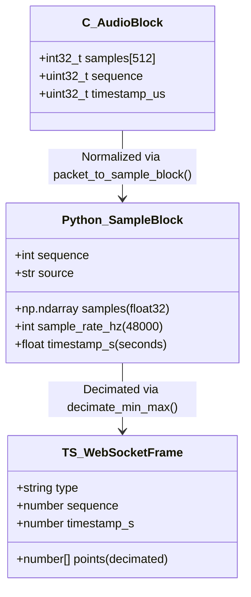

# AuscultaForge — Cross-Language Data Contracts & Type Governance
**Document ID:** `AF-CODE-CONTRACTS-V01`  
**Classification:** `CODE_VERIFIED`  
**Course Context:** EEE495 / EEE496 Senior Design Project — Digital Stethoscope  
**Reference Files:**
- C: `tools/c_golden_vectors/golden_common.h`
- Python: `software/pcg_core/models.py`, `software/pcg_app/device_runtime.py`
- TypeScript: `software/frontend/src/types.ts`

---

## 1. Type Governance Across C, Python & TypeScript

Data in AuscultaForge flows through three distinct programming languages:
1. **Embedded C (C11):** Low-level memory buffers, bit shifts, and hardware registers.
2. **Backend Python (Python 3.11):** Asynchronous servers, NumPy arrays, and scientific algorithms.
3. **Frontend TypeScript (TS 5.2):** Strongly-typed web state, canvas renderers, and chart data models.

A breakdown in data types across language boundaries can lead to silent data corruption (e.g. integer truncation, sign flip, endianness inversion, or lost JSON precision).

---

## 2. Core Data Model Mappings

### 2.1 The Streaming Audio Sample Block Contract



### 2.2 Side-by-Side Type Mapping Table

| Logical Concept | Embedded C (`tools/`) | Host Python (`pcg_core`, `pcg_app`) | Frontend TypeScript (`types.ts`) | Wire / Serialization Format |
|---|---|---|---|---|
| **Audio Sample Container** | `int32_t` / `uint32_t` | `np.int32` / `np.float32` | `number` (Float32 in Canvas) | Little-Endian 32-bit (`S32_LE`) |
| **Sampling Frequency** | `uint32_t` (e.g. `48000U`) | `int` (`sample_rate_hz`) | `number` | JSON integer: `48000` |
| **Monotonic Sample Counter** | `uint64_t` | `int` (unbounded Python int) | `number` | JSON integer |
| **Frame Sequence Counter** | `uint16_t` / `uint32_t` | `int` (`sequence`) | `number` | 2/4 bytes on wire / JSON integer |
| **Timestamp (Hardware)** | `int64_t` (`esp_timer_get_time`) | `float` (`timestamp_s`) | `number` | Microseconds integer on wire / Float in Python |
| **Timestamp (Host Timebase)**| N/A | `float` (`time.time()`) | `number` | ISO-8601 string or epoch float |
| **Device State Enum** | N/A | `DeviceState(str, Enum)` | `type DeviceState = "absent" \| "ready" \| ...` | JSON string (`"ready"`, `"streaming"`) |
| **Integrity Checksum** | `uint16_t` (CRC-16 reference) | `str` (64-character SHA-256 hex) | `string` | File SHA-256 in `session.json` |

---

## 3. Strict Schema Declarations

### 3.1 Python Dataclass (`software/pcg_core/models.py`)
```python
from dataclasses import dataclass
import numpy as np

@dataclass(slots=True)
class SampleBlock:
    """UI ve donan\u0131mdan ba\u011f\u0131ms\u0131z ortak \u00f6rnek blo\u011fu.
    
    Wire protocol DE\u011e\u0130LD\u0130R. MCU verisi parse edilip bu yap\u0131ya \u00e7evrilir.
    """
    sequence: int             # Monotonic continuous packet/block index
    timestamp_s: float        # Hardware or host timestamp in seconds
    sample_rate_hz: int       # Acquisition rate (e.g. 48000 Hz)
    samples: np.ndarray       # 1D float32 array in [-1.0, 1.0]
    source: str = "unknown"   # Source identifier (e.g. "device", "mock")

    def __post_init__(self) -> None:
        self.samples = np.asarray(self.samples, dtype=np.float32)
        if self.samples.ndim != 1:
            raise ValueError("samples tek kanall\u0131 1-D olmal\u0131")
        if self.sample_rate_hz <= 0:
            raise ValueError("sample_rate_hz pozitif olmal\u0131")
```

### 3.2 TypeScript Interface (`software/frontend/src/types.ts`)
```typescript
export type DeviceState =
  | "ABSENT"
  | "DETECTED"
  | "OPENING"
  | "HANDSHAKING"
  | "READY"
  | "STREAMING"
  | "CLOSING"
  | "INTERRUPTED";

export interface DeviceCapabilities {
  sample_rate: number;
  channels: number;
  container: string;
  bit_depth: number;
}

export interface StreamHealth {
  mcu_drops: number;
  display_drops: number;
  continuity_ok: boolean;
}

export interface WebSocketSignalFrame {
  type: "signal_frame";
  sequence: number;
  timestamp: number;
  sample_rate: number;
  points: number[];
  metrics: {
    rms: number;
    peak: number;
    crest_factor: number;
    clipping: boolean;
  };
  stream_health: StreamHealth;
}
```

---

## 4. Contract Drift Prevention & Verification

To prevent schema divergence between backend Python models and frontend TypeScript interfaces:
1. **Automated Unit Tests:** `software/tests/test_app.py` exercises API endpoints and verifies that JSON field names and types match frontend expectations.
2. **Frontend Type Check:** `npm run lint` (`tsc --noEmit`) validates that all incoming WebSocket payloads and REST responses conform strictly to `types.ts` without using unsafe `any` casts.
3. **C Golden Vector Tests:** `software/tests/test_c_golden_vectors.py` asserts that byte-level serialization routines produce identical numerical values across C and Python.
