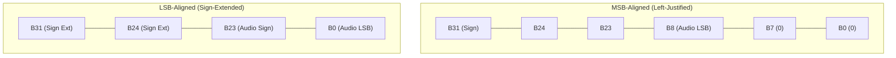

# AuscultaForge — Embedded C Language Foundations & Bit-Level Engineering
**Document ID:** `AF-CODE-C-FOUNDATIONS-V01`  
**Classification:** `CODE_VERIFIED` / `TEST_VERIFIED`  
**Course Context:** EEE495 / EEE496 Senior Design Project — Digital Stethoscope  
**Reference Implementations:** `tools/c_golden_vectors/golden_common.h`, `tools/c_golden_vectors/golden_generator.c`  
**Standard Compliance:** ISO/IEC 9899:1999 (C99) & ISO/IEC 9899:2011 (C11)

---

## 1. Introduction & Academic Defense Scope

In digital acoustic acquisition, data arrives not as abstract Python floats, but as raw binary bits clocked across physical electrical traces. A rigorous understanding of low-level C programming, fixed-width integer semantics, two's-complement arithmetic, and bitwise manipulation is mandatory for any engineer defending this platform before an academic examination panel.

This handbook establishes the mathematical and linguistic rules governing C bit-level operations in AuscultaForge, linking theoretical concepts directly to verified code.

---

## 2. Integer Types, Fixed Widths & `<stdint.h>`

### 2.1 The Standard Fixed-Width Types
In standard C, basic primitive types (`short`, `int`, `long`) have implementation-dependent bit widths. On 8-bit AVR microcontrollers, `int` is 16 bits; on 32-bit Xtensa/ARM architectures, `int` is 32 bits; on 64-bit systems, `long` may be 64 bits (LP64) or 32 bits (LLP64 on Windows).

To ensure deterministic binary layout across cross-compilation toolchains, AuscultaForge strictly mandates the use of `<stdint.h>` exact-width types:

| Standard Type | Exact Bit Width | Signedness | Minimum Value | Maximum Value | Hexadecimal Range |
|---|---|---|---|---|---|
| `uint8_t` | 8 bits (1 byte) | Unsigned | $0$ | $255$ | `0x00` to `0xFF` |
| `int8_t` | 8 bits (1 byte) | Signed (2's comp) | $-128$ | $+127$ | `0x80` to `0x7F` |
| `uint16_t` | 16 bits (2 bytes) | Unsigned | $0$ | $65,535$ | `0x0000` to `0xFFFF` |
| `int16_t` | 16 bits (2 bytes) | Signed (2's comp) | $-32,768$ | $+32,767$ | `0x8000` to `0x7FFF` |
| `uint32_t` | 32 bits (4 bytes) | Unsigned | $0$ | $4,294,967,295$ | `0x00000000` to `0xFFFFFFFF` |
| `int32_t` | 32 bits (4 bytes) | Signed (2's comp) | $-2,147,483,648$ | $+2,147,483,647$ | `0x80000000` to `0x7FFFFFFF` |
| `uint64_t` | 64 bits (8 bytes) | Unsigned | $0$ | $\approx 1.844 \times 10^{19}$ | `0x0000000000000000` to `0xFFFFFFFFFFFFFFFF` |
| `int64_t` | 64 bits (8 bytes) | Signed (2's comp) | $\approx -9.223 \times 10^{18}$ | $\approx +9.223 \times 10^{18}$ | `0x8000000000000000` to `0x7FFFFFFFFFFFFFFF` |

---

## 3. Two's-Complement Representation & Arithmetic

In modern computer architectures (including ESP32-S3 Xtensa and x86-64 host PCs), signed integers are represented using **two's-complement notation**.

### 3.1 Mathematical Definition
For an $N$-bit signed integer with bit vector $[b_{N-1}, b_{N-2}, \dots, b_1, b_0]$ where $b_{N-1}$ is the Most Significant Bit (MSB, the sign bit):
$$V = -b_{N-1} 2^{N-1} + \sum_{i=0}^{N-2} b_i 2^i$$

* **Property 1:** There is only one unique representation for zero ($[0, 0, \dots, 0]$), unlike sign-magnitude or one's complement which suffer from negative zero ($-0$).
* **Property 2:** The negative range extends one value further than the positive range ($-2^{N-1}$ vs $+2^{N-1} - 1$). For example, in 8-bit arithmetic:
  * Maximum positive: $01111111_2 = +127$
  * Minimum negative: $10000000_2 = -128$
  * Negative one: $11111111_2 = -1$

### 3.2 Negation Algorithm
To negate a two's-complement number mathematically:
$$\text{negate}(X) = \sim X + 1$$
*(Invert all bits and add 1).*

#### Worked Example: Negate $+42$ in 8-bit C
1. $+42 = 00101010_2$ (`0x2A`)
2. Bitwise NOT ($\sim$): $11010101_2$ (`0xD5`)
3. Add 1: $11010101_2 + 1 = 11010110_2$ (`0xD6`)
4. Verification:
   $$V = -(1 \times 2^7) + (1 \times 2^6) + (0 \times 2^5) + (1 \times 2^4) + (0 \times 2^3) + (1 \times 2^2) + (1 \times 2^1) + (0 \times 2^0)$$
   $$V = -128 + 64 + 16 + 4 + 2 = -42$$

---

## 4. 24-bit Audio Data in 32-bit Containers (`S32_LE`)

The INMP441 I2S MEMS microphone generates **24-bit signed samples**. However, 32-bit processor buses and DMA engines manipulate memory in 32-bit (4-byte) aligned words.

Depending on I2S controller configuration, 24-bit audio appears inside a 32-bit container in one of two distinct formats:
1. **MSB-Aligned (Left-Justified):** Active 24 bits occupy the upper bits ($B_{31}\text{--}B_8$), and the lowest 8 bits ($B_7\text{--}B_0$) are zero-padded.
2. **LSB-Aligned (Right-Justified):** Active 24 bits occupy the lower bits ($B_{23}\text{--}B_0$), and the upper 8 bits ($B_{31}\text{--}B_{24}$) must be **sign-extended**.



### 4.1 Sign Extension Mechanics: From 24 Bits to 32 Bits
If an audio sample is negative (e.g. $B_{23} = 1$), placing it directly into a 32-bit integer without sign extension corrupts the mathematical value into an enormous positive number.

#### Correct Portable C Implementation (`tools/c_golden_vectors/golden_common.h`):
```c
int32_t sign_extend_24_to_32(uint32_t raw_24) {
    /* If bit 23 is set, sign bit is 1 (negative number) */
    if (raw_24 & 0x00800000U) {
        /* Set upper 8 bits to 1s */
        return (int32_t)(raw_24 | 0xFF000000U);
    } else {
        /* Upper 8 bits are 0s */
        return (int32_t)(raw_24 & 0x00FFFFFFU);
    }
}
```

#### Arithmetic Shift Alternative (Compiler Dependent):
```c
int32_t sign_extend_shift(int32_t val_24) {
    /* Shift left by 8 to place sign bit at bit 31, then arithmetic shift right by 8 */
    return (val_24 << 8) >> 8;
}
```
> [!WARNING]
> **C Standard Trap (Undefined Behavior in C99/C11):**
> Left-shifting a negative signed value (`val_24 << 8` when `val_24 < 0`) is **UNDEFINED BEHAVIOR** under ISO C99 (§6.5.7/4) and ISO C11! Furthermore, right-shifting a negative signed integer is **IMPLEMENTATION-DEFINED** (most compilers perform arithmetic shift, but the standard does not guarantee it).
> **AuscultaForge Mandate:** Always perform bit-shifting on unsigned integers (`uint32_t`), apply explicit bit masks, and cast to `int32_t` as demonstrated in `golden_common.h`.

---

## 5. Endianness & Portable Serialization

### 5.1 Byte Order: Little-Endian vs Big-Endian
* **Little-Endian (LE):** The Least Significant Byte (LSB) is stored at the lowest memory address. Used natively by ESP32-S3 (Xtensa) and PC Host (x86-64).
* **Big-Endian (BE):** The Most Significant Byte (MSB) is stored at the lowest memory address (network byte order).

#### Concrete Example: 32-bit Word `0x12345678`
* In Little-Endian memory:
  * Address $A+0$: `0x78` (LSB)
  * Address $A+1$: `0x56`
  * Address $A+2$: `0x34`
  * Address $A+3$: `0x12` (MSB)
* In Big-Endian memory:
  * Address $A+0$: `0x12` (MSB)
  * Address $A+1$: `0x34`
  * Address $A+2$: `0x56`
  * Address $A+3$: `0x78` (LSB)

### 5.2 Portable Serialization Routine
To serialize an `int32_t` onto the wire in deterministic Little-Endian format without relying on compiler-specific memory layout:
```c
void serialize_s32_le(int32_t sample, uint8_t *dest_bytes) {
    uint32_t u = (uint32_t)sample;
    dest_bytes[0] = (uint8_t)(u & 0xFFU);
    dest_bytes[1] = (uint8_t)((u >> 8) & 0xFFU);
    dest_bytes[2] = (uint8_t)((u >> 16) & 0xFFU);
    dest_bytes[3] = (uint8_t)((u >> 24) & 0xFFU);
}

int32_t deserialize_s32_le(const uint8_t *src_bytes) {
    uint32_t u = ((uint32_t)src_bytes[0]) |
                 (((uint32_t)src_bytes[1]) << 8) |
                 (((uint32_t)src_bytes[2]) << 16) |
                 (((uint32_t)src_bytes[3]) << 24);
    return (int32_t)u;
}
```
This logic is bit-exact, portable across any CPU architecture, and verified in `software/tests/test_c_golden_vectors.py`.

---

## 6. Academic Defense Questions & Pitfalls

### Question 1: What is the exact difference between an arithmetic shift and a logical shift?
* **Expected Answer:**
  * **Logical Right Shift (`>>` on unsigned types):** Shifts bits to the right and always inserts zero (`0`) into the most significant bit.
  * **Arithmetic Right Shift (`>>` on signed types in implementation-defined C):** Shifts bits to the right and replicates the sign bit ($0$ for positive, $1$ for negative) into the upper vacant positions, preserving the mathematical sign and value ($\lfloor X / 2^k \rfloor$).
* **Pitfall:** Assuming `>>` always preserves the sign. If the variable is declared `unsigned int`, `>>` will shift in zeros, completely destroying negative values.

### Question 2: Why can we not simply cast an unaligned byte buffer to `int32_t*` on an embedded MCU?
* **Expected Answer:** Many architectures (including ARM Cortex-M0 and certain Xtensa configurations) trigger an unaligned memory access hardware fault (`LoadStoreAlignmentCause`) if a 32-bit word read is attempted at an address that is not a multiple of 4 ($A \pmod 4 \ne 0$). Furthermore, doing so violates C strict-aliasing rules (ISO C99 §6.5/7), allowing optimizing compilers to generate corrupted assembly.
* **Proper Approach:** Use `memcpy()` or byte-by-byte shifting (`deserialize_s32_le`). Modern optimizing compilers compile `memcpy(&val, ptr, 4)` into a single efficient instruction where hardware permits.
