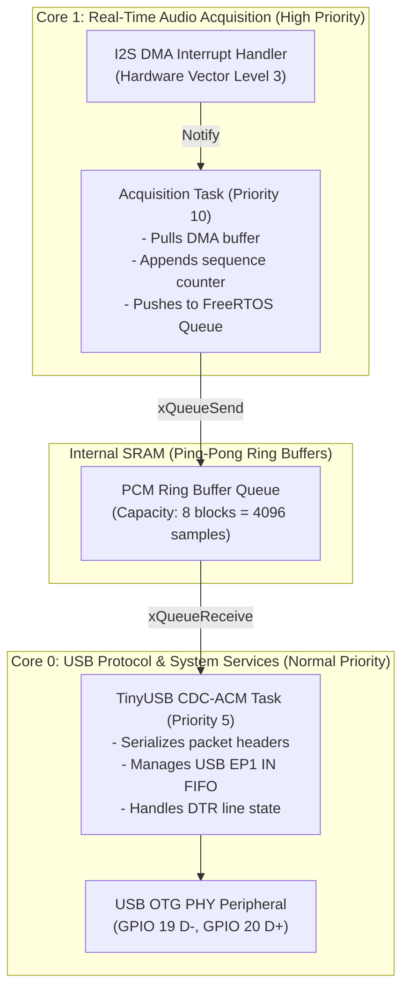

# AuscultaForge — ESP32-S3 Embedded Runtime Architecture
**Document ID:** `AF-CODE-ESP32-ARCH-V01`  
**Classification:** `CODE_VERIFIED` / `HARDWARE_UNVERIFIED`  
**Course Context:** EEE495 / EEE496 Senior Design Project — Digital Stethoscope  
**Target Hardware:** ESP32-S3-DevKitC-1-N16R8 (Espressif Systems)  
**Primary Ownership Boundary:** Module B (Ozan) owns production firmware under `firmware/`; Module C (Ege) provides interoperability test scaffolds.

---

## 1. Silicon Architecture & Physical Hardware Target

The AuscultaForge embedded subsystem is architected for the **ESP32-S3** system-on-chip (SoC), specifically the **DevKitC-1-N16R8** configuration ordered from DirencNet.

### 1.1 Silicon Specifications
* **CPU:** Dual-core 32-bit Xtensa LX7 microprocessors running at up to $240 \text{ MHz}$ ($600 \text{ DMIPS}$).
  * Integrated single-precision Hardware Floating Point Unit (FPU).
  * Vector instructions (Xtensa PIE) for accelerated DSP filtering.
* **Internal Memory:**
  * $384 \text{ KB}$ internal ROM (bootloader and core ROM routines).
  * $512 \text{ KB}$ internal SRAM (data and instruction cache, DMA buffers).
  * $16 \text{ KB}$ SRAM in RTC slow memory.
* **External Memory Packaging (N16R8):**
  * **$16 \text{ MB}$ Octal SPI Flash:** High-speed storage for firmware binaries and persistent calibration coefficients.
  * **$8 \text{ MB}$ Octal SPI PSRAM (Pseudo-Static RAM):** High-density external RAM accessible via CPU data bus cache.
* **Peripherals Utilized:**
  * **I2S0 (Inter-IC Sound):** Dedicated audio master controller with linked-list DMA engine.
  * **USB-OTG Full-Speed PHY:** Dedicated on-chip transceiver connected to `GPIO 19` (D-) and `GPIO 20` (D+), enabling native USB 2.0 Full-Speed ($12 \text{ Mbps}$) without external bridge ICs.

---

## 2. FreeRTOS Dual-Core Multitasking Model

ESP-IDF implements a symmetric multiprocessing (SMP) version of FreeRTOS. To prevent USB transmission overhead from delaying audio acquisition, tasks are statically pinned to dedicated physical CPU cores:



### 2.1 The FreeRTOS Tick Rate & Software Pacing Trap
* In standard ESP-IDF FreeRTOS configurations, `CONFIG_FREERTOS_HZ` defaults to **$100 \text{ Hz}$** ($10 \text{ ms}$ tick period) or **$1000 \text{ Hz}$** ($1 \text{ ms}$ tick period).
* Any call to `vTaskDelay(ticks)` pauses the task until the next tick interrupt.
* **The Software Pacing Fallacy:** Calling `vTaskDelay(11 / portTICK_PERIOD_MS)` in an experimental task loop does **NOT** pace a continuous 48.000 kHz stream. At $100 \text{ Hz}$ tick rate, any delay rounds to an integer multiple of $10 \text{ ms}$ ($10 \text{ ms}, 20 \text{ ms}, \dots$), resulting in severe jitter ($> 20\%$) and irregular burstiness.
* **The Production Solution:** In production firmware, task timing MUST be driven entirely by **hardware I2S DMA interrupts**. The CPU sleeps or performs non-critical work until hardware DMA signals that a buffer has been completely filled by the physical bit clock (`SCK`).

---

## 3. Hardware I2S DMA Controller Architecture

The ESP32-S3 I2S peripheral uses linked-list Direct Memory Access descriptors (`lldesc_t`) residing in internal SRAM.

### 3.1 DMA Descriptor Structure
```c
typedef struct lldesc_s {
    volatile uint32_t size:12;      /* Buffer size in bytes (max 4092) */
    volatile uint32_t length:12;    /* Actual data length in bytes */
    volatile uint32_t offset:5;     /* Offset in buffer */
    volatile uint32_t sosf:1;       /* Start of sub-frame */
    volatile uint32_t eof:1;        /* End of frame (triggers DMA ISR) */
    volatile uint32_t owner:1;      /* 1 = DMA owns buffer; 0 = CPU owns buffer */
    volatile uint8_t *buf;          /* Pointer to physical SRAM memory buffer */
    volatile struct lldesc_s *next; /* Pointer to next descriptor in circular ring */
} lldesc_t;
```

### 3.2 Ping-Pong Double-Buffering Mechanics
1. **Descriptor Ring:** Two DMA descriptors (Descriptor A and Descriptor B) are chained into an infinite circular loop (`A->next = B; B->next = A`).
2. **Buffer Allocation:** Each descriptor points to a dedicated $2,048\text{-byte}$ buffer in internal SRAM ($512 \text{ samples} \times 4 \text{ bytes}$).
3. **Hardware Execution:**
   - As samples arrive over `GPIO 6` (SD), the I2S hardware DMA fills Buffer A without CPU intervention.
   - When Buffer A fills, the DMA hardware sets `A->eof = 1`, flips ownership `A->owner = 0`, triggers the I2S interrupt service routine (ISR), and automatically advances to fill Buffer B.
   - In the ISR, the CPU reads data out of Buffer A, processes headers, and pushes blocks into the USB queue.
   - Buffer swapping operates continuously with zero sample loss.

---

## 4. Hardware Verification & DirencNet Clones Warning

> [!CAUTION]
> **MANDATORY BENCH INSPECTION BEFORE ENUMERATION:**
> The purchased DevKit from DirencNet is labeled `ESP32-S3-DevKitC-1-N16R8`. However, commercial clone manufacturers frequently produce single-port boards or connect a CH340/CP2102 bridge directly to the UART pins while leaving the native USB pins (`GPIO 19/20`) unrouted.
> 
> **Verification Procedure upon Physical Delivery:**
> 1. Verify two physical USB Type-C connectors exist on the PCB:
>    - Connector 1 labeled **"UART"** or **"COM"**.
>    - Connector 2 labeled **"USB"**.
> 2. With an ohmmeter (board unpowered), verify continuity:
>    - Type-C "USB" D- pin connects directly to ESP32-S3 pin `GPIO 19`.
>    - Type-C "USB" D+ pin connects directly to ESP32-S3 pin `GPIO 20`.
> 3. If Connector 2 is absent or non-functional, native USB streaming requires soldering direct breakout wires to `GPIO 19` and `GPIO 20`.
