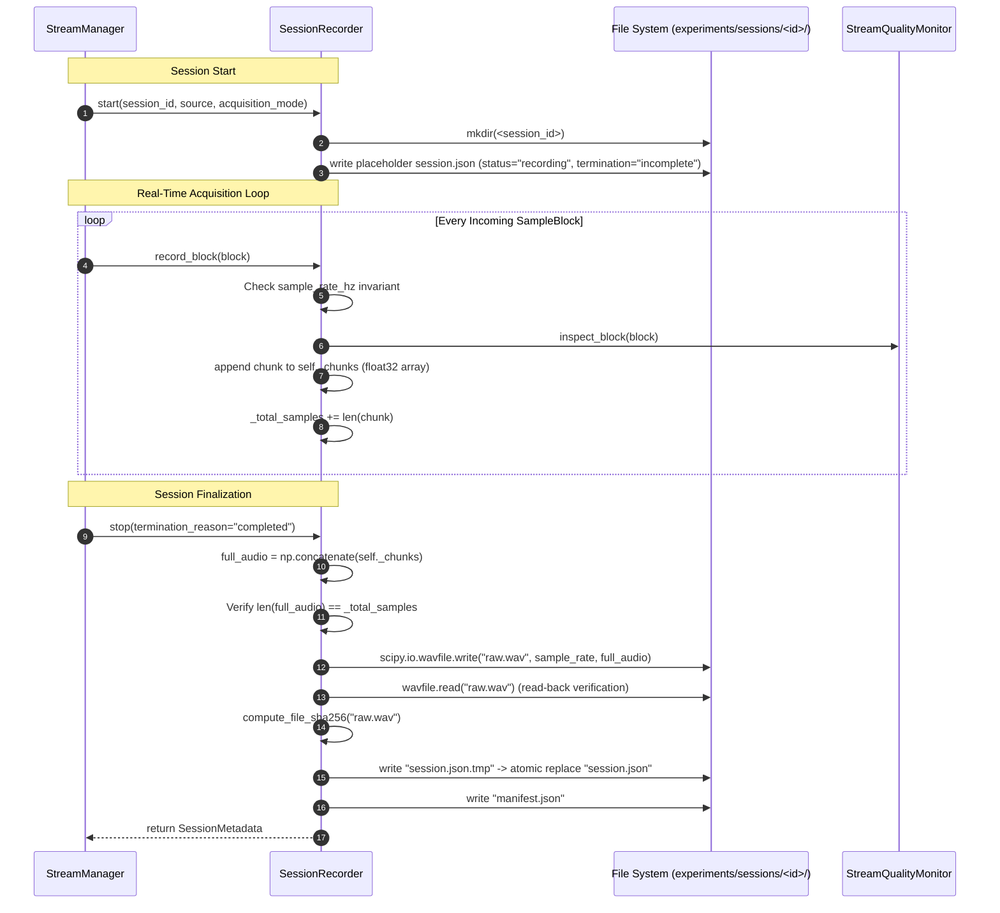

# AuscultaForge — Session Recording, Replay & Storage Integrity Internals
**Document ID:** `AF-CODE-RECORDING-V02`  
**Classification:** `CODE_VERIFIED` / `TEST_VERIFIED`  
**Course Context:** EEE495 / EEE496 Senior Design Project — Digital Stethoscope  
**Reference File:** `software/pcg_core/recording.py`  
**Downstream Orchestration:** `software/pcg_app/state.py` (`StreamManager.recorder`)  
**Data Contract:** `software/pcg_core/models.py` (`SampleBlock.samples` as `np.float32`)  
**Associated Tests:** `software/tests/test_recording.py` (20 automated tests)

---

## 1. Directory-Based Scientific Persistence Architecture

In biomedical acoustic research, recorded audio must never be stored as an uncontextualized binary blob. Without verifiable provenance, scientific recordings are vulnerable to sample rate confusion, undocumented filtering, lost timestamps, and silent file corruption.

AuscultaForge implements a **Tri-File Directory Session Architecture**:
Every scientific recording session is stored as a dedicated directory under `experiments/sessions/<session_id>/` containing three tightly coupled files:

```text
experiments/sessions/<session_id>/
├── raw.wav          # Canonical accepted samples serialized in normalized IEEE float32
├── session.json     # Authoritative session metadata sidecar (provenance, environment, SHA-256)
└── manifest.json    # Machine-readable laboratory manifest for phantom benchmarks & audit
```

### 1.1 Structural Role of Files

1. **`raw.wav`:**
   - Serialized via `scipy.io.wavfile.write()`.
   - Default format: `normalized_float32` (IEEE-754 32-bit floating point, samples scaled to $[-1.0, 1.0]$).
   - Captures unadulterated sensor acquisitions after transport acceptance and normalization, before any user-selected UI bandpass or display decimation filters.
   - **Crucial Distinction:** A normalized float32 WAV is **not** an unparsed bit-for-bit byte copy of the physical wire stream. As documented in the `SessionMetadata.storage_disclaimer`:
     > *"WAV file contains normalized IEEE float32 audio samples in [-1.0, 1.0], derived via linear scaling from acquisition blocks. It is not an unparsed wire bitstream copy."*
2. **`session.json`:**
   - Authoritative JSON metadata sidecar created by `SessionMetadata.to_json()`.
   - Records UTC start/end timestamps, sample rate, total blocks, total sample count, hardware sequence boundaries, stream quality reports, Git commit SHA, runtime environment, and the SHA-256 checksum of `raw.wav`.
3. **`manifest.json`:**
   - Exportable benchmark manifest produced by `export_session_manifest()`.
   - Standardizes parameters for repeatable offline phantom analysis, CirCor / PhysioNet benchmarking, and metrology pipelines.

---

## 2. In-Memory Accumulation and Atomic Serialization Lifecycle

The acquisition pipeline handles audio in real time. Because disk writes can introduce non-deterministic I/O latency, `SessionRecorder` buffers samples in memory and executes serialization upon session finalization.



### 2.1 Initialization & Crash Marker (`start`)
When `SessionRecorder.start()` is invoked:
1. Validates `session_id` using `validate_session_id()`:
   - Enforces regex `^[a-zA-Z0-9_-]+$`.
   - Rejects directory traversal (`..`, `/`, `\`).
   - Rejects Windows reserved device names (`CON`, `PRN`, `AUX`, `NUL`, `COM1-9`, `LPT1-9`).
2. Creates the target directory `experiments/sessions/<session_id>/`.
3. Immediately writes an in-progress placeholder `session.json`:
   ```json
   {
     "session_id": "session_20261020_143000_exp01",
     "status": "recording",
     "termination_reason": "incomplete",
     "started_at_utc": "2026-10-20T14:30:00.124567+00:00",
     "ended_at_utc": null
   }
   ```
   **Why this matters:** If the host process crashes, the USB cable is unplugged, or power is cut mid-stream, an unfinalized session is unambiguously detectable as `status: "incomplete"` rather than masquerading as a valid completed recording.

### 2.2 Streaming Block Ingestion (`record_block`)
When `SessionRecorder.record_block(block: SampleBlock)` is invoked:
1. State verification: Asserts `self._active is True` (raises `RecordingStateError` if stopped).
2. Sample rate consistency check:
   - If initial rate is unset, locks `self._sample_rate_hz = block.sample_rate_hz`.
   - If incoming rate changes mid-session, sets `self._active = False` and raises `RecordingSampleRateError` to prevent writing a corrupted multi-rate WAV file.
3. Quality inspection: Passes the block to `StreamQualityMonitor.inspect_block()` to track sequence gaps, dropped blocks, timestamp regressions, and repeated sequences.
4. Memory buffering: Converts `block.samples` to `np.ndarray` of dtype `np.float32` and appends to `self._chunks`.

### 2.3 Stop & Atomic Serialization (`stop`)
When `SessionRecorder.stop(termination_reason="completed")` is invoked:
1. Concatenation & Sample Accounting:
   ```python
   full_audio = np.concatenate(self._chunks)
   if len(full_audio) != self._total_samples:
       raise SessionCorruptedError(
           f"Sample accounting discrepancy: recorder counted {self._total_samples} samples, "
           f"but concatenated audio contains {len(full_audio)} samples."
       )
   ```
2. WAV File Serialization:
   ```python
   wav_path = session_dir / "raw.wav"
   if self.wav_format == "float32":
       wavfile.write(str(wav_path), self._sample_rate_hz, full_audio.astype(np.float32))
   else:
       scaled = np.clip(full_audio, -1.0, 1.0) * 32767.0
       wavfile.write(str(wav_path), self._sample_rate_hz, scaled.astype(np.int16))
   ```
3. Read-Back Verification:
   The recorder immediately reads back `raw.wav` from disk via `scipy.io.wavfile.read()`, checking that `read_fs == self._sample_rate_hz` and `len(read_samples) == self._total_samples`. If filesystem truncation occurred, `SessionCorruptedError` is raised.
4. Whole-File SHA-256 Digest:
   Computes the SHA-256 hash of the complete written `raw.wav` file via `compute_file_sha256(wav_path)`:
   - Reads the file in 64 KB binary blocks.
   - Hashes the complete file byte stream (including RIFF container headers and data chunk).
5. Atomic Sidecar Write:
   Writes `session.json.tmp` and replaces `session.json` atomically via `Path.replace()`, ensuring readers never observe a partially written JSON file.
6. Laboratory Manifest Export:
   Generates and writes `manifest.json`.

---

## 3. Cryptographic Sidecar Schema & SHA-256 Verification

### 3.1 Actual `session.json` Schema (`SessionMetadata`)
```json
{
  "session_id": "session_20261020_143000_exp01",
  "started_at_utc": "2026-10-20T14:30:00.124567+00:00",
  "ended_at_utc": "2026-10-20T14:30:30.124567+00:00",
  "source": "device",
  "sample_rate_hz": 48000,
  "total_blocks": 2812,
  "total_samples": 1440000,
  "duration_s": 30.0,
  "first_sequence": 100,
  "last_sequence": 2911,
  "first_timestamp_s": 0.0021,
  "last_timestamp_s": 29.9981,
  "raw_wav_relpath": "raw.wav",
  "raw_wav_sha256": "4a7d1ed414474e4033ac29ccb8653d9b168aae62c3e1f82d1c618290327f2f14",
  "stream_quality": {
    "total_blocks": 2812,
    "dropped_blocks": 0,
    "repeated_sequences": 0,
    "sequence_discontinuities": 0,
    "timestamp_regressions": 0,
    "sample_rate_changes": 0,
    "is_healthy": true
  },
  "git_commit_sha": "fa4b75a80d29aab04875534234574db9f6c0af43",
  "environment": {
    "python_version": "3.11.9",
    "numpy_version": "1.26.4",
    "scipy_version": "1.13.1",
    "platform": "Windows-11-10.0.26100-SP0"
  },
  "acquisition_mode": "hardware_serial",
  "termination_reason": "completed",
  "device_info": {
    "port": "COM3",
    "vid": "0x303A",
    "pid": "0x4001",
    "description": "ESP32-S3 USB CDC"
  },
  "app_version": "2.0.0",
  "schema_version": "2.0.0",
  "storage_format": "normalized_float32",
  "wire_format": "S32_LE",
  "storage_disclaimer": "WAV file contains normalized IEEE float32 audio samples in [-1.0, 1.0], derived via linear scaling from acquisition blocks. It is not an unparsed wire bitstream copy.",
  "status": "finalized",
  "manifest_version": "2.0.0"
}
```

### 3.2 Real Role of the SHA-256 Digest
- **What SHA-256 DOES Provide:**
  - **Storage Integrity Verification:** Confirms that `raw.wav` has not suffered bit rot, accidental manual editing, incomplete transfer across storage media, or silent file truncation.
  - **Audit Baseline:** Enables automated test harnesses and metrology pipelines to detect discrepancies between metadata records and audio files on disk.
- **What SHA-256 DOES NOT Provide:**
  - **Proof of Recording Authenticity:** Because `session.json` is stored as an unauthenticated plaintext JSON file on the local filesystem, an attacker with write access could modify `raw.wav` and recompute `raw_wav_sha256` in `session.json`. SHA-256 is an integrity check, **not** a digital signature or cryptographic proof of physical hardware provenance.

---

## 4. Session Verification & Replay Infrastructure

### 4.1 Verification Engine (`verify_session`)
The verification function `verify_session(session_id, sessions_dir)` executes a systematic five-step audit:
1. Validates identifier containment via `validate_session_id()`.
2. Checks directory existence (`missing_session`).
3. Loads `session.json`:
   - Returns `missing_metadata` if sidecar is absent.
   - Returns `corrupted_metadata` if JSON parsing fails.
   - Returns `incomplete` if `status == "recording"` or `termination_reason == "incomplete"`.
4. Checks `raw.wav` existence (`missing_audio`).
5. Recomputes `actual_sha256 = compute_file_sha256(wav_path)` and loads audio to compare:
   - `sha256_match`: `actual_sha256 == meta_data["raw_wav_sha256"]`
   - `sample_count_match`: `len(wav_samples) == meta_data["total_samples"]`
   - `sample_rate_match`: `wav_fs == meta_data["sample_rate_hz"]`
   - If any check fails, returns `is_valid: False` with status `corrupted`.

### 4.2 Replay Integration (`create_session_source`)
Session replay does not use a standalone recorder subclass. Instead, the function `create_session_source()` constructs an audio source object from `software/pcg_core/sources.py`:
- `WavSource(wav_path, block_size=256)`: Fast offline replay for batch testing and analysis.
- `RealtimeWavSource(wav_path, block_size=256, realtime=True, speed_factor=1.0)`: Paced streaming replay that simulates real-time hardware packet arrival at 48 kHz.

---

## 5. Formal Exception Taxonomy

| Exception Class | Base Class | Trigger Condition |
| :--- | :--- | :--- |
| `RecordingStateError` | `RuntimeError` | Calling `start()` when already recording, or `record_block()` / `stop()` when inactive. |
| `RecordingSampleRateError` | `ValueError` | Incoming `SampleBlock.sample_rate_hz` changes mid-session; terminates recording. |
| `SessionCorruptedError` | `ValueError` | Sample accounting mismatch during concatenation or read-back serialization failure. |
| `SessionNotFoundError` | `FileNotFoundError` | Requested `session_id` directory does not exist under `experiments/sessions/`. |
| `SessionIntegrityError` | `ValueError` | Cryptographic SHA-256 mismatch or sample count discrepancy during verification. |
