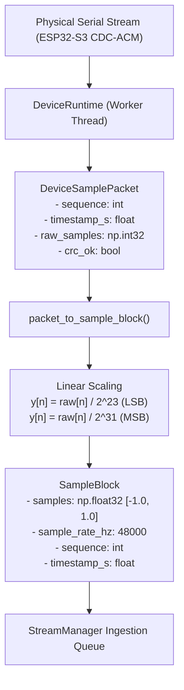

# AuscultaForge — USB Protocol Engineering & Wire-Level Framing
**Document ID:** `AF-CODE-USB-PROTOCOL-V02`  
**Classification:** `CODE_VERIFIED` (Host Layer) / `DOCUMENTED_PROPOSAL` (Firmware Wire Framing)  
**Course Context:** EEE495 / EEE496 Senior Design Project — Digital Stethoscope  
**Reference Files:**
- `software/pcg_app/device_runtime.py` (`DeviceRuntime`, `packet_to_sample_block`, `DeviceSamplePacket`)
- `docs/sdp/week-04/submissions/module-b-ozan/W04_B_to_C_protocol-proposal_v01.md`
- `docs/protocol/PROTOCOL_DRAFT.md`
- `tools/esp32_bench_example/main/main.c` (`HARDWARE_UNVERIFIED`)

---

## 1. Physical USB Standards & Operating Modes

AuscultaForge targets the on-chip USB OTG peripheral of the ESP32-S3 operating as a **USB 2.0 Full-Speed Device**.

### 1.1 Physical Signaling & Transceiver
* **Signaling Rate:** $12.000 \text{ Mbps} \pm 0.25\%$.
* **Signaling Lines:** Differential pair $D+$ (`GPIO 20`) and $D-$ (`GPIO 19`).
* **Line Encoding:** Non-Return-to-Zero Inverted (NRZI) with bit-stuffing (a zero is inserted after six consecutive ones to guarantee clock recovery).
* **Speed Identification:** Full-speed device presence is signaled via a $1.5 \text{ k}\Omega$ pull-up resistor on the $D+$ line.

### 1.2 Transport Class Candidate: USB CDC-ACM
* **Candidate Status:** CDC-ACM is the active **Rev-A proposal under review by Modules B & C** (DW03-09, DW03-12). It is not a closed unilateral decision.
* **Driver Binding:** On Windows 10/11, the in-box driver `usbser.sys` binds automatically to Vendor ID `0x303A` (Espressif) and Product ID `0x4001` (TinyUSB CDC).
* **Comparison with USB Audio Class (UAC):**
  - *UAC:* Presents the stethoscope as a standard audio input device. While it integrates with native sound APIs, Windows OS audio processing stacks often apply sample rate conversion, high-pass filtering, and volume scaling that distort raw physiological signals. Furthermore, standard UAC provides no native sideband for hardware timestamps, sample drop flags, or sequence counters.
  - *CDC-ACM:* Exposes a transparent virtual COM port. It allows raw binary frames containing custom telemetry headers, unadulterated integer PCM words, and error-checking trailers to pass directly to Python without OS audio stack interference.

---

## 2. Nominal Application Throughput vs. Physical USB Bus Overhead

A critical engineering calculation governs the feasibility of streaming 48 kHz 24-bit audio over USB Full-Speed.

### 2.1 Raw Audio Payload Rate
* Sampling frequency: $f_s = 48,000 \text{ samples/second}$.
* Container size: $4 \text{ bytes/sample}$ (`S32_LE` container).
* **Raw Audio Payload Throughput:**
  $$\text{Payload Rate} = 48,000 \times 4 = 192,000 \text{ bytes/second} = 1.536 \text{ Mbit/second}$$

### 2.2 Framing Overhead Scenarios

1. **Proposed 40-byte Packet (8 samples per frame, 6,000 frames/s):**
   - 8 samples $\times$ 4 bytes $= 32\text{ bytes payload}$.
   - 8 bytes header + CRC $= 40\text{ bytes frame}$.
   - Data rate: $6,000 \times 40 = 240,000 \text{ bytes/second} = 1.920 \text{ Mbit/second}$.
   - *Limitation:* Generating 6,000 USB packets per second incurs severe FreeRTOS interrupt and host USB driver scheduling overhead.
2. **Proposed 256-sample Frame (187.5 frames/s with 40-byte header):**
   - 256 samples $\times$ 4 bytes $= 1,024\text{ bytes payload}$.
   - Frame rate: $48,000 / 256 = 187.5 \text{ frames/second}$.
   - Header overhead: $187.5 \times 40 = 7,500 \text{ bytes/second}$.
   - **Nominal Application Rate (before trailers):**
     $$\text{App Throughput} = 192,000 + 7,500 = 199,500 \text{ bytes/second} = 1.596 \text{ Mbit/second}$$
   - With optional 2-byte CRC-16 trailer: $187.5 \times 2 = 375 \text{ bytes/second} \implies 1.599 \text{ Mbit/second}$.
3. **Bench Example 512-sample Block (93.75 frames/s):**
   - 512 samples $\times$ 4 bytes $= 2,048\text{ bytes payload}$.
   - Frame rate: $48,000 / 512 = 93.75 \text{ frames/second}$.
   - Header overhead: $93.75 \times 40 = 3,750 \text{ bytes/second}$.
   - **Nominal Application Rate:**
     $$\text{App Throughput} = 192,000 + 3,750 = 195,750 \text{ bytes/second} = 1.566 \text{ Mbit/second}$$

### 2.3 Physical Bus Utilization Reality
* The nominal application rate of $\approx 1.596 \text{ Mbit/s}$ represents $\approx 13.3\%$ of the gross $12 \text{ Mbps}$ Full-Speed PHY rate.
* **Important Warning:** Do not infer that the remaining $86.7\%$ ($10.4 \text{ Mbit/s}$) is free headroom! Physical USB bus utilization includes:
  - Start-of-Frame (SOF) packets every $1.0 \text{ ms}$.
  - USB token packets (`IN`, `OUT`), data packet PIDs, and 16-bit packet CRCs.
  - Inter-packet delays, bus turnaround times, and NRZI bit stuffing.
  - CDC-ACM bulk endpoints (maximum packet size 64 bytes on Full-Speed) require the host controller to split larger frames into multiple 64-byte USB transactions.
  - OS USB driver interrupt latency and USB host polling intervals.
* True USB bus utilization and headroom can only be confirmed through physical hardware bus-analyzer measurements.

---

## 3. Host Ingestion & Normalization Layer

In the host software (`software/pcg_app/device_runtime.py`), incoming packets are ingested through a decoupled adapter model:



### Key Safety Invariant:
`packet_to_sample_block()` rejects corrupted packets:
```python
if not packet.crc_ok:
    raise ValueError(f"Cannot convert packet with CRC failure at sequence {packet.sequence}")
```
Raw integer samples are validated against legal bounds before normalization into `SampleBlock.samples` (float32 array).

---

## 4. Hardware Flow Control & Disconnection Handling

### DTR (Data Terminal Ready) State Gating:
The experimental firmware (`tools/esp32_bench_example/main/main.c`) monitors host connection status using `tud_cdc_connected()`:
- When the host PC asserts DTR (port opened), streaming commences.
- When the host PC de-asserts DTR (port closed), the MCU pauses transmission and yields via `vTaskDelay()`, preventing unhandled TX FIFO saturation.

### Host Disconnection Handling:
When the USB cable is unplugged mid-stream:
1. `DeviceRuntime` worker thread encounters `serial.SerialException` or read timeout.
2. Catches error and transitions state to `DeviceState.INTERRUPTED`.
3. Notifies `StreamManager`, which finalizes active session recording with `termination_reason="interrupted"`, preserving all audio received prior to disconnection.
