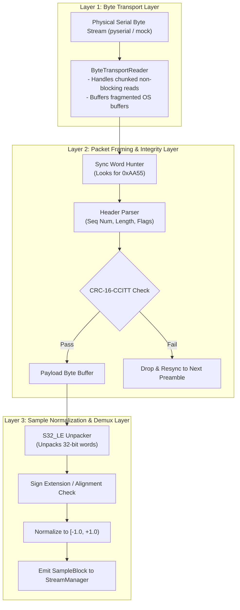

# AuscultaForge — USB Protocol Engineering & Wire-Level Framing
**Document ID:** `AF-CODE-USB-PROTOCOL-V01`  
**Classification:** `CODE_VERIFIED` (Host Layer) / `DOCUMENTED_PROPOSAL` (Firmware Wire Framing)  
**Course Context:** EEE495 / EEE496 Senior Design Project — Digital Stethoscope  
**Reference Files:**
- `software/pcg_app/transport.py`
- `docs/sdp/week-04/submissions/module-b-ozan/W04_B_to_C_protocol-proposal_v01.md`
- `docs/protocol/PROTOCOL_DRAFT.md`

---

## 1. Physical USB Standards & Operating Modes

AuscultaForge utilizes the on-chip USB OTG peripheral of the ESP32-S3 operating as a **USB 2.0 Full-Speed Device**.

### 1.1 Physical Signaling & Transceiver
* **Data Signaling Rate:** $12.000 \text{ Mbps} \pm 0.25\%$.
* **Signaling Lines:** Differential pair $D+$ (`GPIO 20`) and $D-$ (`GPIO 19`).
* **Line Encoding:** Non-Return-to-Zero Inverted (NRZI) with bit-stuffing (a zero is inserted after six consecutive ones to ensure clock synchronization).
* **Speed Identification:** Full-speed device asserts a $1.5 \text{ k}\Omega$ pull-up resistor on the $D+$ line.

### 1.2 USB CDC-ACM (Communication Device Class — Abstract Control Model)
* **Standard Class:** Universal Serial Bus Class Definitions for Communications Devices (v1.2).
* **Driver Binding:** Standard Microsoft Windows driver `usbser.sys` binds automatically to Vendor ID `0x303A` (Espressif Systems) and Product ID `0x4001` (TinyUSB CDC).
* **Zero Driver Footprint:** No external drivers, proprietary INF files, or Zadig WinUSB overrides are required on the host computer.

---

## 2. The 3-Tier Layered Host Protocol Model

To prevent wire framing assumptions from leaking into the core DSP engine, AuscultaForge enforces a **3-tier transport architecture** inside `software/pcg_app/transport.py`:



---

## 3. Wire Packet Framing Proposal Analysis

### 3.1 Proposed 40-byte Packet Structure (Module B — Ozan, Week 04)
Under proposal `W04_B_to_C_protocol-proposal_v01.md`, data is packed into fixed 40-byte frames:

```text
Byte Offset:   0      1      2      3      4      5      6      7
             ┌──────┬──────┬──────┬──────┬──────┬──────┬──────┬──────┐
Field:       │ Sync 0xAA55 │  Seq uint16  │ Flags uint16 │ Length (32)  │
             ├──────┴──────┴──────┴──────┴──────┴──────┴──────┴──────┤
Bytes 8-39:  │ Payload: 8 samples × 4 bytes (S32_LE) = 32 bytes     │
             ├───────────────────────────┬───────────────────────────┤
Bytes 40-41: │ CRC-16-CCITT (2 bytes)   │ End of Frame (Optional)   │
             └───────────────────────────┴───────────────────────────┘
```

* **Sync Word (`0xAA55`):** 2 bytes (`0x55`, `0xAA` in Little-Endian) establishing packet alignment.
* **Sequence Counter (`uint16_t`):** Increments by 1 for each transmitted packet ($0\text{--}65535$).
* **Flags (`uint16_t`):** Encodes sensor health, clipping warnings, and sample alignment mode (bit 0: $0 = \text{LSB}, 1 = \text{MSB}$).
* **Payload Length (`uint16_t`):** Fixed at 32 bytes (8 audio samples).
* **Payload Data (32 bytes):** 8 contiguous audio samples in `S32_LE` format ($8 / 48000 \approx 166.7 \ \mu\text{s}$ of audio).
* **CRC-16-CCITT (2 bytes):** Computed over bytes 0 through 39.

### 3.2 Evaluation: 40-Byte Packets vs. 2048-Byte Bulk Blocks
| Metric | 40-Byte Fixed Frame Proposal | 2048-Byte Bulk Block Proposal | AuscultaForge Assessment |
|---|---|---|---|
| **Packet Frequency** | $6,000 \text{ packets/s}$ | $93.75 \text{ blocks/s}$ | 6,000 packets/s incurs significant OS interrupt overhead on USB Full-Speed. |
| **Protocol Overhead** | $20\%$ overhead (8 bytes header/CRC per 32 bytes data) | $< 0.4\%$ overhead (8 bytes header per 2048 bytes data) | 40-byte frame consumes more USB bandwidth, but provides lower host latency ($167 \ \mu\text{s}$ vs $10.67 \text{ ms}$). |
| **Resynchronization Penalty** | Single packet loss drops only 8 samples ($167 \ \mu\text{s}$) | Corrupted packet drops 512 samples ($10.67 \text{ ms}$) | 40-byte framing confines corruption to microscopic intervals. |
| **Current Status** | `DOCUMENTED_PROPOSAL` | Implemented in Virtual Bench & Tools | **Pending final joint bench approval with Module B (Ozan).** |

---

## 4. DTR Line State Flow Control

Standard USB CDC-ACM includes virtual modem control signals:
* **DTR (Data Terminal Ready):** Asserted by host when opening the COM port; de-asserted upon closing.
* **RTS (Request to Send):** Flow control line.

### Gating Implementation in Embedded C (`tools/esp32_bench_example/main/main.c`):
```c
/* Gated transmission loop */
while (1) {
    /* Check if host PC application has asserted DTR */
    if (tud_cdc_connected()) {
        /* Host is listening: stream audio blocks */
        stream_audio_block();
    } else {
        /* Host disconnected: pause acquisition and avoid buffer overflow */
        vTaskDelay(pdMS_TO_TICKS(50));
    }
}
```
This guarantees that the MCU does not blast packets into unallocated USB FIFOs when the host application is closed.
