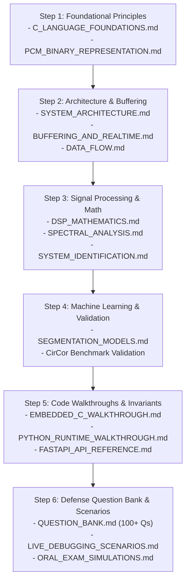

# AuscultaForge — Academic Code Defense Handbook
**Document ID:** `AF-DEFENSE-HANDBOOK-V01`  
**Classification:** `ACADEMIC_GUIDANCE`  
**Course Context:** EEE495 / EEE496 Senior Design Project (Department of Electrical and Electronics Engineering)  
**Primary Student Owner:** Ege Çağın Tepe (Module C Owner)  
**Baseline Git Commit:** `fa4b75a80d29aab04875534234574db9f6c0af43`

---

## 1. The Nature of the Senior Design Academic Defense

In the Department of Electrical and Electronics Engineering, the EEE495/EEE496 Senior Design Capstone Examination is not a marketing pitch or a product sales presentation. It is an intense, rigorous technical examination conducted by a panel of professors specializing in:
1. **Digital Signal Processing & Information Theory:** Frequency transforms, filter causality, coherence, quantization, spectral leakage.
2. **Embedded Systems & Computer Architecture:** Interrupt latency, Direct Memory Access (DMA), USB endpoints, FreeRTOS task scheduling, race conditions, bitwise integer arithmetic.
3. **Electromagnetics & Acoustic Metrology:** Transducer impedance matching, noise coupling, 50 Hz mains shielding, measurement uncertainty.

The committee's primary goal is to determine whether the student genuinely understands every line of code, circuit schematic, and mathematical derivation committed to the repository, or merely assembled open-source libraries without deep comprehension.

---

## 2. Core Defense Principles for Module C (Ege)

### Principle 1: Absolute Honesty Regarding Physical vs. Simulated Evidence
* **Never conflate virtual bench simulation with physical hardware measurements.**
* If asked: *"Has your system captured real heart sounds from a patient?"*
  * **Incorrect / Fatal Answer:** *"Yes, our AI segmented PCG with 95% accuracy."* (This refers to the CirCor open dataset benchmark, not your physical hardware!)
  * **Correct Academic Answer:** *"No. Human clinical trials are explicitly outside our approved academic scope. All physical measurements are conducted on bench acoustic phantoms. For algorithm verification, our Springer segmentation model was trained and evaluated on the PhysioNet CirCor pediatric database using strict patient-level splitting to prevent data leakage."*

### Principle 2: Command of Low-Level Mathematical & Bitwise Details
* You must be able to write down two's-complement binary representations, calculate I2S clock dividers, explain why left-shifting signed negatives is undefined in C99, and derive the $H_1(f)$ transfer function estimator on a whiteboard from memory.

### Principle 3: Clear Module Ownership & Cross-Module Respect
* **Kaan (Module A):** Owns acoustic transducer selection (ECM vs MEMS), chestpiece acoustic cavity design, 3D-printed coupling, analog conditioning, and phantom fabrication.
* **Ozan (Module B):** Owns production embedded firmware under `firmware/`, FreeRTOS task architecture, I2S DMA driver configuration, hardware power budget, and BOM procurement.
* **Ege (Module C):** Owns host software runtime, FastAPI REST and WebSocket bridge, loss-aware session recording with SHA-256 sidecars, display decimation, DSP bandpass filtering, 6-measurement metrology automation, Springer LR-HSMM segmentation workbench, and integration verification.

---

## 3. Defense Preparation Roadmap

To prepare for the oral examination, study the documentation system in the following recommended order:

---

## 4. Key Whiteboard Topics Likely to be Tested

Be prepared to step up to the examination whiteboard and derive or explain:
1. **The I2S Clock Equation:**
   $$f_{\text{SCK}} = 2 \times N_{\text{bits}} \times f_s = 2 \times 32 \times 48,000 = 3,072,000 \text{ Hz} \ (3.072 \text{ MHz})$$
2. **Two's-Complement Sign Extension:**
   Demonstrating how a 24-bit negative number `0xFFFFFF` ($-1$) is sign-extended to 32 bits (`0xFFFFFFFF`).
3. **The Welch PSD Variance Reduction:**
   Why averaging $K$ windowed periodograms reduces spectral variance by a factor of $K$:
   $$\text{Var}\{\hat{S}_{xx}(f)\} \approx \frac{1}{K} S_{xx}^2(f)$$
4. **The $H_1(f)$ Transfer Function Estimator:**
   Deriving why $H_1(f) = S_{xy}(f) / S_{xx}(f)$ cancels output observation noise $v[n]$ when $S_{xv}(f) = 0$.
5. **The Teager-Kaiser Energy Operator:**
   $$\Psi[x[n]] = x^2[n] - x[n-1]x[n+1] \approx A^2 \omega_0^2$$
