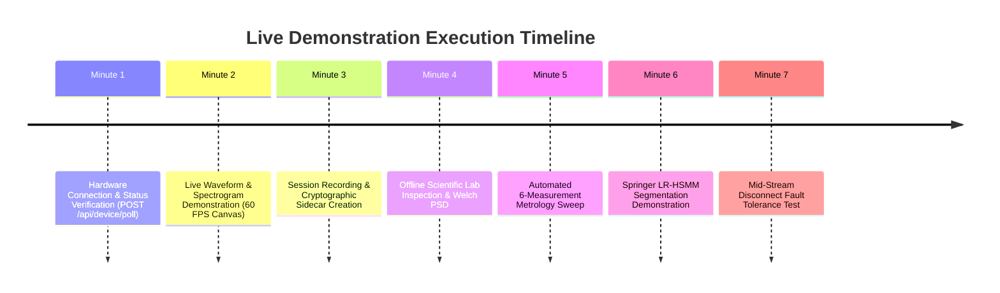

# AuscultaForge — Live Demonstration Runbook
**Document ID:** `AF-DEFENSE-DEMO-RUNBOOK-V01`  
**Classification:** `OPERATIONAL_RUNBOOK`  
**Course Context:** EEE495 / EEE496 Senior Design Project — Digital Stethoscope  
**Author:** Ege Çağın Tepe (Module C Owner)  
**Baseline Git Commit:** `fa4b75a80d29aab04875534234574db9f6c0af43`

---

## 1. Pre-Demo Setup & Bench Checklist (T-15 Minutes)

Before the examination committee enters the room, complete the following setup:

### Hardware Connection Checklist
- [ ] Connect Cable 1: Host PC USB port $\to$ ESP32-S3 **"UART" / "COM"** port (for monitoring).
- [ ] Connect Cable 2: Host PC USB port $\to$ ESP32-S3 **"USB"** Native OTG port (for streaming).
- [ ] Connect Acoustic Phantom: Audio amplifier 3.5mm jack $\to$ Host PC headphone output.
- [ ] Multimeter Check: Measure $3.30 \pm 0.05 \text{ V}$ between INMP441 `VDD` and `GND`.
- [ ] Windows Device Manager: Verify two COM ports appear under **Ports (COM & LPT)**:
  - `Silicon Labs CP210x USB to UART Bridge (COMx)`
  - `USB Serial Device (COMy)` (Native USB)

---

## 2. Server & UI Launch Sequence (T-5 Minutes)

### Terminal 1: Python FastAPI Bridge Server
```powershell
# Open Windows PowerShell in repository root:
.\.venv\Scripts\Activate.ps1
python -m pcg_app.server --host 127.0.0.1 --port 8000
```
* Verify output displays: `Application startup complete. Uvicorn running on http://127.0.0.1:8000`.

### Terminal 2: React Desktop Frontend
```powershell
# Open second PowerShell window:
cd software/frontend
npm run dev
```
* Open web browser at: [http://127.0.0.1:3000](http://127.0.0.1:3000).

---

## 3. Minute-by-Minute Demonstration Script (7 Minutes)



### Minute 1: Hardware Connection & Truthful Status
1. Show the committee the Live Workstation UI. Point to the status badge displaying `DETECTED` (`COM3`).
2. Click **"Connect & Open Device"**.
3. Point out state transition: $\text{DETECTED} \to \text{OPENING} \to \text{HANDSHAKING} \to \text{READY}$.
4. Show the verified capabilities panel: `Sample Rate: 48000 Hz, Channels: 1, Container: S32_LE`.

### Minute 2: Real-Time Waveform & Dynamic Spectrogram
1. Click **"Start Streaming"**. State transitions to `STREAMING`.
2. Speak to the committee: *"The oscilloscope canvas is rendering at 60 FPS using our bounded peak-preserving decimation pipeline. Even though the microphone is acquiring 48,000 samples per second, only 600 peak-preserved min/max points per frame are pushed over WebSockets."*
3. Gently tap the acoustic phantom or chestpiece. Show the sharp transient spikes appearing instantaneously on screen without lagging.
4. Point out the live STFT spectrogram below the waveform, showing frequency content concentrated in the $20\text{--}150\text{ Hz}$ band.

### Minute 3: Session Recording & Cryptographic Integrity
1. Click **"Start Recording"** with session label `Demo_Evaluation_01`.
2. Record for exactly 10.0 seconds.
3. Click **"Stop Recording"**.
4. Open the `experiments/sessions/<session_id>/` directory on screen. Show the generated files:
   - `raw.wav` (normalized float32 WAV, $480,000 \text{ samples} \times 4 \text{ bytes} \approx 1.92 \text{ MB}$).
   - `session.json` (metadata, sample counts, duration, and whole-file SHA-256 hash).
   - `manifest.json` (session manifest registry).
5. Open `session.json`: point out the Git commit SHA, exact sample count ($480,000$), zero dropped samples, and the 64-character `raw_wav_sha256` whole-file hash.

### Minute 4: Offline Scientific Lab & Welch PSD
1. Switch navigation tabs to **"Scientific Lab"**.
2. Select the recorded session `Demo_Evaluation_01`.
3. Click **"Run Spectral Analysis"**.
4. Show the Welch PSD curve: point out the $20\text{--}500\text{ Hz}$ bandpass roll-off, the 50 Hz mains fundamental peak extraction, and the harmonic ratios.

### Minute 5: Automated Metrology Suite
1. Switch to **"Metrology Lab"**.
2. Click **"Run Full 6-Measurement Campaign"**.
3. In 3 seconds, the runner executes workflows for SNR, frequency response $H_1$, repeatability, mains interference, latency, and sample continuity.
4. Open the generated Markdown metrology report and show the advisor-compliant tables.

### Minute 6: Springer LR-HSMM Segmentation Demonstration
1. Switch to **"PCG Research Lab"**.
2. Click **"Segment Current PCG"**.
3. Show the four-color shaded state mask overlaying the acoustic waveform:
   - Green: $S_1$ (Mitral/Tricuspid closure)
   - Yellow: Systole
   - Blue: $S_2$ (Aortic/Pulmonic closure)
   - Gray: Diastole
4. Explain the extended Viterbi cyclic constraint preventing unphysiological state transitions.

### Minute 7: Live Disconnect Fault-Tolerance Test
1. Return to **"Live Workstation"** and start streaming.
2. In front of the committee, **physically unplug the USB cable** from the laptop.
3. Show that neither the Python backend nor the React frontend crashes:
   - The UI immediately displays an amber `INTERRUPTED` banner.
   - The active WAV file is cleanly finalized on disk.
   - Plug the cable back in: click **"Poll Device"** $\to$ the system automatically recovers to `READY`.
