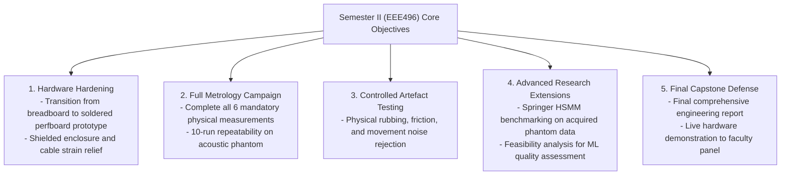

# AuscultaForge — EEE496 Capstone Proposed Defense Outline (Semester II)
**Document ID:** `AF-PRES-EEE496-PROPOSAL-V01`  
**Classification:** `DOCUMENTED_PROPOSAL` / `FUTURE_ROADMAP`  
**Course:** EEE496 Senior Design Project II (Semester II Projected Outline)  
**Department:** Electrical and Electronics Engineering  
**Primary Author:** Ege Çağın Tepe (Module C Owner)  
**Baseline Git Commit:** `fa4b75a80d29aab04875534234574db9f6c0af43`

---

## 1. Academic Disclaimer & Status Boundary

> [!IMPORTANT]
> **PROPOSED FUTURE OUTLINE NOTICE:**
> This document is a **proposed operational and presentation outline** for EEE496 (Semester II). It does **NOT** represent completed work, executed experiments, or final advisor sign-offs. No fabricated second-semester results or experimental numbers are included herein.

---

## 2. Semester II Engineering Objectives (Projected Scope)

In EEE496, the AuscultaForge project transitions from software-heavy foundation and bench prototype bring-up into physical hardware hardening, full acoustic characterization campaigns, and final capstone oral examination:

---

## 3. Projected EEE496 Final Presentation Slide Structure (20-Minute Defense)

### Slide 1–3: Recap of Semester I Foundations
* Problem statement: High-fidelity phonocardiographic acquisition ($20\text{--}500\text{ Hz}$).
* Semester I baseline: INMP441 digital I2S selection, ESP32-S3 architecture, host software suite (394 tests).

### Slide 4–7: Hardware Prototype Evolution & Soldered Assembly
* Comparison between Week 05 solderless breadboard setup and final Semester II soldered prototype.
* Physical shielding, ground bonding, and power rail filtering measurements.
* Mechanical chestpiece coupling revision (acoustic seal and diaphragm clamping).

### Slide 8–13: The Six Mandatory Physical Characterization Results
* **Result 1:** Measured Phantom Frequency Response ($|H_1(f)|$) and Coherence ($\gamma_{xy}^2(f)$).
* **Result 2:** Measured Signal-to-Noise Ratio (SNR) in relative dB.
* **Result 3:** Measurement Repeatability across 10 identical runs ($\text{CV} \le 5.0\%$).
* **Result 4:** Spectral Mains Interference Level (50 Hz and harmonics).
* **Result 5:** Measured Physical End-to-End Latency via dual-channel oscilloscope.
* **Result 6:** Verified Dropped-Packet Rate during the 30-minute continuous streaming test.

### Slide 14–16: Controlled Acoustic Artefact Evaluation
* Quantitative assessment of chestpiece rubbing noise vs. genuine PCG signals.
* Spectral distribution of friction artefacts ($0\text{--}100\text{ Hz}$).
* Effectiveness of the 4th-order $20\text{ Hz}$ high-pass filter in suppressing motion artifacts.

### Slide 17–18: Advanced Supporting Research & ML Feasibility
* Performance of the Springer LR-HSMM segmentation pipeline on physical phantom recordings.
* Cross-domain evaluation and classification feasibility roadmap.

### Slide 19–20: Conclusion, Project Retrospective & Contributions
* Evaluation of achievements against original EEE495/EEE496 course requirements.
* Individual contributions: Kaan (Module A), Ozan (Module B), Ege (Module C).
* Recommendations for industrialization or clinical trial adaptation.
