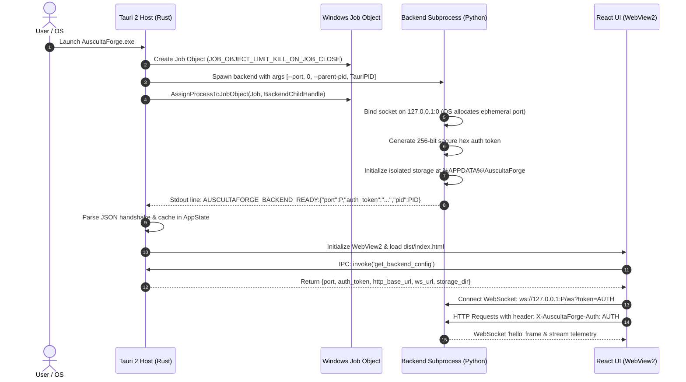

# AuscultaForge Desktop Workstation Architecture

- **Document Version:** 1.0.0
- **Release Target:** AuscultaForge Desktop 1.0 (Alpha 0.1.0-alpha.1)
- **Target OS:** Windows 10 / Windows 11 (x64)
- **Author:** Ege Çağın Tepe (Module C Lead)
- **Module:** Module C (Host Software, Signal Processing & Scientific Laboratory)

---

## 1. System Topology Overview

AuscultaForge Desktop is engineered as a three-tier hybrid desktop workstation combining low-overhead systems programming, interactive web graphics, and high-performance scientific Python computing:

```
+-----------------------------------------------------------------------------------+
|                           AuscultaForge Desktop Workstation                       |
|                                                                                   |
|  +-----------------------------------------------------------------------------+  |
|  |                 TIER 1: NATIVE DESKTOP SHELL (Tauri 2 / Rust)               |  |
|  |  - Windows Application Entrypoint & Window Management                       |  |
|  |  - Windows Job Object Process Supervision (Zero Orphan Processes)           |  |
|  |  - Ephemeral Port Discovery & Secure Handshake Hand-off                     |  |
|  |  - Native Shell IPC Commands: Config, Restart, Explorer File Reveal         |  |
|  +-------------------------------------+---------------------------------------+  |
|                                        | Microsoft WebView2 Rendering Pipe         |
|  +-------------------------------------v---------------------------------------+  |
|  |                   TIER 2: REACT TELEMETRY WORKSPACE (TSX / CSS)             |  |
|  |  - High-Rate Waveform Display & Decimated Decoupled Ring Buffer             |  |
|  |  - Live Workspace: Spectral Periodograms, RMS / Peak / Crest Telemetry     |  |
|  |  - Specimen Archives: Session Playback, WAV & JSON Metadata Integrity     |  |
|  |  - Scientific Laboratory: Welch PSD, H1 Frequency Response, Springer DBN/HMM|  |
|  |  - Sensor Hardware: True ESP32-S3 State Machine (No Fabricated Telemetry)   |  |
|  +-------------------------------------+---------------------------------------+  |
|                                        | Localhost Loopback (Ephemeral Port + Auth)|
|  +-------------------------------------v---------------------------------------+  |
|  |             TIER 3: SELF-CONTAINED SCIENTIFIC BACKEND (Python / FastAPI)    |  |
|  |  - Ephemeral Loopback Binding (port: 0 -> dynamic OS port allocation)      |  |
|  |  - Per-Process Cryptographic Token Security Middleware                      |  |
|  |  - Ring-Buffer Real-Time Streaming & Audio Resampling (StreamManager)      |  |
|  |  - Deterministic Virtual Bench Harness (8 Known-Answer Test Oracles)       |  |
|  |  - Session Recorder: Normalized Float32 WAV, Manifest & SHA-256 Checksums  |  |
|  |  - Hardware Discovery & USB Seam (Isolated, Honest Absence State)           |  |
|  +-----------------------------------------------------------------------------+  |
+-----------------------------------------------------------------------------------+
```

---

## 2. Process Architecture & Startup Handshake

To ensure safe concurrent execution and prevent port collision with developer environments (which standardly use port 8000), AuscultaForge Desktop utilizes an ephemeral dynamic port protocol:



---

## 3. Zero-Orphan Process Management Guarantee

Desktop scientific applications frequently suffer from orphaned Python subprocesses lingering after the GUI closes, holding system audio devices or ports. AuscultaForge implements a dual-layer defense:

### Layer 1: OS Kernel Guarantee (Windows Job Object)
Upon spawning `auscultaforge-backend.exe`, the Rust shell binds the process to a newly created Windows Job Object configured with:
```rust
info.BasicLimitInformation.LimitFlags = JOB_OBJECT_LIMIT_KILL_ON_JOB_CLOSE;
```
If the Tauri application process terminates, whether cleanly, via user close, or via abnormal termination (e.g., Task Manager kill or crash), the Windows kernel automatically and unconditionally terminates all processes assigned to that Job Object.

### Layer 2: Subprocess Watchdog Guarantee (Win32 Parent PID Monitor)
`desktop_server.py` runs a background daemon thread that tracks the parent process ID passed via `--parent-pid`:
- It queries the parent process handle using `OpenProcess(SYNCHRONIZE, FALSE, parent_pid)`.
- It continuously waits or polls `GetExitCodeProcess`.
- If the parent process terminates, the backend initiates an immediate graceful Uvicorn server shutdown:
```python
if is_parent_alive is False:
    server.should_exit = True
```

---

## 4. Frontend Decoupling & Ingestion Flow

High-rate digital stethoscopes operate at 48 kHz (48,000 samples per second). Directly sending 48,000 raw samples per second into the React component render loop would crash browser garbage collectors and saturate the DOM thread.

AuscultaForge solves this via a two-stage decimation pipeline:
1. **Audio/Acquisition Layer (Backend):** Streams chunks into a circular audio ring-buffer.
2. **Display Decimator (Backend `DisplayWorker`):** Computes min/max envelopes down to a fixed 600-point frame published at 30–60 FPS over WebSocket.
3. **UI Rendering:** Canvas-based rendering in React draws downsampled envelope frames with sub-millisecond draw times, allowing butter-smooth 60 FPS oscilloscope displays while preserving bit-perfect full-rate recording in the background session WAV files.
