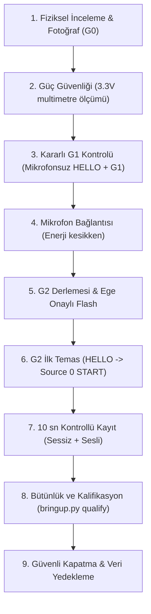

# Cuma G2 Laboratuvar Runbook'u ve Kontrol Listesi
## 30 Ekim 2026 — ESP32-S3 + INMP441 İlk Fiziksel Entegrasyon Seansı

**Rol Dağılımı ve Görev Sınırları:**
- **Ege (Yazılım / Entegrasyon Sorumlusu):** Firmware derleme, I²S konfigürasyonu, USB CDC iletişimi, flash onayı, kayıt, veri kalifikasyonu ve kurtarma adımları.
- **Kaan (Mekanik / Akustik Sorumlusu):** Mikrofon breakout montajı, lehim kontrolü, göğüs parçası/kuplaj hazırlığı.
- **Ozan (Elektronik / Güç Sorumlusu):** Besleme gerilimi ölçümü, ortak GND doğrulaması, multimetre/osiloskop cihaz takibi.

> [!CAUTION]
> **Temel Güvenlik ve Donanım Kuralları:**
> 1. INMP441'e **ASLA 5V veya VBUS BAĞLANMAZ**. Yalnızca multimetre ile ölçülmüş 3.3V verilir.
> 2. Enerji varken kablo takıp çıkarılmaz; lehim yapılmaz.
> 3. İnsan üzerinde test yapılmaz (etik kurul dışı).
> 4. Hiçbir flash işlemi Ege'nin açık iki aşamalı onayı (`FLASH <PORT>`) olmadan başlatılamaz.
> 5. Başarısız deneme kayıtları silinmez; teşhis için saklanır.

---

### A. Gerekli Parçalar ve Masaüstü Araçları

- [ ] **ESP32-S3 DevKitC-1 N16R8** geliştirme kartı.
- [ ] **INMP441 MEMS Mikrofon Breakout Modülü** (başlık pinleri düzgün lehimlenmiş, alt akustik portu temiz ve açık).
- [ ] **Veri taşıyan sağlam USB-C kablosu** (yalnızca tek kablo bağlanacak).
- [ ] **Dijital Multimetre** (DC gerilim ve süreklilik/kısa devre kontrolü için).
- [ ] **Sağlam Breadboard ve Erkek-Dişi / Erkek-Erkek Jumper Kablolar**.
- [ ] **Masaüstü/Laptop Bilgisayar:**
  - `ausculta-forge` deposu güncel `main` dalında.
  - Çalışan Python 3.11 `.venv` ortamı.
  - Lokal `ESP-IDF v5.5.1` derleme araçları (`firmware/build/esp-idf-v5.5.1` ve `firmware/build/idf-tools`).
  - Çalışan AuscultaForge Masaüstü Uygulaması.
- [ ] **Akıllı Telefon / Kamera** (kartın ön/arka yüzü ve kurulan devrenin fotoğrafları için).
- [ ] *(Varsa)* **Masaüstü Osiloskop veya Mantık Analizörü** (BCLK ve WS saat hatlarını teyit için).

---

### B. Adım Adım Laboratuvar Uygulama Akışı



#### Adım 1: Fiziksel Kart İncelemesi (G0 Kapısı)
1. Kartın ön ve arka yüzünü fotoğraflayın. Modül üzerindeki **ESP32-S3-WROOM-1 N16R8** yazısını teyit edin.
2. Kart üzerindeki iki USB-C portunu inceleyin: Biri UART Köprüsü (CP2102/CH340/Prolific), diğeri doğrudan ESP32-S3 GPIO19/20'ye giden **Native USB** portudur.
3. [PHYSICAL_INSPECTION_CHECKLIST.md](PHYSICAL_INSPECTION_CHECKLIST.md) formunu açarak fiziksel maddeleri inceleyin.

#### Adım 2: Güç Güvenliği ve Gerilim Doğrulaması
1. **Mikrofonu henüz bağlamayın.**
2. Kartı tek USB kablosuyla bilgisayara takın.
3. Multimetreyi DC 20V kademesine alın.
4. Kart üzerindeki `3V3` pini ile `GND` pini arasındaki gerilimi ölçün:
   - **Beklenen Değer:** 3.25 V – 3.35 V arası regüle gerilim.
   - *5V veya dengesiz gerilim görülürse derhâl kabloyu çekin; mikrofonu bağlamayın!*
5. Gerilim doğrulandıktan sonra **USB kablosunu bilgisayardan çıkarın**.

#### Adım 3: Mevcut G1 Sürümünün Korunması ve Ön Testi
1. Kartın firmware altyapısının sağlam olduğunu teyit etmek için kartı tekrar takın.
2. Terminalde CDC COM portunu tespit edin ve HELLO testi yapın:
   ```powershell
   .\.venv\Scripts\python.exe tools/hardware/bringup.py hello --port COM_CDC
   ```
3. Handshake doğrulandıktan sonra 10 saniyelik sentetik G1 testi çalıştırın:
   ```powershell
   .\.venv\Scripts\python.exe tools/hardware/bringup.py g1 --port COM_CDC
   ```
4. `PHYSICAL_G1_PASSED` sonucunu görün. Bu adım, USB ve temel yazılım zincirinin kusursuz olduğunu kanıtlar.
5. USB kablosunu tekrar çıkarın.

#### Adım 4: INMP441 Fiziksel Bağlantısı (Enerji KESİKKEN)
1. INMP441 breakout kartını inceleyin. Lehimlerin düzgün olduğunu ve alt kısımdaki mikrofon deliğinin (akustik port) açık olduğunu teyit edin.
2. Enerji kesikken multimetre ile VDD ve GND pinleri arasında kısa devre olmadığını ölçün.
3. Ön pin planına göre bağlantıları breadboard üzerinde yapın:
   - **VDD / VCC** $\rightarrow$ ESP32-S3 `3V3` pini
   - **GND** $\rightarrow$ ESP32-S3 `GND` pini
   - **SD / DOUT** $\rightarrow$ ESP32-S3 `GPIO6` (Geçici öneri / PROVISIONAL)
   - **WS / LRCLK** $\rightarrow$ ESP32-S3 `GPIO5` (Geçici öneri / PROVISIONAL)
   - **SCK / BCLK** $\rightarrow$ ESP32-S3 `GPIO4` (Geçici öneri / PROVISIONAL)
   - **L/R** $\rightarrow$ **GND** (Sol I²S slotu seçimi için GND'ye köprüleyin)
4. *Not:* Eğer fiziksel header üzerinde GPIO4/5/6 pinleri başka amaçla ayrılmışsa veya çakışma varsa, güvenli GPIO grubundan (GPIO 1..18 arası, 3 hariç) yeni pinler seçin ve not edin.

#### Adım 5: Doğrulanmış Bağlantıya Göre G2 Derlemesi ve Flash
1. ESP-IDF 5.5.1 ortamını yükleyin:
   ```powershell
   Set-Location C:\Dev\Antigravity\bitirme\ausculta-forge
   $env:IDF_TOOLS_PATH = Join-Path (Get-Location) 'firmware/build/idf-tools'
   $env:IDF_PYTHON_ENV_PATH = Join-Path $env:IDF_TOOLS_PATH 'python_env/idf5.5_py3.11_env'
   $env:PATH = 'C:\Users\egeca\AppData\Local\Programs\Python\Python311;' + $env:PATH
   . ./firmware/build/esp-idf-v5.5.1/export.ps1
   ```
2. G2 profilini konfigüre edin (fiziksel bağlantıya göre):
   ```powershell
   cd firmware
   idf.py menuconfig
   ```
   - `AuscultaForge board profile` menüsüne girin.
   - `Enable physically reviewed INMP441 wiring` seçeneğini aktif edin (`[X]`).
   - Onaylanan BCLK, WS, DIN pin numaralarını girin.
   - `INMP441 L/R tied to 3.3 V` seçeneğini `[ ]` (kapalı/GND = sol kanal) olarak bırakın.
   - Ayarları kaydedip çıkın.
3. Repo köküne dönün ve release derlemesini çalıştırın:
   ```powershell
   cd ..
   .\.venv\Scripts\python.exe tools/hardware/bringup.py build
   ```
4. `firmware/build/release/firmware_build_manifest.json` dosyasında `source_modes: [1, 0]` olduğunu teyit edin.
5. **Flash Yetkilendirmesi (Yalnızca Ege'nin Onayıyla):**
   ```powershell
   .\.venv\Scripts\python.exe tools/hardware/bringup.py identify --port COM_ROM
   .\.venv\Scripts\python.exe tools/hardware/bringup.py flash --port COM_ROM
   ```
   - Araç sizden ikinci kez `FLASH COM_ROM` yazmanızı isteyecektir. Bilgileri kontrol edip Ege'nin açık onayıyla yazın.

#### Adım 6: Güvenli START / RECORD / STOP Sırası
1. Kartı normal çalışma modunda başlatın (gerekirse RESET'e basın).
2. Yeni oluşan CDC COM portu üzerinden HELLO gönderin:
   ```powershell
   .\.venv\Scripts\python.exe tools/hardware/bringup.py hello --port COM_CDC
   ```
   `FIRMWARE HANDSHAKE VERIFIED` mesajını görün.
3. AuscultaForge Masaüstü Uygulamasını açın:
   - **Device Center** sekmesine gidin $\rightarrow$ Portu seçin $\rightarrow$ **Connect & HELLO** yapın.
   - Aktif kaynak olarak **Source 0 (I2S Hardware)** seçin.
   - **Start Acquisition** butonuna basın.
4. Hemen **Live Workspace** sekmesine geçin:
   - **RECORD** butonuna basarak dosya kaydını başlatın.
   - **10 saniyelik kontrollü kayıt protokolü:**
     - *0 – 5. saniye:* Tam sessizlik (ortam gürültü tabanı).
     - *5 – 10. saniye:* Mikrofonun yakınında kontrollü ses (konuşma veya hafif el çırpma).
5. **Önce** Live Workspace'te **STOP RECORDING** butonuna basarak WAV dosyasının güvenle diske yazılmasını sağlayın.
6. **Ardından** Device Center sekmesine dönüp **STOP Acquisition** butonuna basarak donanım akışını durdurun ve `STOP_ACK` yanıtını teyit edin.

#### Adım 7: Kanıt Dosyalarının Doğrulanması ve Kalifikasyon
Oluşturulan kayıt `experiments/sessions/<session_id>/` altına yazılır.
1. Kalifikasyon analizini çalıştırın:
   ```powershell
   .\.venv\Scripts\python.exe tools/hardware/bringup.py qualify --session experiments/sessions/<session_id> --output experiments/hardware/g2_first_test.json
   ```
2. Bu betik şunları otomatik denetler ve raporlar:
   - WAV dosya boyutu, formatı (float32 mono, 48 kHz) ve SHA-256 hash bütünlüğü.
   - Gerçek örnek sayısı ($N$) ve süre ($N / 48000$).
   - DC ortalama değeri, RMS seviyesi, tepe genlik ve kırpılma (clipping) oranı.
   - Doğrusal Welch PSD spektrumu ($FS^2 / Hz$).
   - Sabit sıfır veya ölü kanal kontrolü.

#### Adım 8: Deney Sonu ve Güvenli Kapatma
1. Uygulama arayüzünde `Disconnect` butonuna basarak COM portunu serbest bırakın.
2. AuscultaForge masaüstü uygulamasını kapatın.
3. USB kablosunu bilgisayardan çıkarın.
4. Tüm terminal loglarını, `g2_first_test.json` kalifikasyon raporunu ve fotoğraf dosyalarını `experiments/hardware/` altına kaydedip arşivleyin.

---

### C. Hata Durumlarında İlk Güvenli Teşhis

| Belirti / Hata | Olası Kök Neden | Güvenli Teşhis ve Düzeltme Adımı |
|---|---|---|
| **Sabit Sıfır (All-Zero Data)** | Yanlış slot seçimi veya SD hattı kopuk | L/R pininin sağlam şekilde GND'ye bağlı olduğunu teyit edin. SD pini ile GPIO6 arasındaki sürekliliği multimetreyle ölçün. Clocks (BCLK/WS) aktif mi osiloskopla kontrol edin. |
| **Aşırı DC Ofset / Tam Doygunluk** | VDD paraziti veya lehim köprüsü | VDD-GND arasını ölçün. Mikrofonun altındaki akustik giriş deliğinin lehim pastası veya yapışkanla tıkanmadığından emin olun. |
| **Port Açılmıyor / Erişim Engellendi** | Başka bir seri monitör açık | Arka planda açık kalan PuTTY, Arduino IDE, Serial Monitor veya Python betiğini kapatın. |
| **Cihaz Yanıt Vermiyor / Çökme** | Firmware veya DMA takılması | BOOT tuşuna basılı tutun $\rightarrow$ RESET'e basıp bırakın $\rightarrow$ BOOT'u bırakın (ROM Bootloader modu). Kararlı G1 sürümüne anında geri dönün. |
| **DMA / Ring Buffer Taşması** | USB aktarım tıkanıklığı | UART loglarını inceleyin; eşzamanlı ağır işlem yapmayın, USB kablosunu doğrudan ana karta bağlayın (pasif çoklayıcı kullanmayın). |

---

### D. Acil Kurtarma Planı (Rollback to Stable G1)

Eğer I²S sürücüsü veya donanım bağlantısında beklenmeyen bir kilitlenme yaşanırsa:
1. Enerjiyi kesin, mikrofon kablolarını ayırın.
2. Kartı ROM Download moduna alın (BOOT basılı + RESET tıkla).
3. Doğrulanmış fabrika G1 firmware'ini geri yükleyin:
   ```powershell
   .\.venv\Scripts\python.exe tools/hardware/bringup.py flash --port COM_ROM --manifest firmware/build/release/firmware_build_manifest.json
   ```
4. Terminalde `FLASH COM_ROM` yazarak onaylayın.
5. Kartı yeniden başlatıp `bringup.py hello` ve `bringup.py g1` ile sistemin kararlı temel hatta döndüğünü teyit edin.
