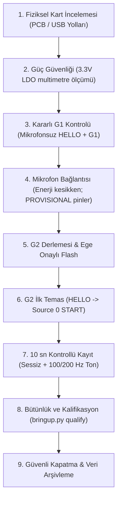

# Cuma G2 Laboratuvar Runbook'u ve Kontrol Listesi
## 30 Ekim 2026 — ESP32-S3 + INMP441 İlk Fiziksel Entegrasyon Seansı

**Rol Dağılımı ve Görev Sınırları:**
- **Ege (Yazılım / Entegrasyon Sorumlusu):** Firmware derleme, I²S konfigürasyonu, USB CDC iletişimi, flash onayı, kayıt, veri kalifikasyonu ve kurtarma adımları.
- **Kaan (Mekanik / Akustik Sorumlusu):** Mikrofon breakout montajı, lehim kontrolü, akustik port/kuplaj hazırlığı.
- **Ozan (Elektronik / Güç Sorumlusu):** Besleme gerilimi ölçümü, ortak GND doğrulaması, multimetre/osiloskop cihaz takibi.

> [!CAUTION]
> **Temel Güvenlik ve Donanım Kuralları:**
> 1. INMP441'e **ASLA 5V veya VBUS BAĞLANMAZ**. Yalnızca multimetre ile ölçülmüş 3.3V LDO rayı verilir.
> 2. Enerji varken kablo takıp çıkarılmaz; lehim yapılmaz.
> 3. İnsan veya hasta üzerinde kayıt yapılmaz (etik kurul dışı).
> 4. Hiçbir flash işlemi Ege'nin açık iki aşamalı onayı (`FLASH <PORT>`) olmadan başlatılamaz.
> 5. Başarısız deneme kayıtları silinmez; teşhis için saklanır.
> 6. Mevcut doğrulanmış fiziksel G1 kanıt dosyaları (`experiments/hardware/week6_20261026_sprint/cli-g1/`) asla değiştirilmez.

---

### A. Gerekli Parçalar ve Masaüstü Araçları

- [ ] **ESP32-S3 Kartı (Satıcı Kodu: DSTK22852 / WROOM-1-N16R8 Modüllü):**
  - *Not:* Kart genel Espressif DevKitC-1 referans kartı değildir; gerçek PCB yerleşimi, pin dizilimi ve USB hatları cuma günü ilk kez fiziksel olarak doğrulanacaktır.
- [ ] **INMP441 MEMS Mikrofon Breakout Modülü** (başlık pinleri düzgün lehimlenmiş, alt akustik portu temiz ve açık).
- [ ] **Veri taşıyan sağlam USB-C kablosu** (yalnızca tek kablo bağlanacak).
- [ ] **Dijital Multimetre** (DC gerilim ve süreklilik/kısa devre kontrolü için; cihaz model ve seri no kaydedilecek).
- [ ] **Sağlam Breadboard ve Bağlantı Kabloları (Jumper)**.
- [ ] **Masaüstü/Laptop Bilgisayar:**
  - `ausculta-forge` deposu güncel `main` dalında.
  - Python 3.11 `.venv` ortamı.
  - Lokal `ESP-IDF v5.5.1` derleme araçları (`firmware/build/esp-idf-v5.5.1` ve `firmware/build/idf-tools`).
  - Çalışan AuscultaForge Masaüstü Uygulaması.
- [ ] **Test Sinyali Kaynağı (Akıllı Telefon / Hoparlör):** Kontrollü yapay test tonu (100 Hz / 200 Hz saf sinüs) çalmak için.
- [ ] **Akıllı Telefon / Kamera** (kartın ön/arka yüzü ve kurulan devrenin fotoğrafları için).
- [ ] *(Varsa)* **Masaüstü Osiloskop veya Mantık Analizörü** (BCLK ve WS saat hatlarını teyit için).

---

### B. Adım Adım Laboratuvar Uygulama Akışı



#### Adım 1: Fiziksel Kart İncelemesi ve USB Güzergâh Tespiti
1. Kartın ön ve arka yüzünü fotoğraflayın. Modül üzerindeki **ESP32-S3-WROOM-1 N16R8** yazısını teyit edin.
2. Kart üzerindeki iki USB-C portunu inceleyin:
   - **Port A (Harici USB-UART Köprüsü):** CP2102/CH340/Prolific entegresine gider; ROM bootloader, firmware flash (`esptool`) ve UART debug içindir.
   - **Port B (Native USB):** Doğrudan ESP32-S3 GPIO19 (D-) ve GPIO20 (D+) pinlerine gider; binary protokol ve CDC veri akışı içindir.
3. Windows Aygıt Yöneticisi'ni açın. Kartı tek kablo ile bağlayıp hangi portun hangi COM numarası aldığını tespit edin (COM numaraları sabit değildir; yeniden başlatmalarda değişebilir).
4. Genel DevKitC pin şemalarından tahmin yürütmeyin; gerçek pin dizilimini fotoğrafla karşılaştırın.

#### Adım 2: Güç Güvenliği ve Gerilim Doğrulaması (Mikrofon Ayrık)
1. **Mikrofonu henüz devreye bağlamayın.**
2. Kartı tek USB kablosuyla bilgisayara takın.
3. Multimetreyi DC 20V kademesine alın.
4. Kartın regüle `3V3` çıkışı ile `GND` pini arasındaki gerilimi ölçün:
   - **Kart Regülatör Şartnamesi:** Kart üzerindeki LDO regülatör tipik olarak nominal 3.3 V (±%2 ila ±%3 tolerans ile 3.15 V – 3.45 V) üretmelidir.
   - **INMP441 Besleme Toleransı:** 1.62 V – 3.63 V arası (TDK veri sayfası).
   - *Ölçülen gerilim 3.15 V – 3.45 V bandı dışındaysa veya 5V/VBUS kısa devresi varsa USB'yi derhâl çekin; mikrofonu asla bağlamayın.*
5. Multimetre modelini, seri numarasını ve ölçülen gerilim değerini forma kaydedin.
6. Gerilim doğrulandıktan sonra **USB kablosunu bilgisayardan çıkarın**.

#### Adım 3: Mevcut G1 Sürümünün Korunması ve Ön Testi
1. Kart üzerinde çalışan mevcut G1 sürümünün sağlamlığını doğrulamak için kartı tekrar bağlayın.
2. Aygıt Yöneticisi veya `tools/hardware/bringup.py watch` ile Native CDC portunu (`COM_CDC`) tespit edin:
   ```powershell
   .\.venv\Scripts\python.exe tools/hardware/bringup.py hello --port COM_CDC
   ```
3. Handshake teyidinden sonra 10 saniyelik fiziksel G1 testini çalıştırın:
   ```powershell
   .\.venv\Scripts\python.exe tools/hardware/bringup.py g1 --port COM_CDC
   ```
4. `PHYSICAL_G1_PASSED` sonucunu görün (480.000 örnek, 1875 çerçeve, 0 kayıp).
5. Bu test sistemin temel USB CDC iletişiminin kusursuz çalıştığını kanıtlar.
6. USB kablosunu tekrar çıkarın.

#### Adım 4: INMP441 Fiziksel Bağlantısı (Enerji KESİKKEN)
1. INMP441 breakout kartını inceleyin: Lehim köprüsü/çapak olmadığını ve alt kısımdaki mikrofon deliğinin açık olduğunu büyüteçle kontrol edin.
2. Enerji kesikken multimetre direnç/diyot modunda VDD ve GND pinleri arasında kısa devre olmadığını ölçün.
3. Ön pin planına göre bağlantıları breadboard üzerinde yapın:
   - **VDD / VCC** $\rightarrow$ ESP32-S3 `3V3` regüle çıkış
   - **GND** $\rightarrow$ ESP32-S3 `GND` pini (kısa ortak toprak)
   - **SCK / BCLK** $\rightarrow$ ESP32-S3 `GPIO4` (**PROVISIONAL / Geçici Öneri**)
   - **WS / LRCLK** $\rightarrow$ ESP32-S3 `GPIO5` (**PROVISIONAL / Geçici Öneri**)
   - **SD / DOUT** $\rightarrow$ ESP32-S3 `GPIO6` (**PROVISIONAL / Geçici Öneri**)
   - **L/R** $\rightarrow$ **GND** (Sol I²S slotu seçimi için kesinlikle GND'ye bağlanmalıdır)
4. *Önemli:* GPIO4/5/6 pinleri geçici öneridir. Kart incelendiğinde bu pinler strap (GPIO0/3/45/46), sekizli PSRAM (GPIO35-37), flaş (GPIO26-32) veya UART debug (GPIO43-44) ile çakışıyorsa, güvenli gruptan (GPIO 1..18 arası, 3 hariç) yeni pinler seçilmeli ve Kconfig'e işlenmelidir.

#### Adım 5: Doğrulanmış Bağlantıya Göre G2 Derlemesi ve Flash
1. Pinned ESP-IDF 5.5.1 ortamını yükleyin:
   ```powershell
   Set-Location C:\Dev\Antigravity\bitirme\ausculta-forge
   $env:IDF_TOOLS_PATH = Join-Path (Get-Location) 'firmware/build/idf-tools'
   $env:IDF_PYTHON_ENV_PATH = Join-Path $env:IDF_TOOLS_PATH 'python_env/idf5.5_py3.11_env'
   $env:PATH = 'C:\Users\egeca\AppData\Local\Programs\Python\Python311;' + $env:PATH
   . ./firmware/build/esp-idf-v5.5.1/export.ps1
   ```
2. Fiziksel olarak teyit edilen pinlere göre menüyü yapılandırın:
   ```powershell
   cd firmware
   idf.py menuconfig
   ```
   - `AuscultaForge board profile` $\rightarrow$ `Enable physically reviewed INMP441 wiring` seçeneğini aktif edin (`[X]`).
   - Onaylanan BCLK, WS, DIN pin numaralarını girin.
   - `INMP441 L/R tied to 3.3 V` seçeneğini `[ ]` (kapalı/GND = sol kanal) olarak bırakın.
   - Kaydedip çıkın.
3. Release derlemesini çalıştırın:
   ```powershell
   cd ..
   .\.venv\Scripts\python.exe tools/hardware/bringup.py build
   ```
4. `firmware/build/release/firmware_build_manifest.json` dosyasında `source_modes: [1, 0]` olduğunu görün.
5. **Flash Yetkilendirmesi (Yalnızca Ege'nin Açık Onayıyla):**
   - Kartı harici UART köprü portuna bağlayın veya BOOT moduna alın. ROM portunu tespit edin (`COM_ROM`):
     ```powershell
     .\.venv\Scripts\python.exe tools/hardware/bringup.py identify --port COM_ROM
     .\.venv\Scripts\python.exe tools/hardware/bringup.py flash --port COM_ROM
     ```
   - Araç sizden ikinci kez `FLASH COM_ROM` yazmanızı isteyecektir. Bilgileri kontrol edip Ege'nin açık onayıyla yazın.

#### Adım 6: Güvenli START / RECORD / STOP Sırası
1. Kartı normal modda başlatın.
2. Windows Aygıt Yöneticisi'nden Native USB CDC portunu (`COM_CDC`) tespit edin (ROM portundan farklıdır).
3. HELLO sorgusu ile el sıkışmayı teyit edin:
   ```powershell
   .\.venv\Scripts\python.exe tools/hardware/bringup.py hello --port COM_CDC
   ```
   `FIRMWARE HANDSHAKE VERIFIED` mesajı görülmelidir.
4. AuscultaForge Masaüstü Uygulamasını açın:
   - **Device Center** sekmesine gidin $\rightarrow$ Portu seçin $\rightarrow$ **Connect & HELLO** yapın.
   - Aktif kaynak olarak **Source 0 (I2S Hardware)** seçin.
   - **Start Acquisition** butonuna basın.
5. Hemen **Live Workspace** sekmesine geçin:
   - **RECORD** butonuna basarak dosya kaydını başlatın.
   - **10 saniyelik kontrollü yapay ses protokolü:**
     - *0 – 5. saniye:* Tam sessizlik (oda gürültü tabanı).
     - *5 – 10. saniye:* Akıllı telefondan/hoparlörden mikrofona yakın kontrollü 100 Hz veya 200 Hz yapay sinüs tonu oynatın. (İnsan/hasta sesi kullanılmaz).
6. **Önce** Live Workspace'te **STOP RECORDING** butonuna basarak WAV dosyasının diske güvenle yazılmasını sağlayın.
7. **Ardından** Device Center sekmesine dönüp **STOP Acquisition** butonuna basarak donanım akışını durdurun ve `STOP_ACK` yanıtını teyit edin.

#### Adım 7: Kanıt Dosyalarının Doğrulanması ve Kalifikasyon
Kayıt oturumu `experiments/sessions/<session_id>/` altına yazılır.
1. Kalifikasyon analizini çalıştırın:
   ```powershell
   .\.venv\Scripts\python.exe tools/hardware/bringup.py qualify --session experiments/sessions/<session_id> --output experiments/hardware/g2_first_test.json
   ```
2. Bu betik şunları denetler ve raporlar:
   - WAV formatı (float32 mono, 48 kHz) ve SHA-256 hash bütünlüğü.
   - Gerçek örnek sayısı ($N$) ve süre ($N / 48000$).
   - DC ortalama değeri, RMS seviyesi, tepe genlik ve kırpılma (clipping) oranı.
   - Doğrusal Welch PSD spektrumu ($FS^2 / Hz$) — 100/200 Hz test tonunun tepesi görünmelidir.
   - Sabit sıfır veya ölü kanal kontrolü.
3. *Sınıflandırma Notu:* Akustik kalibratör, kuplör veya ses basınç ölçer kullanılmadığından, bu test sonucu yalnızca **işlevsellik testi (functionality check)** olarak raporlanır; kalibre edilmiş akustik metroloji veya klinik PCG doğrulaması olarak iddia edilemez.

#### Adım 8: Deney Sonu ve Güvenli Kapatma
1. Uygulama arayüzünde `Disconnect` butonuna basarak COM portunu serbest bırakın.
2. AuscultaForge masaüstü uygulamasını kapatın.
3. USB kablosunu bilgisayardan çıkarın.
4. Devre elemanlarını yalnızca enerjisiz durumdayken sökün.
5. Tüm oturum dosyalarını, terminal çıktılarını ve multimetre ölçüm notlarını `experiments/hardware/` altına kaydedin.

---

### C. Sensör Hata Durumlarında Güvenli Teşhis

| Belirti / Hata | Olası Kök Neden | Güvenli Teşhis ve Düzeltme Adımı |
|---|---|---|
| **Sabit Sıfır (All-Zero Data)** | 1. L/R pini havada kalmış veya VDD'ye bağlı.<br>2. BCLK veya WS saat sinyali gitmiyor.<br>3. SD (DOUT) pini temassız. | - L/R pininin sağlam şekilde GND'ye lehimli/bağlı olduğunu ve firmware'de sol slotun seçildiğini teyit edin.<br>- Osiloskop/lojik analizör ile BCLK (~3.072 MHz) ve WS (~48 kHz) saat hatlarını kontrol edin.<br>- SD hattının GPIO6'ya temasını multimetre süreklilik testiyle doğrulayın. Dijital sessizlik, mikrofonun sağlam olduğunu kanıtlamaz. |
| **Kablo / Sinyal Kopması** | Gevşek jumper veya USB temassızlığı | - USB bağlantısını sarsmadan sabit tutun; gevşek breadboard jumper kablolarını sağlam olanlarla değiştirin.<br>- Sistem kilitlenirse acquisition'ı derhâl durdurun. |
| **Yanlış I²S Slotu** | L/R pini VDD'ye bağlı (sağ slot) fakat firmware sol slot okuyor | - L/R pinini 3.3V yerine GND'ye köprüleyin veya firmware'de `CONFIG_AF_I2S_RIGHT_SLOT=y` yapın. |
| **Aşırı DC Ofset / Tam Doygunluk** | VDD hattında aşırı gürültü veya akustik delik tıkanıklığı | - 3.3V besleme gürültüsünü osiloskopla inceleyin; yerel 100 nF dekuplaj kondansatörünün bağlı olduğunu doğrulayın.<br>- INMP441'in alt yüzündeki akustik giriş deliğinin lehim artığı veya yapıştırıcı ile tıkanmadığını büyüteçle kontrol edin. |
| **Port Açılmıyor / Erişim Engellendi** | Başka bir proses portu tutuyor | - Arka planda açık kalan seri monitör, PuTTY, terminal veya önceki Python oturumunu kapatın. |

---

### D. Korunmuş İmmutable G1 Yedeği ile Acil Geri Dönüş (Rollback)

G2 derlemesi veya fiziksel deneyi sırasında firmware çökmesi, kilitlenme veya donanım uyumsuzluğu yaşanırsa, `firmware/build/release/` klasöründeki dosyalara bağımlı kalmadan, **salt-okunur olarak ayrılmış ve kilitlenmiş G1 yedeği** kullanılacaktır:

- **Korunmuş Yedek Konumu:** `firmware/g1_rollback_backup/` (Salt-okunur / IsReadOnly)
- **Doğrulanmış Binary Hashes:**
  - `bootloader.bin`: `2796dbba8a3e3dca0bc6588985caaadb234b3c12a721e15a6500d4798ea9807d`
  - `partition-table.bin`: `73c0b5c3e5fcba3a151cc70c453c93dd5f4798899e7f2f8cca76da1f32ffc501`
  - `auscultaforge_g1.bin`: `9ebe95852d92959bf581fbe7fe6da7df8dc3bc745075428e8f57a3726a5ce0b1`
- **Geri Dönüş Adımları:**
  1. USB kablosunu çıkarın; mikrofon kablolarını devreden ayırın.
  2. Kart üzerindeki `BOOT` tuşuna basılı tutun $\rightarrow$ USB'yi takın (veya `RESET` tuşuna basıp bırakın) $\rightarrow$ `BOOT` tuşunu bırakın (ROM Download modu).
  3. Aygıt Yöneticisi'nden ROM bootloader portunu (`COM_ROM`) tespit edin.
  4. Korunmuş yedek manifesti ile doğrudan flash atın:
     ```powershell
     .\.venv\Scripts\python.exe tools/hardware/bringup.py flash --port COM_ROM --manifest firmware/g1_rollback_backup/firmware_build_manifest.json
     ```
  5. Terminalde `FLASH COM_ROM` yazarak onaylayın.
  6. Kartı normal modda yeniden başlatın. Native CDC portunu tespit edip `bringup.py hello` ve `bringup.py g1` ile sistemin kararlı temel hatta döndüğünü doğrulayın.
