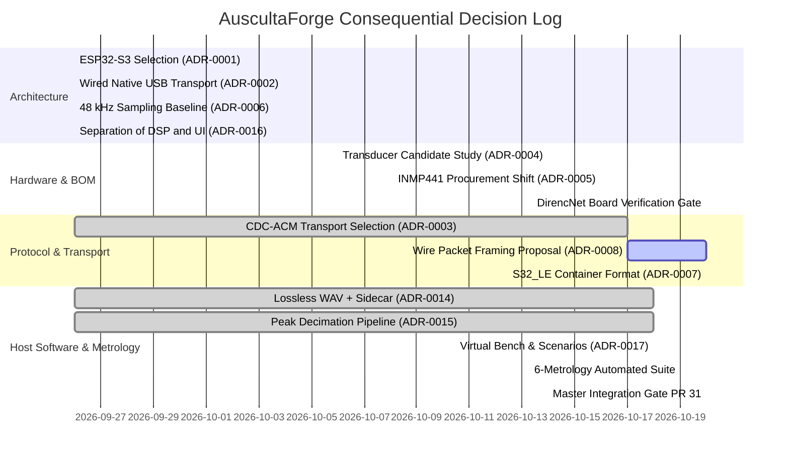

# AuscultaForge — Architectural Decision Timeline
**Document ID:** `AF-HIST-DECISION-TIMELINE-V01`  
**Classification:** `GIT_VERIFIED` / `CODE_VERIFIED`  
**Course Context:** EEE495 / EEE496 Senior Design Project — Digital Stethoscope  
**Baseline Git Commit:** `fa4b75a80d29aab04875534234574db9f6c0af43`

---

## 1. Timeline Overview

This document presents a chronological log of major engineering, architectural, and procurement decisions across Modules A, B, and C. Every entry links to the corresponding Engineering Decision Record (ADR), commit SHA, primary decision owner, and current verification status.

---

## 2. Chronological Decision Records

### Entry D01: Microcontroller Platform Selection — ESP32-S3
* **Date:** 2026-09-26
* **Owner:** Joint Module B (Ozan) / Module C (Ege)
* **ADR Link:** [`ADR-0001-esp32-s3-mcu-selection.md`](../decisions/ADR-0001-esp32-s3-mcu-selection.md)
* **Commit:** `667daa7`
* **Status:** `CODE_VERIFIED`
* **Context:** Needed a high-performance, cost-effective microcontroller capable of continuous 48 kHz multi-channel acquisition, DMA double-buffering, and high-throughput USB streaming.
* **Alternatives Considered:**
  1. *STM32F4 / F7:* Mature industrial audio ecosystem, but higher board cost and limited Turkish local hobbyist stock.
  2. *Standard ESP32:* Lacks native USB OTG PHY; requires external CP2102/CH340 USB-UART bridge which chokes at continuous high-baud streaming.
  3. *Raspberry Pi Pico (RP2040):* Excellent dual-core and PIO, but lacks integrated hardware I2S peripheral and hardware floating-point acceleration.
* **Decision:** Selected **ESP32-S3-DevKitC-1** featuring dual Xtensa LX7 cores @ 240 MHz, hardware I2S controller with DMA, and on-chip full-speed USB OTG PHY.

---

### Entry D02: Physical Data Transport — Wired Native USB CDC-ACM
* **Date:** 2026-09-26 (Formalized 2026-10-17 in PR #30)
* **Owner:** Module B (Ozan) / Module C (Ege)
* **ADR Link:** [`ADR-0002-wired-native-usb-vs-wireless.md`](../decisions/ADR-0002-wired-native-usb-vs-wireless.md) & [`ADR-0003-usb-cdc-acm-transport.md`](../decisions/ADR-0003-usb-cdc-acm-transport.md)
* **Status:** `CODE_VERIFIED` (Host) / `HARDWARE_UNVERIFIED` (Physical MCU)
* **Context:** Choosing between wireless transport (Bluetooth Classic / BLE / Wi-Fi) vs. wired USB.
* **Alternatives Considered:**
  1. *Bluetooth SPP / BLE:* Subject to RF packet dropouts, 2.4 GHz co-channel interference, variable packet latency, and limited sustained bandwidth.
  2. *Wi-Fi TCP/UDP:* High microcontroller power dissipation ($> 250\text{ mA}$ active RF), connection dropouts, and complex network setup during bench tests.
  3. *Vendor Bulk USB Transfer:* Slightly lower protocol overhead, but requires custom WinUSB / libusb driver installations (Zadig), complicating deployment.
* **Decision:** Selected **Wired Native USB CDC-ACM**. Standard Microsoft `usbser.sys` driver binds out-of-the-box on Windows without third-party installations. Sustains $\approx 12\text{ Mbps}$ full-speed USB bandwidth, far exceeding the $\approx 1.536\text{ Mbps}$ required for 48 kHz 32-bit streaming.

---

### Entry D03: Acoustic Transducer Selection — Digital MEMS Baseline
* **Date:** 2026-10-06
* **Owner:** Module A (Kaan)
* **ADR Link:** [`ADR-0004-i2s-digital-mems-vs-analog-ecm.md`](../decisions/ADR-0004-i2s-digital-mems-vs-analog-ecm.md)
* **Commit:** `16fc986`
* **Status:** `DOCUMENTED_PROPOSAL` / `HARDWARE_UNVERIFIED`
* **Context:** Selecting the primary transducer modality to capture cardiac phonocardiography ($20\text{--}500\text{ Hz}$) from the chestpiece.
* **Alternatives Considered:**
  1. *Electret Condenser Microphone (ECM):* Requires high-impedance JFET biasing, multi-stage op-amp pre-amplification, anti-aliasing filtering, and ADC sampling. Highly vulnerable to 50 Hz mains hum and breadboard capacitive coupling.
  2. *Piezoelectric Contact Sensor:* Strong low-frequency coupling, but extreme acoustic impedance mismatch with air cavities, severe resonance peaks, and non-linear distortion.
* **Decision:** Selected **Digital I2S MEMS Microphone** as primary baseline. The MEMS sensor integrates the acoustic diaphragm, low-noise preamplifier, and 24-bit Sigma-Delta ADC directly on silicon. Digital bits are clocked over I2S, entirely bypassing breadboard analog noise.

---

### Entry D04: Procurement Sourcing Realignment — INMP441 Substitution
* **Date:** 2026-10-16
* **Owner:** Module B (Ozan) / Module A (Kaan)
* **ADR Link:** [`ADR-0005-inmp441-procurement-substitution.md`](../decisions/ADR-0005-inmp441-procurement-substitution.md)
* **Commit:** `9067b57` (PR #28)
* **Status:** `GIT_VERIFIED` / `CODE_VERIFIED`
* **Context:** Initial Week 02–03 BOM specified PUI Audio high-performance MEMS microphones (e.g. DMM-4026).
* **Blocker:** Turkish local distributors (DirencNet, Robotistan) did not stock PUI Audio surface-mount parts. International delivery via DigiKey/Mouser exceeded student budget allowances and semester timelines.
* **Decision:** Replaced PUI Audio with the **INMP441 I2S MEMS breakout module** available in-stock from DirencNet.
* **Consequences:** INMP441 comes pre-soldered on a convenient 0.1" pitch breakout board, ideal for breadboard testing. Acoustic SNR is specified at 61 dBA (sufficient for bench phantom testing in $20\text{--}500\text{ Hz}$ band).

---

### Entry D05: Host Display Decoupling — Peak-Preserving Decimation
* **Date:** 2026-09-26 (Hardened in Sprint 05, PR #21)
* **Owner:** Module C (Ege)
* **ADR Link:** [`ADR-0015-bounded-peak-preserving-display-decimation.md`](../decisions/ADR-0015-bounded-peak-preserving-display-decimation.md)
* **Commit:** `da8f0d5`
* **Status:** `CODE_VERIFIED` / `TEST_VERIFIED`
* **Context:** Streaming 48,000 raw samples per second over WebSockets to React caused high garbage collection overhead and browser tab freezing.
* **Alternatives Considered:**
  1. *Subsampling (take every N-th sample):* Aliasing occurs; narrow transient acoustic events (like sharp S1/S2 clicks or valve snaps) are completely missed if they fall between subsampled points.
  2. *Simple Average (boxcar filter):* Blurs transients and reduces visible waveform dynamic range.
* **Decision:** Implemented **Peak-Preserving Min/Max Decimation** (`software/pcg_app/display_pipeline.py`). Divides incoming blocks into buckets and outputs the exact minimum and maximum sample in each bucket ($\le 600$ points total per display frame).
* **Consequences:** Transient acoustic peaks are 100% preserved; browser frame rate stays smooth at 60 FPS with $< 5\%$ CPU utilization.

---

### Entry D06: Structured Directory Recording — Lossless WAV + Metadata Sidecars
* **Date:** 2026-09-26 (Hardened in Sprint 04, PR #20; Consolidated in PR #31)
* **Owner:** Module C (Ege)
* **ADR Link:** [`ADR-0014-lossless-raw-wav-and-metadata-sidecar.md`](../decisions/ADR-0014-lossless-raw-wav-and-metadata-sidecar.md)
* **Commit:** `d8c3505`
* **Status:** `CODE_VERIFIED` / `TEST_VERIFIED`
* **Context:** Storing scientific PCG data for repeatable offline analysis and metrology validation.
* **Alternatives Considered:**
  1. *HDF5 / NetCDF:* Standard in big-data scientific computing, but difficult to inspect in standard audio software (Audacity) and requires heavy binary libraries.
  2. *Single WAV file with embedded INFO chunks:* Limited metadata schema; metadata fields often stripped by third-party audio editing software.
* **Decision:** Enforced **Structured Directory Session Persistence**: Each session is stored under `experiments/sessions/<session_id>/` containing `raw.wav` (lossless normalized float32 WAV by default), `session.json` (metadata, exact sample count, dropped packets, and whole-file SHA-256 storage hash), and `manifest.json`.
* **Consequences:** `verify_session()` automatically checks the whole-file SHA-256 hash before loading or analyzing, detecting bit rot, truncation, or accidental editing.
