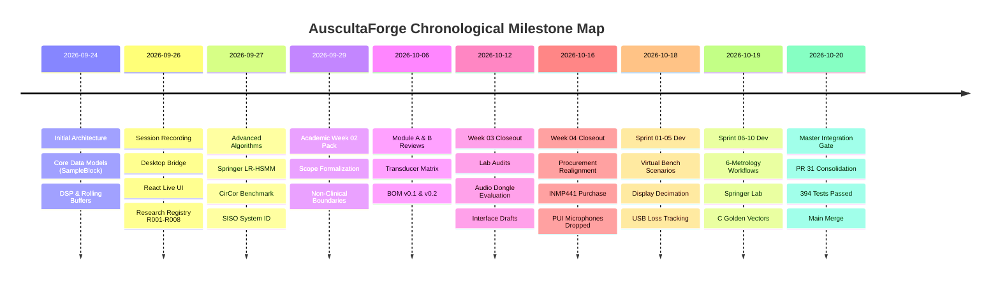
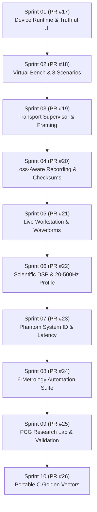

# AuscultaForge — Complete Project Development Chronicle
**Document ID:** `AF-HIST-CHRONICLE-V01`  
**Classification:** `GIT_VERIFIED` / `CODE_VERIFIED`  
**Course Context:** EEE495 / EEE496 Senior Design Project (Department of Electrical and Electronics Engineering)  
**Baseline Git Commit:** `fa4b75a80d29aab04875534234574db9f6c0af43` (Master Integration Gate Merge)  
**Author:** Ege Çağın Tepe (Module C Owner) with cross-module attribution to Kaan (Module A) and Ozan (Module B)

---

## 1. Executive Chronicle Overview

The AuscultaForge project originated as an engineering exploration into cardiac phonocardiography (PCG), focusing on the acoustic acquisition, hardware digitization, loss-aware transmission, and scientific analysis of heart sound signals ($20\text{--}500\text{ Hz}$).

The development history of the project spans two parallel timelines:
1. **The Academic Calendar (EEE495 Weeks 01–05):** Governed by faculty milestones, requirements formalization, transducer candidate comparisons, procurement closeout under Turkish local distributor constraints, and laboratory bench readiness gates.
2. **The Software Sprint Cadence (Module C Sprints 01–10):** An agile software engineering sequence dedicated to building a truthful, deterministic host runtime, multi-tier transport ingestion, loss-aware streaming, 20–500 Hz metrology pipelines, SISO system identification, and research-grade segmentation algorithms prior to physical silicon arrival.

This chronicle reconstructs the complete developmental arc from the repository's initial commit (`c7751bf`, 2026-09-24) through the Master Integration Gate PR #31 (`fa4b75a`, 2026-10-20).

---

## 2. Chronological Engineering Chronicle

### Epoch 1: Inception, Core Abstractions and Early Pipelines (2026-09-24 to 2026-09-25)
* **Status:** `GIT_VERIFIED` (`c7751bf` $\to$ `a8bd7ec`)
* **Primary Contributor:** Ege (Module C)
* **Key Context:** Senior Design project repository initialization. The foundational design requirement established in this epoch was the **separation of ingestion from analysis** via a uniform data block abstraction (`SampleBlock`).

#### Architectural Events:
1. **Repository Structure & Core Dataclasses (`c7751bf`, `bdf52b3`):**
   - Established the three-module architecture: Module A (`hardware/`), Module B (`firmware/`), Module C (`software/`).
   - Introduced `SampleBlock` (`software/pcg_core/models.py`), enforcing four mandatory fields: `samples: np.ndarray`, `sample_rate: int`, `timestamp: float`, `sequence_number: int`.
2. **DSP Pipeline & Rolling Buffers (`d5d0886`, `8c6d471`):**
   - Implemented `StreamingBandpass` (`software/pcg_core/dsp.py`) using second-order sections (`scipy.signal.sosfilt`) with persistent filter state vectors ($z_k$). This guaranteed causal filtering across contiguous packet chunks without transient step-discontinuities at block edges.
   - Introduced `RollingBuffer` (`software/pcg_core/buffers.py`), a thread-safe, circular memory ring enabling overlapping window extraction for spectral estimation.
3. **Reproducible Experiment Harness (`45157d1`, `5120b8f`):**
   - Added command-line experiment runners (`pcg_core.experiment`) producing structured JSON artifacts, anchoring reproducible research early in the repository's lifecycle.
4. **Reference-to-Capture Validation Engine (`b2642ce`, `a8bd7ec`):**
   - Developed cross-correlation time-alignment ($\tau$) and gain compensation algorithms (`software/pcg_core/validation.py`) to benchmark experimental acquisitions against pristine reference recordings.

---

### Epoch 2: Desktop Ingestion, State Machines and Scientific Foundation (2026-09-26 to 2026-09-28)
* **Status:** `GIT_VERIFIED` (`667daa7` $\to$ `abbfd97`)
* **Primary Contributor:** Ege (Module C)
* **Key Context:** Bridging the Python DSP backend with modern web UI technologies, laying down formal scientific units, and adding research algorithms.

#### Architectural Events:
1. **Decision Record on Hardware & Team Boundaries (`667daa7`):**
   - Formally documented initial hardware assumptions: ESP32-S3 microcontroller, nominal 48 kHz sampling baseline, electret vs. MEMS trade-offs, and module ownership assignments.
2. **Dual-File Session Persistence (`d8c3505`):**
   - Established the strict recording rule: Audio MUST be saved as 16-bit or 24-bit uncompressed WAV paired with an immutable JSON sidecar (`<session_id>.meta.json`) recording sample count, dropped packets, SHA-256 payload checksums, and git commit hashes.
3. **DeviceRuntime State Machine (`18d5381`, `a586346`):**
   - Implemented an 8-state hardware lifecycle (`ABSENT`, `DETECTED`, `OPENING`, `HANDSHAKING`, `READY`, `STREAMING`, `CLOSING`, `INTERRUPTED`) inside `software/pcg_app/device_runtime.py`.
   - Prevented illegal streaming transitions and established truthful capability discovery.
4. **Peak-Preserving Decimation & Backpressure Isolation (`da8f0d5`):**
   - Solved a fundamental host performance bottleneck: streaming 48,000 raw float64 samples per second directly over WebSockets froze browser rendering loops.
   - Built `DisplayDecimator` (`software/pcg_app/display_pipeline.py`), which decimates blocks into $\le 600$ peak-preserved min/max envelope points for UI rendering while preserving the intact 48 kHz stream for background disk recording.
5. **Research Registry & Scientific Literature Map (`46c4e62`, `f357358`):**
   - Formalized registries R001 through R008 (`docs/research/SOURCE_REGISTRY.md`), mapping algorithms directly to peer-reviewed literature (Springer et al., Schmidt et al., Clifford et al.).
6. **Springer LR-HSMM Segmentation & CirCor Benchmarking (`d38fd71`, `1bcfb74`):**
   - Implemented duration-dependent Hidden Semi-Markov Models (HSMM) with logistic regression emission probabilities predicting four cardiac states: $S_1$, systole, $S_2$, diastole.
   - Built a validation suite running against open-access PhysioNet CirCor pediatric PCG recordings.

---

### Epoch 3: Academic Week 02 — Project Scope Formalization (2026-09-29 to 2026-10-05)
* **Status:** `GIT_VERIFIED` (`919a562` $\to$ `4905aec`)
* **Contributors:** Ege, with alignment to Faculty Requirements
* **Key Context:** Preparation of the official EEE495 Week-02 Project Planning Pack.

#### Key Developments:
1. **Non-Clinical Prototype Boundary (`02e53da`):**
   - Established the foundational academic constraint: The system is an engineering research prototype evaluated strictly on acoustic bench phantoms. All claims of clinical medical diagnosis were removed.
2. **Six Mandatory Advisor Physical Measurements:**
   - Formalized the 6 physical characterization metrics mandated for semester completion:
     1. Phantom Frequency Response ($20\text{--}500\text{ Hz}$) via SISO transfer function $H_1(f)$.
     2. Signal-to-Noise Ratio (SNR) in relative dBFS.
     3. Measurement Repeatability ($\ge 10$ runs).
     4. Mains Interference (50 Hz and harmonics).
     5. End-to-End Latency.
     6. Dropped-Packet Rate during prolonged streaming ($\ge 30$ minutes).
3. **Week 02–14 Directory Architecture (`827084e`):**
   - Created the structured academic directory tree under `docs/sdp/` to store team meeting briefs, weekly submission packages, and laboratory records.

---

### Epoch 4: Academic Weeks 03–04 — Transducer Evaluation & Procurement Shift (2026-10-06 to 2026-10-16)
* **Status:** `GIT_VERIFIED` (`16fc986` $\to$ `9067b57`)
* **Contributors:** Kaan (Module A), Ozan (Module B), Ege (Module C)
* **Key Context:** Candidate selection, Turkish electronic distributor sourcing, lab audits, and component procurement.

#### Key Developments:
1. **Transducer Evaluation (Module A — Kaan, `16fc986`, `86e3bb6`):**
   - Evaluated Electret Condenser Microphones (ECM) vs. Digital MEMS transducers.
   - ECM required an analog preamplifier and external filtering stage, introducing noise coupling risks on solderless breadboards.
   - Digital MEMS provided an integrated 24-bit Sigma-Delta ADC and I2S digital output, bypassing breadboard analog noise.
2. **Initial Sourcing BOM and Sourcing Blocker (Module B — Ozan, `e90817a`, `18e977c`):**
   - Initial procurement plans called for high-grade PUI Audio MEMS microphones.
   - Turkish local distributors (DirencNet, Robotistan, Özdisan) did not have the exact PUI part numbers in stock; international importation faced university procurement delays.
3. **Procurement Closeout Realignment (PR #28, `9067b57`, 2026-10-16):**
   - Official procurement shift: Switched primary digital transducer to the **INMP441 I2S MEMS breakout board** (purchased via DirencNet).
   - Ordered ESP32-S3-DevKitC-1-N16R8 (16 MB Flash, 8 MB Octal PSRAM) from DirencNet.
   - Ordered backup ECM microphones and PAM8403 audio amplifier for acoustic phantom excitation.
4. **B-to-C Interface Protocol Proposals (`W04_B_to_C_protocol-proposal_v01.md`, `797c489`):**
   - Ozan drafted initial frame proposals: 16-byte fixed headers vs. 40-byte packets, sequence numbers, and CRC-16 polynomial proposals.
   - Protocol remained classified as `DOCUMENTED_PROPOSAL` pending physical bench arrival.

---

### Epoch 5: Module C Software Sprints 01–10 (2026-10-18 to 2026-10-20)
* **Status:** `GIT_VERIFIED` (Feature branches for PR #17 through PR #26)
* **Contributor:** Ege (Module C)
* **Key Context:** Intensive agile sprints to build complete host infrastructure, simulation benches, and verification suites.

#### Detailed Sprint Breakdown:
* **Sprint 01 (PR #17):** Established authoritative runtime states, prevented UI from faking hardware connections, added honest offline indicators.
* **Sprint 02 (PR #18):** Implemented `virtual_bench.py` with 8 deterministic known-answer scenarios (100 Hz sine, counter ramp, boundary stress, clipping, packet drops, timestamp jitter, corrupt payloads, and lifecycle fault recovery).
* **Sprint 03 (PR #19):** Built 3-layer transport architecture: Layer 1 (Byte Transport), Layer 2 (Packet Framing/CRC), Layer 3 (Sample Normalization & Channel Slot Unpacking).
* **Sprint 04 (PR #20):** Integrated SHA-256 payload hashing into session sidecars, built session integrity verifier, and prevented corrupted session files from replaying silently.
* **Sprint 05 (PR #21):** Refined Live Workspace with circular canvas rendering, split backpressure queues (MCU drops vs. UI display drops), and added timecode rulers.
* **Sprint 06 (PR #22):** Developed 20–500 Hz scientific bandpass profile, rolling spectral SNR, crest factor, and clipping counters.
* **Sprint 07 (PR #23):** Built phantom stimulus-response engine in `software/pcg_core/phantom.py` estimating SISO $H_1(f)$ transfer function, delay, and coherence.
* **Sprint 08 (PR #24):** Created `software/pcg_core/metrology/` automated test harness executing all 6 mandatory measurements with Markdown and CSV report generation.
* **Sprint 09 (PR #25):** Implemented frontend `ResearchLab.tsx` and `ValidationLab.tsx`, exposing model benchmarks and event matching matrices.
* **Sprint 10 (PR #26):** Authored `tools/c_golden_vectors/`, a portable C11 test suite verifying identical bitwise sign extension and endianness conversion between C and Python.

---

### Epoch 6: Master Integration Gate & Final Merge (2026-10-20)
* **Status:** `GIT_VERIFIED` (`1f396ec` $\to$ `fa4b75a`)
* **Lead Integrator:** Ege (Module C)
* **Key Context:** Consolidating independent sprint branches into `main` on top of Kaan's and Ozan's Week 4 deliverables.

#### Resolution of Semantic Divergences:
During integration, 8 overlapping files were audited and reconciled:
1. `software/frontend/src/bridgeClient.ts`: Merged WebSocket stream handlers with metrology and research endpoints.
2. `software/frontend/src/types.ts`: Consolidated telemetry, system identification, and model evaluation types.
3. `software/pcg_app/app.py`: Registered all 57 routes across core runtime, virtual bench, sessions, metrology, and research labs.
4. `software/pcg_app/analysis_service.py`: Reconciled multi-channel file analysis with single-channel 48 kHz streaming.
5. `software/pcg_app/state.py`: Unified `StreamManager` state holding references to virtual bench sources, active WAV recorders, and WebSocket subscribers.
6. `software/frontend/src/components/ScientificLab.tsx`: Integrated SISO transfer function views with metrology reports.
7. `software/pcg_core/__init__.py`: Exposed clean namespace exports.
8. `.gitignore`: Preserved temporary binary fixture filters and experiment scratch directories.

#### Verification & Merge:
- 394 automated Python pytest tests passed (16.42s).
- Frontend TypeScript linting and build completed with 0 errors.
- Final Acceptance Patch applied: Corrected `/api/device/poll` route in bring-up docs, audited startup commands, preserved UNVERIFIED hardware status for experimental C generators.
- Merged PR #31 into `main` via merge commit `fa4b75a80d29aab04875534234574db9f6c0af43`.
