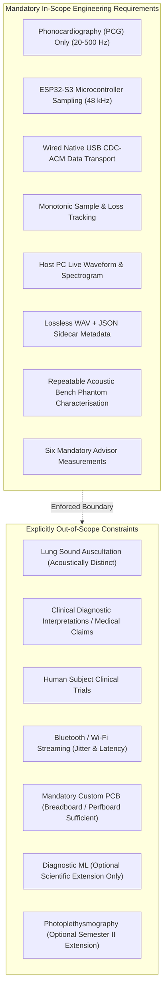

# AuscultaForge — Requirements Evolution & Traceability
**Document ID:** `AF-HIST-REQ-EVOLUTION-V01`  
**Classification:** `GIT_VERIFIED` / `DOCUMENTED_PROPOSAL`  
**Course Context:** EEE495 / EEE496 Senior Design Project — Digital Stethoscope  
**Baseline Git Commit:** `fa4b75a80d29aab04875534234574db9f6c0af43`

---

## 1. Scope and Boundary Definition

The AuscultaForge requirements were established to investigate a complete digital phonocardiographic (PCG) acquisition chain. As the project progressed through academic reviews, market procurement audits, and software engineering sprints, requirements evolved from general concepts into concrete, verifiable technical specifications.

### The Scope Matrix: In-Scope vs. Explicitly Out-of-Scope

---

## 2. Requirements Evolution by Subsystem

### 2.1 Acoustic Transducer & Sensor Conditioning

| Requirement Item | Initial Draft (Week 01–02) | Revision 1 (Week 03) | Final Baseline (Week 04 / PR #28) | Rationale & Evidence |
|---|---|---|---|---|
| **Transducer Modality** | Electret Condenser (ECM) or Analogue MEMS | Comparative study of ECM vs. Digital I2S MEMS | **Dual Evaluation with Digital MEMS Baseline** | Digital MEMS integrates Sigma-Delta ADC and I2S master/slave bus on silicon, eliminating breadboard analog noise pickup. |
| **Microphone Candidate** | PUI Audio High-SNR MEMS (e.g. DMM-4026) | PUI Audio candidate retained in BOM v0.1 | **INMP441 Omnidirectional I2S MEMS** | Local procurement constraint: PUI was unavailable from Turkish distributors (DirencNet/Robotistan); INMP441 was in-stock and immediately deliverable. |
| **Acoustic Bandwidth** | $20\text{--}2000\text{ Hz}$ general audio | $20\text{--}1000\text{ Hz}$ extended phonocardiography | **$20\text{--}500\text{ Hz}$ Cardiac Core** | Heart sound energy concentrates below 500 Hz ($S_1, S_2$ at 20–150 Hz; murmurs up to 400 Hz). Higher frequencies introduce unnecessary acoustic noise. |
| **Analogue Conditioning** | Multi-stage Op-Amp active bandpass filter | High-pass rumble filter ($f_c \approx 20\text{ Hz}$) | **Minimal Conditioning (I2S Direct) / Active Backup for ECM** | Digital MEMS outputs raw I2S words directly to MCU DMA; analogue filtering is only required if testing the secondary ECM path. |

---

### 2.2 Embedded Microcontroller & Sampling Architecture

| Requirement Item | Initial Draft (Week 01–02) | Revision 1 (Week 03) | Final Baseline (Week 04 / PR #30) | Rationale & Evidence |
|---|---|---|---|---|
| **Microcontroller Platform** | STM32 or ESP32 family | ESP32-S3 DevKitC-1 selected | **ESP32-S3-DevKitC-1-N16R8** | Dual Xtensa LX7 cores, dedicated USB OTG peripheral with internal full-speed PHY, 8 MB PSRAM, and robust I2S DMA controller. |
| **Sampling Rate Baseline** | 44.1 kHz or 48.0 kHz | 48.0 kHz nominal baseline | **48.000 kHz Continuous Hardware Baseline** | 48 kHz aligns with standard audio I2S clock dividers ($3.072\text{ MHz}$ BCLK for 32-bit slots). Allows pristine oversampling of $20\text{--}500\text{ Hz}$ signals. |
| **Timing & Pacing** | FreeRTOS task delay loop | 512 samples per $\approx 10.67\text{ ms}$ task | **Hardware I2S DMA Interrupt Pacing** | Software `vTaskDelay` pacing is subject to FreeRTOS tick jitter (10 ms tick); strict 48.000 kHz sampling requires DMA hardware timing. |
| **Sample Word Representation** | 16-bit or 24-bit PCM | 24-bit PCM inside 32-bit words | **32-bit Little-Endian Container (`S32_LE`)** | INMP441 produces 24-bit two's complement samples transmitted in 32-bit I2S slots. Container layout is documented in `tools/c_golden_vectors/`. |
| **Continuity Tracking** | None (assume reliable USB) | Packet sequence counter ($0\text{--}65535$) | **Monotonic Cumulative Sample Index + Frame Sequence** | Enables absolute sample loss calculation even if multiple consecutive packets are dropped. |

---

### 2.3 Wire Protocol & Device-to-Host Transport

| Requirement Item | Initial Draft (Week 02) | Revision 1 (Week 03) | Final Baseline (PR #31) | Current Status |
|---|---|---|---|---|
| **Physical Interface** | USB Virtual COM Port | USB CDC-ACM via internal USB OTG | **Dual-USB Configuration (UART for debug, Native USB for streaming)** | `HARDWARE_UNVERIFIED` (Requires physical DevKit inspection on arrival). |
| **Packet Framing** | Raw binary PCM stream | 40-byte fixed frame with header & CRC | **3-Tier Transport Architecture** (Layer 1 Bytes, Layer 2 Frames, Layer 3 Normalized Blocks) | Frame format remains a `DOCUMENTED_PROPOSAL` pending joint bench approval with Module B. |
| **Integrity Check** | Optional checksum | CRC-16-CCITT ($0\text{x}1021$) | **CRC-16 Proposal in Firmware / SHA-256 in Host Session Sidecars** | Layer 2 decoder validates frames; host persistence enforces SHA-256 payload integrity. |
| **Backpressure Strategy** | Unspecified | Drop oldest if buffer full | **Queue-bounded Decoupling with Loss Accounting** | Transport supervisor tracks short writes and dropped bytes without blocking hardware DMA. |

---

### 2.4 Host Software, Display & Metrology Requirements

| Requirement Item | Initial Draft (Sprint 01) | Revision 1 (Sprint 05) | Final Baseline (Sprint 08–10 / PR #31) | Verification Method |
|---|---|---|---|---|
| **Waveform UI Rendering** | Full-rate 48 kHz points over WebSocket | Browser canvas throttled to 30 FPS | **Peak-Preserving Decimation ($\le 600$ min/max points per frame)** | Validated in `software/tests/test_display_pipeline.py`. Retains acoustic clicks while capping CPU load $< 5\%$. |
| **Session Persistence** | Single WAV audio file | WAV + basic JSON metadata | **Lossless WAV + Cryptographic JSON Sidecar** | Validated in `software/tests/test_recording.py`. Stores SHA-256 hash, Git SHA, sample count, and drop statistics. |
| **Spectrogram Visualization** | Offline FFT plot | Live STFT spectrogram in frontend | **Real-Time Dynamic Spectrogram with Decibel Color Mapping** | Implemented in `ScientificLab.tsx` and validated via `pcg_core.analysis`. |
| **Mandatory Metrology** | Manual lab measurement notes | Python verification scripts | **Automated 6-Measurement Metrology Suite (`pcg_core.metrology`)** | Validated in `software/tests/test_metrology_automation.py`. Generates markdown and CSV reports for all 6 advisor measurements. |
