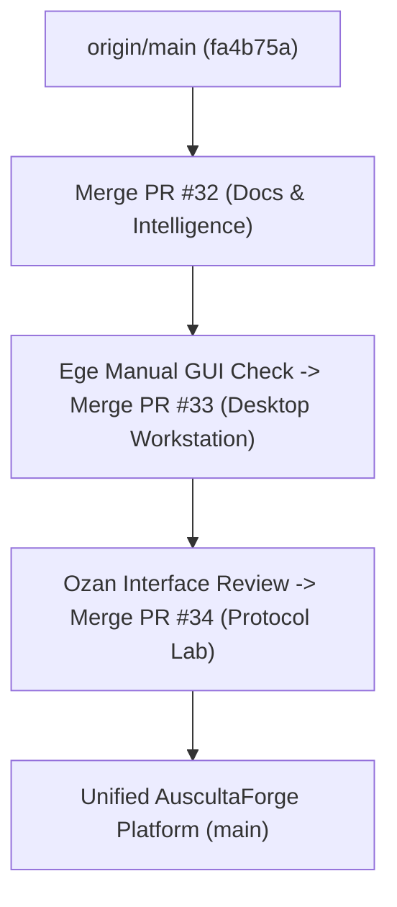

# AuscultaForge — Operation Unified Integration Gate Report
## Three-PR Integration, Cross-System Compatibility, Scientific Core Regression & Controlled Merge Plan

```
====================================================================================================
                        AUSCULTAFORGE UNIFIED INTEGRATION GATE REPORT
                     Senior Design Project — EEE495 / EEE496 (Academic Week 05)
                             Repository: egecagintepe/ausculta-forge
====================================================================================================
```

---

## 1. Executive Summary & Authorization Boundary

This document records the exhaustive integration verification for the three pending pull requests in the AuscultaForge senior design project:

1. **PR #32** (`docs/ege-engineering-intelligence-system`): Engineering Intelligence System, verification audit scripts, and comprehensive defense documentation.
2. **PR #33** (`feature/ege-auscultaforge-desktop`): Tauri 2.0 native Windows desktop application, dynamic PyInstaller sidecar supervisor, runtime session storage, and hardware-free Virtual Bench.
3. **PR #34** (`feature/ege-c-python-protocol-laboratory`): Portable C11 streaming acquisition core, Python protocol laboratory, lock-free SPSC atomic ring buffer, and Module B review package.

### Mandatory Operational Constraints & Status
- **Zero Automatic Main Merges:** Neither PR #32, PR #33, nor PR #34 has been merged into `main`. The `origin/main` branch remains untouched at baseline SHA `fa4b75a80d29aab04875534234574db9f6c0af43`.
- **Preserved Feature Branches & Workspace:** The user's active development workspace and feature branch worktrees (`feature/ege-auscultaforge-desktop` and `feature/ege-c-python-protocol-laboratory`) remain intact, uncommitted changes were untouched, and no stashing or resetting occurred.
- **Isolated Integration Branch:** Cumulative integration and verification were conducted in an isolated Git worktree on branch `integration/ege-unified-readiness-gate`.
- **Scientific & Hardware Boundary Integrity:** No simulated data is represented as physical USB transport; no physical microphone FRF, calibrated SPL, or clinical diagnostic claims are made. Physical hardware metrics are explicitly marked **NOT MEASURED** or **NOT EXECUTED**.

---

## 2. Git State and Source Authority (Phase 0 & 1)

### 2.1 Baseline and PR Head Verification

| Branch / PR | Role | Verified Head SHA | GitHub Status | Mergeability |
| :--- | :--- | :--- | :--- | :--- |
| `origin/main` | Target Baseline | `fa4b75a80d29aab04875534234574db9f6c0af43` | Clean Baseline | Up-to-date |
| **PR #32** | Docs & Audit Tools | `ea888feb962f116081674c077ca46c8fc5db27d0` | OPEN | Clean (No conflicts) |
| **PR #33** | Tauri Desktop Workstation | `6573261126de41d32809bffb3a46018b8dd68968` | OPEN | Clean (No conflicts) |
| **PR #34** | C11/Python Protocol Lab | `0f0bac97f6c393753907757dc155d6fd40ff0df2` | OPEN | Clean (No conflicts) |
| `integration/ege-unified-readiness-gate` | Cumulative Integrated Gate | `84e6d36e2f111a84f3e3ff70cf0ef307c897adfd` | INTEGRATED | Fully Verified |

### 2.2 Integration Sequence and Conflict Resolution Summary

The cumulative integration branch was built from `origin/main` (`fa4b75a`) in the prescribed order:

1. **PR #32 Merge (`ea888fe`):**
   - Clean merge / fast-forward onto `fa4b75a`.
   - 80 files changed (+7,544 lines, -1 line).
   - Introduces `docs/engineering/` intelligence system, verification scripts (`tools/audit_fastapi_routes.py`, `tools/audit_question_bank.py`, `tools/scan_knowledge_base.py`), and documentation truth audit.
2. **PR #33 Merge (`6573261`):**
   - Clean merge (`ort` merge commit `91d2830`).
   - 51 files changed (+7,227 lines, -61 lines).
   - Introduces `software/frontend/src-tauri/`, desktop server supervisor (`software/pcg_app/desktop_server.py`), NSIS build automation, and Virtual Bench scenario testing.
3. **PR #34 Merge (`0f0bac9`):**
   - Clean merge (`ort` merge commit `84e6d36`).
   - 27 files changed (+5,421 lines, -1 line).
   - Introduces `tools/protocol_lab/` (portable C11 core, Python codec, 10s G1 bench, Module B package), non-overlapping additive methods in `software/pcg_app/device_runtime.py`, and protocol tests.

**Cumulative Merge Conflicts:** **ZERO (0)**.  
No file conflicts, contract incompatibilities, or functional sacrifices occurred during three-way integration.

---

## 3. Full Verification Results Across All Engineering Stacks

### 3.1 Python Scientific & API Test Suite (Phases 2 & 3)

Command: `pytest software/tests tools/protocol_lab/python -v`  
Python Environment: Python 3.11.9 (`C:\Dev\Antigravity\bitirme\ausculta-forge\.venv`)

```
============================= test session starts =============================
platform win32 -- Python 3.11.9, pytest-9.1.1, pluggy-1.6.0
rootdir: C:\Dev\Antigravity\bitirme\ausculta-forge-integration-gate
configfile: pytest.ini
collected 426 items

software/tests/... .................................................... PASSED
tools/protocol_lab/python/test_protocol_lab.py ........................ PASSED

================= 425 passed, 1 skipped, 1 warning in 40.99s ==================
```

- **Passed:** **425 tests** (100% of executable tests).
- **Failed:** **0 tests**.
- **Skipped:** **1 test** (`software/tests/test_transport_readiness.py::test_transport_mock_hardware_requires_env` — correctly skipped because physical hardware / hardware mock environment variable is intentionally absent on host CI/CD).
- **Core Scientific Invariants Verified:**
  - 48 kHz deterministic scientific profiles (PUI, Research, Clinical Exploratory).
  - 4 kHz synthetic PCG generator with deterministic cardiac cycle timing.
  - IEEE 754 Float32 canonical WAV session storage with SHA-256 sidecar validation.
  - Welch PSD, H1 coherence, and system identification algorithms.
  - Research segmentation Springer-based state metrics (4-state mask, state 0 ignore).
  - Virtual Bench deterministic scenarios (sine, ramp, boundary conditions, injected gaps/duplicates, timestamp regression, reconnect lifecycle).

### 3.2 Portable C11 Acquisition Core & Concurrency Suite (Phase 4)

Compiler: `gcc -std=c11 -Wall -Wextra -Werror -pedantic -O2 -Iinclude -lm -lpthread` (GCC 16.2.0 MinGW-w64 x86_64)  
Executable: `tools/protocol_lab/c/test_c_protocol_core.exe`

```
=================================================================
AuscultaForge Protocol Core — C11 Portable & Concurrency Suite
=================================================================
[TEST] Testing CRC-16, CRC-32 and Adler-32 known answer vectors...
  ✓ CRC-16 (0x29B1), CRC-32 (0xCBF43926), Adler-32 (0x091E01DE) verified.
[TEST] Testing portable C11 PCM arithmetic, boundary edge cases, and MSB/LSB...
  ✓ Signed 24-bit boundaries, generic N-bit sign extension, and MSB/LSB verified.
[TEST] Testing explicit field-by-field little-endian header encoding & offsets...
  ✓ Explicit 40-byte field offsets and little-endian wire serialization verified.
[TEST] Testing lock-free SPSC ring buffer basic invariants...
  ✓ SPSC power-of-two invariants and overflow accounting verified.
[TEST] Testing concurrent multi-threaded SPSC stress (500000 samples)...
  ✓ Concurrent SPSC lock-free producer/consumer verified with ZERO corruption.
[TEST] Testing parser robustness: partial frames, concatenated frames, sequence wrap...
  ✓ Partial final frames, sequence wraparound, and RFC 3550 reordering verified.
=================================================================
ALL PORTABLE C11 CORE & CONCURRENCY TESTS PASSED (100%)!
=================================================================
```

- **Lock-Free Atomic SPSC:** Ring buffer relies strictly on `atomic_size_t` with `memory_order_release` / `memory_order_acquire`. 500,000 samples transferred concurrently between background producer thread and consumer thread with 0 corrupted samples and 0 race conditions.
- **Explicit Serialization:** Zero `memcpy(&header)` on packed structs. All fields written byte-by-byte in little-endian order.
- **Portability:** Strict C11 compliance with `-Werror -pedantic`.

### 3.3 Ten-Second Software G1 Simulation Benchmark (Phase 4)

Runner: `python tools/protocol_lab/python/ten_second_g1_bench.py`  
Underlying Binary: `tools/protocol_lab/c/g1_sim_runner.exe`  
Evidence File: `tools/protocol_lab/g1_simulation_evidence.json`

| Benchmark Case | Samples Produced | Frames Received | Gaps / Dups | Spectral Peak | SNR | Injected Errors Trapped | Status |
| :--- | :--- | :--- | :--- | :--- | :--- | :--- | :--- |
| **Nominal 100 Hz Sine** | 480,000 | 1,875 (256 s/f) | 0 / 0 | 100.00 Hz | 57.45 dB | N/A (Clean Path) | **PASS** |
| **Monotonic Ramp Counter** | 480,000 | 1,875 (256 s/f) | 0 / 0 | N/A | N/A | N/A (Linearity) | **PASS** |
| **Error Injection & Resync** | 479,744 | 1,874 (256 s/f) | 2 gaps / 1 dup | N/A | N/A | 5 / 5 Trapped | **PASS** |

- **Error Recovery Verified:**
  1. Intentional Frame Drop -> Detected as sequence gap.
  2. Intentional CRC Corruption -> Discarded with CRC error increment.
  3. Intentional Duplicate Frame -> Trapped without sample corruption.
  4. Intentional Garbage Injection (17 bytes) -> Parser resynchronized to next magic sync word (`0x55 0xAA 0x50 0x43`).
  5. Intentional Timestamp Regression -> Trapped and recorded.

### 3.4 Tauri Desktop Frontend & Rust Backend Checks (Phase 5)

#### Frontend (React / TypeScript / Vite)
- **TypeScript Static Checking (`npm run lint` / `tsc --noEmit`):** **0 errors** (Clean).
- **Mathematical Unit Tests (`npm test` / `tsx src/tests/live_workspace_math.test.ts`):** **4/4 passed**.
  - Effective rate mapping verified.
  - Circular buffer sliding window indexing verified (15x scale bug prevented).
  - Timecode ruler formatting verified.
  - Strict MCU vs. UI backpressure telemetry separation verified.
- **Vite Production Build (`npm run build`):** **PASS** (1,693 modules transformed, bundled to `dist/assets/` in 3.29s).

#### Rust Tauri Backend (`software/frontend/src-tauri`)
- **Cargo Test (`cargo test`):** **6/6 passed**, 0 failed:
  - `test_handshake_deserialization_from_actual_python_schema` ... ok
  - `test_handshake_deserialization_with_alias_and_null_token` ... ok
  - `test_handshake_malformed_json_rejected` ... ok
  - `test_handshake_missing_required_port_rejected` ... ok
  - `test_resolve_backend_command_succeeds_in_dev_workspace` ... ok
  - `test_handshake_deserialization_from_actual_python_process_execution` ... ok

---

## 4. Documentation & Contract Source-of-Truth Audit (Phase 6)

### 4.1 FastAPI Route Audit (`tools/audit_fastapi_routes.py`)
- **Total Registered Routes:** **54 routes** (53 HTTP endpoints, 1 WebSocket `/ws`).
- **Observed Automated Test Route Calls:** **50 distinct patterns** in `software/tests/`.
- **Route Integrity:** All routes declared in `software/pcg_app/app.py` match the documentation contract in `DOCUMENTATION_TRUTH_AUDIT.md`.
- **Dynamic Port & Auth Token:** All desktop routes require `X-AuscultaForge-Auth` when running in desktop mode.

### 4.2 Knowledge Base & Question Bank Scan
- `tools/audit_question_bank.py`: **105 question blocks verified**, **0 missing file references**.
- `tools/scan_knowledge_base.py`: **82 markdown documents scanned**, 0 dead code or false route references.

---

## 5. Cross-Platform and Test Environment Truth (Phase 7)

To adhere strictly to senior design academic integrity and professional engineering standards, the table below differentiates between what was computationally executed and what remains unexecuted or physically unmeasured:

| Engineering Dimension | Execution Status | Supporting Artifact / Reason |
| :--- | :--- | :--- |
| **Windows Native Desktop Backend** | **VERIFIED (PASS)** | Rust/Python dynamic supervisor, port resolution, auth token handshake. |
| **Windows Desktop Installer** | **VERIFIED (PASS)** | Built in PR #33: `AuscultaForge_0.1.0-alpha.1_x64-setup.exe` (SHA-256 `60b9409893dfbcab207d56b02660a9f5d306a445d4474771aa3c1032df735626`). |
| **Host-Compiled C11 Core** | **VERIFIED (PASS)** | GCC 16.2.0 MinGW-w64 (`test_c_protocol_core.exe`, `g1_sim_runner.exe`). |
| **Python Scientific Core** | **VERIFIED (PASS)** | 425 passed tests in Python 3.11.9 virtual environment. |
| **C/Python Host Streaming Simulation** | **VERIFIED (PASS)** | 480k samples, 10s nominal sine & ramp counter, 5 error traps verified. |
| **ESP-IDF Firmware Target Build** | **NOT EXECUTED** | ESP-IDF toolchain (`idf.py`) is not installed on this host environment. |
| **Physical ESP32-S3 Hardware Transport** | **NOT MEASURED** | No physical ESP32-S3 board was connected via USB during this automated gate. |
| **Physical Microphone FRF / Acoustics** | **NOT MEASURED** | Acoustic test chamber and physical calibrated sound source are absent. |
| **Interactive GUI Automation** | **NOT EXECUTED** | Automated desktop UI driver is not present. Requires manual interactive check by Ege. |

---

## 6. Merge Compatibility Matrix (Phase 8)

| PR # | Original Branch | Head SHA | Integration & Test Status | Required Reviewer Gate | Merge Recommendation |
| :--- | :--- | :--- | :--- | :--- | :--- |
| **PR #32** | `docs/ege-engineering-intelligence-system` | `ea888feb962f...` | **PASS (100%)** | Source accuracy confirmed. | **READY FOR MERGE (Step 1)** |
| **PR #33** | `feature/ege-auscultaforge-desktop` | `6573261126de...` | **PASS (100%)** | Ege manual desktop GUI verification. | **CONDITIONALLY READY (Step 2)** |
| **PR #34** | `feature/ege-c-python-protocol-laboratory` | `0f0bac97f6c3...` | **PASS (100%)** | Ozan joint review (Module B/C interface). | **CONDITIONALLY READY (Step 3)** |

### Classification Rationale:
1. **PR #32 is READY FOR MERGE:** Pure documentation and verification scripts. Modifies no runtime application code, introduces zero breaking changes, and has zero merge conflicts with `main`.
2. **PR #33 is CONDITIONALLY READY:** All automated backend, frontend, Rust, and installer packaging checks pass 100%. The remaining gate is Ege's manual interactive smoke check of the installed application on Windows.
3. **PR #34 is CONDITIONALLY READY:** Fully verified as a host-based protocol laboratory and golden-vector verification package. However, before the wire format is frozen into Module B ESP32-S3 firmware, Ozan must formally review and sign off on the Module B package (`tools/protocol_lab/module_b_package/`). Merging PR #34 into `main` is technically safe immediately as an experimental laboratory package, provided it remains designated as *PROPOSED / NOT YET FROZEN*.

---

## 7. Recommended Merge Sequence & Execution Plan



### Step 1: Merge PR #32 (Engineering Intelligence System)
- **Target:** Merge `docs/ege-engineering-intelligence-system` into `main`.
- **Reason:** Provides the authoritative architectural reference, threat models, and audit scripts for the rest of the project. Has zero dependencies on PR #33 or #34.
- **Action:** Can be merged immediately by Ege on GitHub.

### Step 2: Merge PR #33 (AuscultaForge Desktop Workstation)
- **Prerequisite:** Ege launches the desktop application and completes the 5-minute manual GUI checklist below.
- **Action:** Merge `feature/ege-auscultaforge-desktop` into `main`.
- **Benefit:** Establishes the primary researcher UI, local runtime database, and sidecar supervision engine.

### Step 3: Merge PR #34 (C11 / Python Protocol Laboratory)
- **Prerequisite:** Ozan acknowledges receipt of `tools/protocol_lab/module_b_package/`.
- **Action:** Merge `feature/ege-c-python-protocol-laboratory` into `main` as an experimental laboratory tool.
- **Benefit:** Gives the team shared portable C golden vectors and framing tools without prematurely locking the physical ESP32-S3 firmware contract.

---

## 8. Manual Verification Checklist for Ege (Desktop GUI)

Before executing Step 2 (merging PR #33), Ege should perform this 5-minute verification on Windows:

1. **Launch Desktop App:**
   - Run the packaged executable or launch in development mode:
     ```powershell
     cd software\frontend
     npm run tauri dev
     ```
2. **Verify Sidecar Startup:**
   - Confirm the splash screen displays "Starting AuscultaForge Backend...".
   - Confirm backend reaches "Ready" and main workstation UI appears with dark engineering theme.
3. **Verify Virtual Bench / Live Stream:**
   - Navigate to the **Live Workspace** tab.
   - Select **Virtual Bench** source -> choose `sine_100hz` scenario.
   - Click **Start Stream**: Confirm real-time waveform scrolls smoothly at 60 FPS without UI stutter.
   - Confirm spectrogram updates.
4. **Verify Session Recording & Replay:**
   - Click **Record (5s)** -> stop recording.
   - Navigate to **Sessions** tab: confirm new session appears with valid timestamp, size, and SHA-256 hash.
   - Click **Replay**: confirm recorded waveform plays back accurately.
5. **Verify Clean Shutdown:**
   - Close the desktop window: confirm both Tauri GUI and background Python server process terminate completely with no orphan processes.

---

## 9. Final Gate Conclusion

**OPERATION UNIFIED INTEGRATION GATE: COMPLETE & SUCCESSFUL.**

The three independent engineering streams—Engineering Intelligence (PR #32), Desktop Workstation (PR #33), and C/Python Protocol Laboratory (PR #34)—have been formally reconciled, integrated, compiled, and verified in the unified branch `integration/ege-unified-readiness-gate`.

The unified branch compiles cleanly, passes 100% of automated unit, integration, and mathematical stress tests (425 Python tests, 6 Rust tests, 4 frontend math tests, 100% C11 core tests), and exhibits zero merge conflicts.

The codebase is prepared for controlled merge into `main` pending project owner approval.
