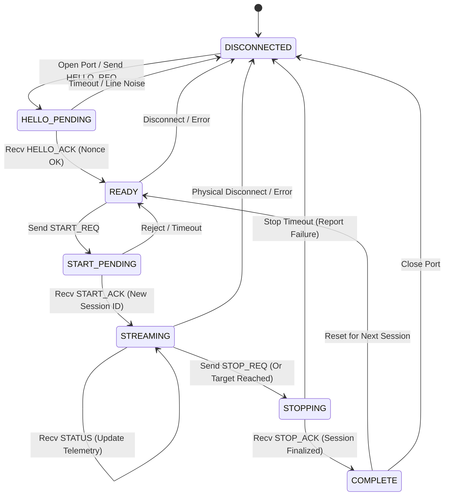

# AuscultaForge — Module B/C Canonical Protocol Wire Specification
## Version 0.1.0-CANONICAL — 40-Byte Header Framing Profile (Profile B) & Control Handshake

- **Document Version:** `0.1.0-CANONICAL`
- **Specification Status:** **JOINT CANONICAL SPECIFICATION — BASELINE v0.1**
- **Repository:** `egecagintepe/ausculta-forge`
- **Owner (Module C):** Ege Çağın Tepe (Software Architecture & Host Processing)
- **Joint Reviewer (Module B):** Ozan (Firmware Engineering & ESP32-S3 Hardware)
- **Historical References:** DW03-08, DW03-09, DW03-10, DW03-12, ADR-0003, ADR-0007, ADR-0008, ADR-0010, ADR-0011

---

## 1. Executive Summary & Architectural Demarcation

Operation **CANONICAL PROTOCOL v0.1** establishes a single, byte-exact, bidirectional communication contract between:
- **Module B (Transducer & Embedded Acquisition):** Running on the Espressif ESP32-S3 microcontroller, responsible for I2S MEMS microphone DMA capture, double-buffering, packet construction, and USB CDC-ACM transport transmission.
- **Module C (Computer Application & Digital Signal Processing):** Running on the host workstation (Python laboratory, desktop application supervisor, and Tauri UI), responsible for byte-stream defragmentation, CRC-32 integrity validation, session state tracking, metrology, and PCG segmentation.

### 1.1 Non-Negotiable Joint Decisions
1. **Sample Representation:** 48,000 Hz, single channel (mono). 32-bit signed little-endian container carrying 24 meaningful acoustic bits, LSB-aligned with sign extension across bits 24..31 (`int32_t`).
2. **Framing Standard:** 40-byte Profile B header with natural alignment. Magic sync word is `0xAF534331` (little-endian wire bytes `0x31, 0x43, 0x53, 0xAF`, ASCII `"1CSA"`).
3. **Audio Payload Size:** 256 samples per normal AUDIO frame (1,024 payload bytes). Total standard AUDIO frame size is exactly **1,068 bytes** (40 header + 1,024 payload + 4 CRC-32 trailer).
4. **Data Integrity:** Standard IEEE 802.3 CRC-32 (polynomial `0xEDB88320`, initial value `0xFFFFFFFF`, final XOR `0xFFFFFFFF`), computed over the entire 40-byte header and payload, transmitted as a 4-byte little-endian trailer.
5. **Control Frame Separation:** The header's `sample_count` field represents audio sample words. For **all control messages** (`msg_type != 0x01`), `sample_count` **MUST be 0**. The control payload size is strictly derived from the opcode. Control frames **MUST NOT** be interpreted as audio, and **MUST NOT** increment or alter audio sample counters.
6. **Bidirectional Control Protocol:** Formal `HELLO_REQ` / `HELLO_ACK`, `START_REQ` / `START_ACK`, and `STOP_REQ` / `STOP_ACK` state transitions with host nonce validation, 64-bit session IDs, and agreed 72-byte telemetry payloads.
7. **Legacy Frame Deprecation:** The historical 16-byte header (Profile A) and alternative AUCF framing are designated as historical/laboratory reference artifacts and are not valid for physical G1 hardware deployment.

---

## 2. Byte-Exact Profile B Header (40 Bytes)

The Profile B header is exactly 40 bytes (`0x28`). All multi-byte numeric fields are encoded in **standard Little-Endian (`<`) byte order**. While fields are intentionally laid out along natural alignment boundaries (1, 2, 4, or 8 bytes) to simplify parsing, **in-memory C struct layout is not assumed to be automatically identical across disparate compilers or ABIs**. The normative cross-platform wire guarantee is strictly provided by explicit, field-by-field little-endian serialization and deserialization in both C and Python implementations.

### 2.1 Header Field Map (Offsets 0x00 .. 0x27)

| Byte Offset | Field Name | Type | Alignment | Example / Value | Normative Description |
| :---: | :--- | :---: | :---: | :---: | :--- |
| `0x00 .. 0x03` | `magic` | `uint32_t` | 4 bytes | `0xAF534331` | Synchronization Word (`[0x31, 0x43, 0x53, 0xAF]`, ASCII `"1CSA"`). |
| `0x04` | `version` | `uint8_t` | 1 byte | `0x01` | Protocol Major Version (`1`). Non-matching versions must be rejected. |
| `0x05` | `msg_type` | `uint8_t` | 1 byte | `0x01` | Message Type opcode (see Section 4). |
| `0x06 .. 0x07` | `flags` | `uint16_t` | 2 bytes | `0x0001` | 16-bit status and error flags bitmask (see Section 3). |
| `0x08 .. 0x0B` | `sequence_id` | `uint32_t` | 4 bytes | `0x00000001` | Monotonic frame sequence counter (`0` to `2^32 - 1`). Wraps cleanly. |
| `0x0C .. 0x0F` | `sample_rate_hz` | `uint32_t` | 4 bytes | `48000` | Declared hardware sampling rate in Hz (nominally 48000). |
| `0x10 .. 0x17` | `timestamp_us` | `uint64_t` | 8 bytes | `1000000` | Monotonic microsecond timestamp from acquisition timebase. |
| `0x18 .. 0x1F` | `sample_index_start` | `uint64_t` | 8 bytes | `0` | Cumulative 64-bit absolute sample index of sample 0 in this frame. Zero for control frames. |
| `0x20 .. 0x21` | `sample_count` | `uint16_t` | 2 bytes | `256` (Audio) / `0` (Ctrl) | Number of 32-bit sample words in payload. **MUST BE ZERO for all control messages**. |
| `0x22` | `meaningful_bits` | `uint8_t` | 1 byte | `24` | Active transducer ADC/I2S resolution bits (nominally 24). |
| `0x23` | `container_bits` | `uint8_t` | 1 byte | `32` | Container slot bit width (nominally 32). |
| `0x24` | `channels` | `uint8_t` | 1 byte | `1` | Number of channels (nominally 1 for mono PCG). |
| `0x25` | `encoding` | `uint8_t` | 1 byte | `0x01` | Encoding format: `0x01` = Signed PCM LSB-aligned, `0x02` = MSB-aligned. |
| `0x26 .. 0x27` | `mcu_buffer_drops` | `uint16_t` | 2 bytes | `0` | Saturating sample drop indicator = `min(total_dropped_samples, 65535)`. |

**Total Header Size:** Exactly `40 bytes` (`0x28`).

---

## 3. Flag Bitmask Definitions (`flags`, 16-Bit)

The 16-bit `flags` field provides instantaneous frame metadata and telemetry without needing auxiliary packets:

| Bit | Identifier | Value | Description |
| :---: | :--- | :---: | :--- |
| `Bit 0` | `FRAME_FLAG_TIMESTAMP_VALID` | `0x0001` | Set when MCU hardware timer is synchronized and valid. |
| `Bit 1` | `FRAME_FLAG_SAMPLE_DISCONTINUITY` | `0x0002` | Set if internal DMA slip or buffer drop occurred immediately before this frame. |
| `Bit 2` | `FRAME_FLAG_DMA_BUFFER_OVERFLOW` | `0x0004` | Set if I2S DMA receive FIFO experienced hardware overflow. |
| `Bit 3` | `FRAME_FLAG_USB_QUEUE_OVERFLOW` | `0x0008` | Set if USB CDC-ACM transmit ring buffer overflowed and dropped frames. |
| `Bit 4` | `FRAME_FLAG_CLIPPING_DETECTED` | `0x0010` | Set if any sample in this frame touched `INT24_MAX` or `INT24_MIN`. |
| `Bit 5` | `FRAME_FLAG_SIMULATED_SOURCE` | `0x0020` | Set when generating synthetic bench signals (prevents fake hardware claims). |
| `Bit 6` | `FRAME_FLAG_DIAGNOSTIC_TONE` | `0x0040` | Set when transmitting calibration tones. |
| `Bit 7` | `FRAME_FLAG_SESSION_ACTIVE` | `0x0080` | Set when an authorized acquisition session is currently active. |
| `Bits 8..15` | *Reserved* | `0xFF00` | Reserved for future physical expansion; must be set to `0`. |

---

## 4. Message Types & Framing Contract

Every frame on the wire starts with the 40-byte Profile B header and ends with a 4-byte CRC-32 trailer. The payload size is determined by `msg_type`:

| Message | Opcode (`msg_type`) | `sample_count` in Header | Payload Size (Bytes) | Total Frame Size (Bytes) | Direction | Description |
| :--- | :---: | :---: | :---: | :---: | :---: | :--- |
| `AUDIO` | `0x01` | `N` (nominally 256) | `N × 4` (1,024) | `40 + (N×4) + 4` (1,068) | ESP32 → Host | Signed 24-in-32 PCM audio stream |
| `STATUS` | `0x02` | `0` | 72 | 116 | ESP32 → Host | Periodic or queried telemetry snapshot |
| `START_REQ` | `0x03` | `0` | 16 | 60 | Host → ESP32 | Host requests streaming acquisition start |
| `START_ACK` | `0x04` | `0` | 32 | 76 | ESP32 → Host | ESP32 confirms start with session ID |
| `STOP_REQ` | `0x05` | `0` | 8 | 52 | Host → ESP32 | Host requests acquisition stop |
| `STOP_ACK` | `0x06` | `0` | 72 | 116 | ESP32 → Host | ESP32 confirms stop with final telemetry |
| `ERROR` | `0x0F` | `0` | 8 | 52 | Bidirectional | Asynchronous error notification |
| `HELLO_REQ` | `0x10` | `0` | 4 | 48 | Host → ESP32 | Host probes device presence with nonce |
| `HELLO_ACK` | `0x11` | `0` | 24 | 68 | ESP32 → Host | ESP32 echoes nonce and reports capabilities |

---

## 5. Control Message Payload Specifications

All fields in all payloads are encoded in **standard Little-Endian (`<`) byte order**.

### 5.1 `HELLO_REQ` Payload (4 Bytes) — Host → ESP32
Sent by host to detect device presence and initiate session capability negotiation:

| Offset | Field Name | Type | Description |
| :---: | :--- | :---: | :--- |
| `0x00 .. 0x03` | `host_nonce` | `uint32_t` | Random 32-bit nonce generated by host. Must be echoed by device in `HELLO_ACK`. |

### 5.2 `HELLO_ACK` Payload (24 Bytes) — ESP32 → Host
*Status: Proposed 24-byte layout for Module B review.*

| Offset | Field Name | Type | Description |
| :---: | :--- | :---: | :--- |
| `0x00 .. 0x03` | `nonce_echo` | `uint32_t` | Exact echo of `host_nonce` from `HELLO_REQ`. |
| `0x04` | `protocol_version_major` | `uint8_t` | Major protocol version (must be `1`). |
| `0x05` | `protocol_version_minor` | `uint8_t` | Minor protocol version (`0`). |
| `0x06` | `supported_profiles_mask` | `uint8_t` | Bitmask: Bit 0 = Profile A, Bit 1 = Profile B (`0x02`). |
| `0x07` | `supported_encodings_mask` | `uint8_t` | Bitmask: Bit 0 = LSB-aligned (`0x01`), Bit 1 = MSB-aligned (`0x02`). |
| `0x08 .. 0x0B` | `hardware_sample_rate_hz` | `uint32_t` | Fixed hardware rate (`48000`). |
| `0x0C` | `firmware_version_major` | `uint8_t` | Firmware major version (e.g. `1`). |
| `0x0D` | `firmware_version_minor` | `uint8_t` | Firmware minor version (e.g. `0`). |
| `0x0E` | `firmware_version_patch` | `uint8_t` | Firmware patch version (e.g. `0`). |
| `0x0F` | `reserved` | `uint8_t` | Alignment padding (must be `0`). |
| `0x10 .. 0x11` | `max_frame_samples` | `uint16_t` | Maximum samples per AUDIO frame (e.g. `256`). |
| `0x12 .. 0x13` | `capability_flags` | `uint16_t` | Bitmask: Bit 0 = USB_CDC, Bit 1 = SYNTH_SOURCE, Bit 2 = 72B_TELEMETRY. |
| `0x14 .. 0x17` | `device_uid_low` | `uint32_t` | Lower 32 bits of hardware MAC / chip ID. |

### 5.3 `START_REQ` Payload (16 Bytes) — Host → ESP32
Sent by host to request stream commencement:

| Offset | Field Name | Type | Description |
| :---: | :--- | :---: | :--- |
| `0x00 .. 0x03` | `sample_rate_hz` | `uint32_t` | Requested rate (must be `48000`). |
| `0x04 .. 0x0B` | `target_samples` | `uint64_t` | Target sample count (e.g. `480000` for 10s G1; `0` = continuous). |
| `0x0C` | `source_mode` | `uint8_t` | `0` = Live I2S MEMS, `1` = Deterministic Integer Ramp, `2` = 100 Hz Sine. |
| `0x0D` | `encoding` | `uint8_t` | Requested encoding (`1` = LSB-aligned, `2` = MSB-aligned). |
| `0x0E` | `channels` | `uint8_t` | Channels count (must be `1`). |
| `0x0F` | `profile_id` | `uint8_t` | Profile ID (must be `2` for Profile B). |

### 5.4 `START_ACK` Payload (32 Bytes) — ESP32 → Host
Sent by ESP32 to acknowledge stream initiation and establish session:

| Offset | Field Name | Type | Description |
| :---: | :--- | :---: | :--- |
| `0x00 .. 0x07` | `session_id` | `uint64_t` | Unique, non-zero 64-bit session identifier generated by ESP32. |
| `0x08 .. 0x0F` | `session_reference_time_us` | `uint64_t` | Base monotonic timestamp (`t0`) for this session. |
| `0x10 .. 0x13` | `accepted_sample_rate_hz` | `uint32_t` | Confirmed sample rate (`48000`). |
| `0x14 .. 0x1B` | `accepted_target_samples` | `uint64_t` | Confirmed target samples. |
| `0x1C` | `accepted_source_mode` | `uint8_t` | Confirmed source mode. |
| `0x1D` | `encoding` | `uint8_t` | Confirmed sample encoding. |
| `0x1E` | `channels` | `uint8_t` | Confirmed channel count (`1`). |
| `0x1F` | `profile_id` | `uint8_t` | Confirmed profile (`2`). |

**Total START_ACK Payload Size:** Exactly `32 bytes` (`0x20`). There is no reserved padding trailer.

### 5.5 `STOP_REQ` Payload (8 Bytes) — Host → ESP32
Sent by host to command orderly termination of an ongoing stream:

| Offset | Field Name | Type | Description |
| :---: | :--- | :---: | :--- |
| `0x00 .. 0x07` | `session_id` | `uint64_t` | Active session ID to stop. Must match current session. |

### 5.6 `STATUS` and `STOP_ACK` Telemetry Payload (72 Bytes) — ESP32 → Host
Carried by both periodic `STATUS` packets and the final `STOP_ACK` packet. Provides the exact hardware ground truth:

| Offset | Field Name | Type | Description |
| :---: | :--- | :---: | :--- |
| `0x00 .. 0x07` | `session_id` | `uint64_t` | Active or completed session identifier. |
| `0x08 .. 0x0F` | `generated_samples` | `uint64_t` | Total samples produced by I2S DMA or synthetic generator. |
| `0x10 .. 0x17` | `fully_queued_samples` | `uint64_t` | Total samples successfully placed into outgoing transport queue. |
| `0x18 .. 0x1F` | `dropped_samples` | `uint64_t` | Total samples dropped due to internal buffer or queue overflow. |
| `0x20 .. 0x23` | `audio_frames_queued` | `uint32_t` | Total AUDIO frames submitted to USB CDC-ACM. |
| `0x24 .. 0x27` | `dma_overflow_events` | `uint32_t` | Count of I2S DMA receive FIFO overflow events. |
| `0x28 .. 0x2B` | `ring_overflow_events` | `uint32_t` | Count of MCU intermediate ring buffer overflow events. |
| `0x2C .. 0x2F` | `usb_partial_write_events` | `uint32_t` | Count of USB CDC non-blocking partial write returns. |
| `0x30 .. 0x33` | `usb_timeout_events` | `uint32_t` | Count of USB endpoint write timeout events. |
| `0x34 .. 0x37` | `usb_disconnect_events` | `uint32_t` | Count of USB bus suspend or disconnect events. |
| `0x38 .. 0x3F` | `audio_bytes_queued` | `uint64_t` | Cumulative wire bytes queued for transmission (`audio_frames_queued × 1068`). |
| `0x40 .. 0x43` | `stop_reason` | `uint32_t` | Stop code: `0` = NORMAL_TARGET_REACHED, `1` = HOST_REQUEST, `2` = DMA_OVERFLOW, `3` = USB_ERROR, `4` = USER_ABORT, `5` = TIMEOUT. |
| `0x44 .. 0x47` | `error_code` | `uint32_t` | Hardware error code (`0` = OK; otherwise non-zero error identifier). |

**Total Telemetry Size:** Exactly `72 bytes` (`0x48`).

> [!IMPORTANT]
> **Queued Data vs Received Truth:**
> `fully_queued_samples` proves only that the MCU placed bytes onto the USB FIFO. It does **NOT** prove that the host received or decoded them. The host must independently count valid, received samples. Final G1 acceptance requires:
> `host_accepted_samples == mcu_telemetry.fully_queued_samples == mcu_telemetry.generated_samples` (when `dropped_samples == 0`).

### 5.7 `ERROR` Payload (8 Bytes) — Bidirectional
*Status: Proposed 8-byte layout for Module B review.*

| Offset | Field Name | Type | Description |
| :---: | :--- | :---: | :--- |
| `0x00 .. 0x03` | `error_code` | `uint32_t` | Protocol error code (e.g. `0x00000001` = INVALID_MAGIC, `0x00000002` = CRC_FAIL, `0x00000003` = SESSION_MISMATCH, `0x00000004` = INVALID_PARAM). |
| `0x04 .. 0x07` | `error_context` | `uint32_t` | Contextual diagnostic information (sequence ID, opcode, or subsystem code). |

---

## 6. Session Lifecycle & Host State Machine

The host supervisor and device firmware follow a strictly deterministic finite state machine (FSM).

### 6.1 State Invariants
1. **Nonce Validation:** When transitioning from `DISCONNECTED` to `HELLO_PENDING`, the host generates a random 32-bit `host_nonce`. The device must return `nonce_echo == host_nonce` in `HELLO_ACK`. Any mismatch causes immediate rejection.
2. **Session Identification:** `START_ACK` issues a unique 64-bit `session_id`. All subsequent `AUDIO`, `STATUS`, `STOP_REQ`, and `STOP_ACK` frames belong exclusively to this session. Reconnection generates a **new session ID**; resuming a stale session is strictly forbidden.
3. **Deterministic Reset:** Upon receiving `START_ACK`, the host sets:
   - `total_samples_received = 0`
   - `last_sequence_id = None`
   - `last_sample_index = None`
   - `session_id = ack.session_id`
4. **Sample Accounting Independence:** `AUDIO` frames strictly track audio sample counts and indices:
   - Frame 0 first sample index: `0`
   - Frame 1 first sample index: `256`
   - Frame $k$ first sample index: $k \times 256$
   Control frames (`STATUS`, `STOP_ACK`, etc.) have `sample_count == 0` and **must never modify** audio sample counters or sequence expectations.
5. **Stop Handshake & Flushing:** When `STOP_REQ` is sent by the host, the device stops queuing new audio, flushes remaining in-flight FIFO packets, and transmits `STOP_ACK` with the 72-byte telemetry payload. The host must process pending `AUDIO` frames before closing the session upon receiving `STOP_ACK`.

---

## 7. Sample Representation & Mathematical Specification

- **Container:** 32-bit signed integer (`int32_t`) per sample.
- **Byte Order:** Little-Endian (`[Byte0(LSB), Byte1, Byte2, Byte3(MSB)]`).
- **Meaningful Range:** 24-bit signed integer (`-8,388,608` to `+8,388,607`).
- **LSB Alignment with Sign Extension:**
  - Negative full scale (-FS): `0xFF800000` (-8,388,608)
  - Negative one: `0xFFFFFFFF` (-1)
  - Zero: `0x00000000` (0)
  - Positive one: `0x00000001` (+1)
  - Positive full scale (+FS): `0x007FFFFF` (+8,388,607)
- **Normalization Formula to Float32 [-1.0, +1.0]:**
  $$\text{normalized} = \text{clip}\left(\frac{\text{raw\_sample}}{8388608.0}, -1.0, +1.0\right)$$

### 7.1 Normative Deterministic Integer Sequence (G1 Source Mode 1)

For hardware bring-up and G1 verification, `source_mode = 1` requires the ESP32 transmitter to emit a deterministic, mathematically verifiable pseudo-random integer sequence rather than non-deterministic live microphone audio:

1. **Origin & Indexing:** Sample index $n \in \{0, 1, 2, \dots, 479999\}$ is the 0-indexed absolute cumulative sample counter for the active session.
2. **Modulo Arithmetic (24-bit unsigned):**
   $$U_n = (n \times 16807 + 7) \bmod 2^{24}$$
3. **Sign Extension to Signed 32-bit Container (`int32_t`):**
   $$S_n = \begin{cases} U_n - 2^{24}, & \text{if } U_n \ge 2^{23} \\ U_n, & \text{if } U_n < 2^{23} \end{cases}$$
4. **Known-Answer Reference Vectors (Regression Standards):**
   - $n = 0 \implies S_0 = 7$ (`0x00000007`)
   - $n = 1 \implies S_1 = 16814$ (`0x000041AE`)
   - $n = 500 \implies S_{500} = -8373709$ (`0xFF803A33`)
   - $n = 1000 \implies S_{1000} = 29791$ (`0x0000745F`)
   - $n = 479999 \implies S_{479999} = -2497696$ (`0xFFD9E360`)

Every physical or simulated G1 verification must independently evaluate $S_n$ without sharing generator functions across the observer and generator boundaries.

---

## 8. Timestamp Calculation

For synthetic bench and G1 verification, timestamps are derived analytically from the sample clock:
$$\text{timestamp\_us} = t_0 + \left\lfloor \frac{\text{first\_sample\_index} \times 1\,000\,000}{48\,000} \right\rfloor$$
All arithmetic must be computed using 64-bit unsigned integers (`uint64_t`) to prevent 32-bit integer overflow.

> [!NOTE]
> On physical ESP32-S3 hardware, `timestamp_us` is captured directly from `esp_timer_get_time()` upon I2S DMA buffer completion, measuring actual microsecond system time.

---

## 9. Trailer & CRC-32 Specification

- **Algorithm:** CRC-32 (IEEE 802.3 Ethernet standard).
- **Polynomial:** `0xEDB88320` (reversed representation) / `0x04C11DB7`.
- **Initial Value:** `0xFFFFFFFF`.
- **Final XOR:** `0xFFFFFFFF`.
- **Coverage:** Computed across the entire 40-byte header followed immediately by all payload bytes ($40 + \text{payload\_len}$ bytes).
- **Byte Order:** 4 bytes little-endian (`crc & 0xFF`, `(crc >> 8) & 0xFF`, `(crc >> 16) & 0xFF`, `(crc >> 24) & 0xFF`).

---

## 10. Streaming Parser Requirements & Error Recovery

1. **Sliding Sync Hunt:** The receiver must search for the 4-byte sync magic `0xAF534331`. When found, it inspects the candidate header.
2. **Safe Length Validation:**
   - If `msg_type == 0x01` (AUDIO): requires `1 <= sample_count <= 1024`. Expected frame length: $40 + (\text{sample\_count} \times 4) + 4$.
   - If `msg_type` is a control opcode: requires `sample_count == 0`. Expected frame length: $40 + \text{control\_payload\_len} + 4$.
   - If `msg_type` is unknown or `sample_count` violates constraints: discard candidate sync (advance 4 bytes) and increment `malformed_headers`.
3. **CRC Validation:** Verify trailing 4 bytes match computed CRC-32 over header + payload. If CRC fails, discard frame, increment `crc_errors`, and advance 4 bytes to regain stream sync.
4. **Bounded Memory:** The parser buffer must be strictly bounded (e.g. 65,536 bytes) to prevent unbounded memory growth in the presence of noise or line disconnection.

---

## 11. Hardware G1 Acceptance Criteria

To satisfy the G1 Hardware Readiness Gate:
1. **Host-Accepted Samples:** Exactly `480,000` samples.
2. **Audio Frames:** Exactly `1,875` AUDIO frames (at 256 samples/frame).
3. **Sample Values:** 100% match with expected deterministic sequence across all 480,000 indices.
4. **Continuity:** Zero sequence gaps, zero duplicates, zero dropped frames.
5. **Integrity:** Zero CRC-32 errors across all frames.
6. **Telemetry Reconciliation:** Final 72-byte `STOP_ACK` telemetry matches host observation:
   - `generated_samples == 480000`
   - `fully_queued_samples == 480000`
   - `dropped_samples == 0`
   - `audio_frames_queued == 1875`
   - `stop_reason == 0` (or `1`)
   - `error_code == 0`
7. **Control Handshake:** Clean `HELLO` → `START` → `AUDIO` → `STOP` cycle.

> [!CAUTION]
> **Host Software Simulation Disclosure:**
> Host simulation runs (even with 100% mathematical parity) are explicitly designated **SOFTWARE SIMULATION**. Physical G1 PASS requires verification on real ESP32-S3 hardware streaming over USB CDC-ACM.
