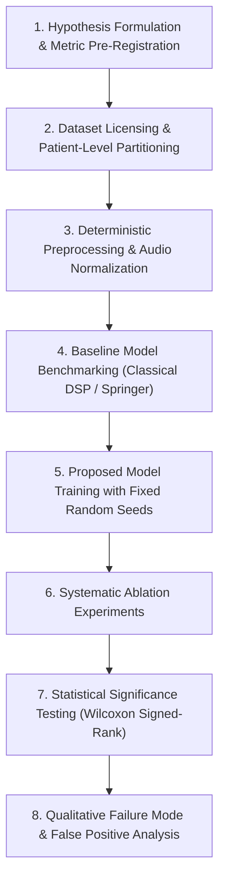

# AuscultaForge — Scientific Machine Learning Experiment Design Protocol
**Document ID:** `AF-RES-EXP-DESIGN-V01`  
**Classification:** `RESEARCH_METHODOLOGY`  
**Course Context:** EEE495 / EEE496 Senior Design Project — Digital Stethoscope  
**Reference Directory:** `software/pcg_core/segmentation/validation/`

---

## 1. The Standardized 8-Stage Scientific Experiment Protocol

To prevent ad-hoc, irreproducible experiments in Semester II, all machine learning investigations must adhere to this standardized 8-stage protocol:

---

## 2. Protocol Specification by Stage

### Stage 1: Pre-Registration of Hypotheses & Metrics
* The research team must document the null hypothesis ($H_0$) and alternative hypothesis ($H_1$) in writing before training models.
* Evaluation metrics are pre-registered:
  * Primary Metric: Segment-level $F_1$-score at tolerance $\delta = \pm 50 \text{ ms}$.
  * Secondary Metrics: Sensitivity (Recall), Positive Predictive Value (Precision), and State Duration Error ($\Delta \tau$).

### Stage 2: Dataset Partitioning & Anti-Leakage Protocol
* **Permitted Benchmark Datasets:**
  1. PhysioNet CirCor DigiScope Pediatric PCG Dataset (PhysioNet Challenge 2022, Open Data Commons Attribution License).
  2. PhysioNet Computing in Cardiology Challenge 2016 (Open-access heart sound database).
* **Partitioning Rule:**
  * Datasets are partitioned into 5 cross-validation folds strictly stratified by **`subject_id`**.
  * Zero audio files from a given subject may appear in both train and validation/test folds.
  * Verified programmatically via `pcg_core.segmentation.validation.splitting`.

### Stage 3: Deterministic Preprocessing
* Audio resampled to $1,000 \text{ Hz}$ using rational polyphase filtering (`scipy.signal.resample_poly`).
* 2nd-order Butterworth bandpass filtering ($25\text{--}400 \text{ Hz}$).
* Schmidt non-linear spike clipping applied.
* Feature arrays serialized to disk with SHA-256 hashes to guarantee identical training inputs across model comparisons.

### Stage 4: Baseline Benchmarking
* Every proposed deep learning or complex architecture must be evaluated head-to-head against:
  1. **Baseline 0:** Energy threshold detector (naive baseline).
  2. **Baseline 1:** The official Springer et al. LR-HSMM (`pcg_core.segmentation.springer_hsmm`).
* A proposed model is considered unsuccessful if it fails to achieve a statistically significant improvement over Baseline 1.

### Stage 5: Training & Fixed Reproducibility Seeds
* All stochastic operations (weight initialization, mini-batch shuffling, dropout masks) must take an explicit integer seed (`seed = 42`).
* Training loss curves, learning rate schedules, and epoch checkpoints must be serialized to `experiments/research/checkpoints/`.

### Stage 6: Ablation Study Matrix
Every published performance gain must be ablated to isolate the genuine cause of improvement:
* **Ablation A:** Remove each input feature envelope one by one.
* **Ablation B:** Replace learned duration distributions with fixed empirical durations.
* **Ablation C:** Remove temporal transition constraints.

### Stage 7: Statistical Significance Testing
* Reporting raw mean accuracy is scientifically insufficient.
* The team must execute a **two-sided Wilcoxon signed-rank test** across cross-validation folds:
  $$p < 0.05$$
  is required to reject the null hypothesis and claim an improvement.

### Stage 8: Error Analysis & Failure Cases
* The evaluation report must document the top 10 worst-performing recordings (lowest $F_1$).
* Failure modes must be classified:
  * Tachycardia duration mismatch ($HR > 140\text{ BPM}$).
  * Severe systolic murmur masking $S_2$.
  * Friction artifact falsely detected as $S_1$.
