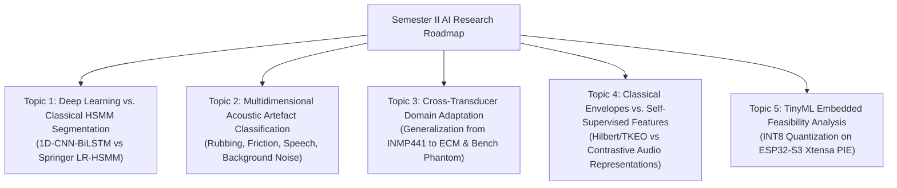

# AuscultaForge — Semester II Artificial Intelligence & Machine Learning Research Roadmap
**Document ID:** `AF-RES-AI-ROADMAP-V01`  
**Classification:** `RESEARCH_ROADMAP` / `DOCUMENTED_PROPOSAL`  
**Course Context:** EEE495 / EEE496 Senior Design Project — Digital Stethoscope  
**Primary Author:** Ege Çağın Tepe (Module C Owner)  
**Academic Disclaimer:** Research proposal only. Does NOT introduce medical diagnostic production claims.

---

## 1. Research Scope & Ethical Boundaries

Machine learning in biomedical acoustic instrumentation must be approached with rigorous scientific conservatism. While early-stage engineering projects often attempt naive disease diagnosis (e.g. "binary murmur classification"), such models almost universally fail to generalize due to dataset bias, patient demographic shifts, and unmodeled acoustic noise.

In Semester II (EEE496), the AuscultaForge AI research roadmap investigates five tightly scoped, publishable engineering research questions centered on **signal quality assessment, domain generalization, and segmentation robustness**:

---

## 2. Five Proposed Research Directions

### Direction 1: Deep Sequential Modeling vs. Classical Springer HSMM
* **Research Question:** Can a compact 1D-CNN-BiLSTM or temporal convolutional network (TCN) outperform Springer's duration-dependent HSMM in segmenting heart sounds under severe noise while remaining computationally viable for real-time desktop execution?
* **Experimental Hypothesis:** Deep temporal networks will exhibit higher tolerance to non-stationary ambient noise, but may produce unphysiological state transitions unless regularized by a Markovian transition loss.
* **Proposed Baseline:** The existing `SpringerHSMM` (`software/pcg_core/segmentation/springer_hsmm.py`).
* **Evaluation Metric:** Event matching $F_1$-score at tolerance $\delta = \pm 50 \text{ ms}$ on PhysioNet CirCor.

### Direction 2: Automated Recording Quality & Artefact Classification
* **Research Question:** Can we automatically categorize non-cardiac interference into discrete physical categories (chestpiece friction, respiratory excursion, ambient room speech, electromagnetic mains hum)?
* **Target Objective:** Replace binary "good/bad" quality heuristics with an informative multi-class feedback engine, informing the user *why* a recording is poor and how to adjust the chestpiece physically.
* **Dataset Requirement:** Physical recordings collected on the acoustic bench phantom with controlled artificial noise injection (mechanical shaker, abrasive rubbing pad, loudspeaker speech playback).

### Direction 3: Cross-Microphone Domain Adaptation & Sensor Invariance
* **Research Question:** How severe is the performance degradation when a segmentation model trained on open-access clinical data (recorded with Littmann / 3M digital stethoscopes) is evaluated on recordings from low-cost consumer MEMS microphones (INMP441)?
* **Investigation:** Quantify the acoustic transfer function shift between clinical acoustic sensors and bench MEMS sensors; evaluate whether simple frequency-domain normalization (cepstral mean normalization or spectral whitening) restores segmentation accuracy.

### Direction 4: Hand-Crafted Acoustic Envelopes vs. Learned Representations
* **Research Question:** Do learned temporal representations (e.g. self-supervised representations from audio contrastive learning) extract more robust cardiac boundaries than classical Hilbert and Teager-Kaiser Energy Operators?
* **Ablation Matrix:** Evaluate performance when systematically disabling each of the four Springer envelopes (Homomorphic, Hilbert, Wavelet, PSD) versus learned 1D convolutional filterbanks.

### Direction 5: Embedded TinyML Deployment Feasibility on ESP32-S3
* **Research Question:** Can a reduced-parameter segmentation or quality model be quantized to INT8 and executed locally on the ESP32-S3 microcontroller using TensorFlow Lite for Microcontrollers (TFLM) and Xtensa PIE vector acceleration?
* **Feasibility Limits:** Model parameter memory must fit within $256 \text{ KB}$ of internal SRAM; per-second inference time must consume $< 15\%$ of Core 0 CPU budget at $240 \text{ MHz}$.

---

## 3. Mandatory Governance & Ethical Prerequisites

Before any Semester II ML experiment is committed to the codebase, the following gates must be satisfied:
1. **Advisor Sign-Off:** Written approval of the experiment plan from the senior design faculty advisor.
2. **Strict Subject-Level Splitting:** Verification of zero patient overlap between training, validation, and test folds (`test_circor_adapter.py`).
3. **No Clinical Diagnostic Output:** Models output signal quality scores and cardiac event boundaries only; diagnostic labels are strictly barred.
4. **Reproducible Preprocessing:** All audio resampled via deterministic polyphase filters (`pcg_core.segmentation.preprocessing`) with fixed random seeds.
