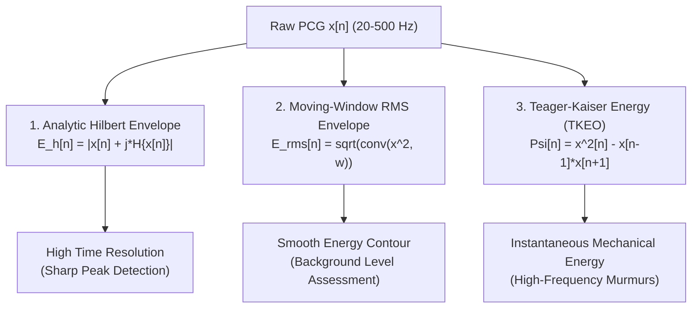

# AuscultaForge — Digital Signal Processing (DSP) Mathematics
**Document ID:** `AF-SCI-DSP-MATH-V01`  
**Classification:** `CODE_VERIFIED` / `TEST_VERIFIED`  
**Course Context:** EEE495 / EEE496 Senior Design Project — Digital Stethoscope  
**Reference Files:**
- `software/pcg_core/dsp.py`
- `software/pcg_core/scientific/envelopes.py`
- `software/pcg_core/scientific/signal_quality.py`

---

## 1. Sampling Theory & Anti-Aliasing Foundations

### 1.1 The Nyquist-Shannon Theorem
Let $x_a(t)$ be a continuous-time bandlimited signal with continuous Fourier transform $X_a(f) = 0$ for all $|f| > f_{\max}$. The signal can be uniquely and perfectly reconstructed from its discrete samples $x[n] = x_a(n T_s)$ if and only if the sampling frequency $f_s = 1 / T_s$ satisfies:
$$f_s > 2 f_{\max}$$
The frequency $f_N = f_s / 2$ is the **Nyquist folding frequency**.

### 1.2 AuscultaForge 48 kHz Oversampling Analysis
* For cardiac PCG, the maximum frequency of clinical interest is $f_{\max} = 500 \text{ Hz}$.
* The minimum Nyquist rate is $f_{s,\min} = 1,000 \text{ Hz}$.
* AuscultaForge samples continuously at **$f_s = 48,000 \text{ Hz}$** ($f_N = 24,000 \text{ Hz}$).
* **Oversampling Ratio ($\text{OSR}$):**
  $$\text{OSR} = \frac{f_s}{2 f_{\max}} = \frac{48,000}{2 \times 500} = 48$$
* **Engineering Advantages of 48x Oversampling:**
  1. Relaxes analog anti-aliasing filter requirements: Transition band extends from $500 \text{ Hz}$ all the way to $24,000 \text{ Hz}$.
  2. Spreads quantization noise power across $24 \text{ kHz}$, improving in-band SNR by $10 \log_{10}(48) \approx 16.8 \text{ dB}$ before digital filtering.
  3. Eliminates phase distortion in the cardiac passband caused by steep analog filters.

---

## 2. Digital Filter Realization: Second-Order Sections (SOS)

### 2.1 The Direct-Form Numerical Instability Problem
An $N$-th order IIR filter is described by its rational transfer function in the $z$-domain:
$$H(z) = \frac{\sum_{i=0}^N b_i z^{-i}}{1 + \sum_{j=1}^N a_j z^{-j}}$$
In direct-form implementations (e.g. `scipy.signal.lfilter` with standard $[b, a]$ polynomials), as filter order $N$ increases, the roots of the denominator polynomial (the poles) become extremely sensitive to finite numerical precision errors. A minor round-off error in a high-order coefficient $a_j$ can displace poles outside the unit circle ($|z| \ge 1$), causing catastrophic filter instability and numerical blow-up.

### 2.2 Second-Order Sections (Biquad Cascade)
AuscultaForge factors all IIR filters into a cascade of $K = \lceil N/2 \rceil$ second-order sections (biquads):
$$H(z) = g \cdot \prod_{k=1}^K \frac{b_{0k} + b_{1k}z^{-1} + b_{2k}z^{-2}}{1 + a_{1k}z^{-1} + a_{2k}z^{-2}}$$

* Each section is represented by a row in an $(K, 6)$ matrix: $[b_{0k}, b_{1k}, b_{2k}, 1, a_{1k}, a_{2k}]$.
* Pole pairs are grouped with adjacent zero pairs to minimize peak gain and prevent internal arithmetic overflow.
* **Filter Specification (`pcg_core/dsp.py`):**
  * Type: 4th-order Butterworth bandpass filter ($K = 4$ sections).
  * Passband: $20 \text{ Hz}$ to $500 \text{ Hz}$.
  * Attenuation: Maximally flat passband with zero ripple; $-24 \text{ dB/octave}$ roll-off in stopbands.

### 2.3 Streaming Causal Filtering vs. Zero-Phase Filtering
* **Streaming Causal Filtering (`scipy.signal.sosfilt`):**
  * Operates forward in time on incoming blocks of 512 samples.
  * Preserves delay state vector $z_k$:
    $$y[n], z_k = \text{sosfilt}(\text{sos}, x[n], z_i=z_k)$$
  * Invariant: Zero transient spike or discontinuity at block boundaries. Introduces physical group delay $\tau_g \approx 3.2 \text{ ms}$.
* **Zero-Phase Offline Filtering (`scipy.signal.sosfiltfilt`):**
  * Passes signal forward, reverses it in time, and passes it through the filter again.
  * Transfer function magnitude is $|H(z)|^2$; phase is identically zero ($\phi(f) = 0$).
  * Used exclusively for offline scientific analysis on fully recorded WAV sessions.

---

## 3. Signal Characterization & Quality Metrics

In `software/pcg_core/scientific/signal_quality.py`, incoming audio blocks are continuously characterized across four mathematical dimensions:

### 3.1 Root Mean Square (RMS) Level
The effective energy of a discrete sample block of length $N$:
$$x_{\text{RMS}} = \sqrt{\frac{1}{N} \sum_{n=0}^{N-1} x^2[n]}$$
In decibels relative to digital full scale:
$$\text{RMS}_{\text{dBFS}} = 20 \log_{10} \left( \max(x_{\text{RMS}}, \epsilon) \right)$$
where $\epsilon = 10^{-12}$ protects against $\log(0)$ errors.

### 3.2 Peak Amplitude & Clipping Detection
$$x_{\text{peak}} = \max_{0 \le n < N} |x[n]|$$
* Digital full scale is $x_{\text{FS}} = 1.0$.
* A sample is flagged as **clipped** if:
  $$|x[n]| \ge 1.0 - 10^{-5} \quad (\approx 0.99999)$$
* If consecutive clipped samples occur, a non-zero `clipping_count` is broadcast to alert the user of transducer saturation.

### 3.3 Crest Factor
The ratio of the instantaneous peak amplitude to the effective RMS level:
$$C = \frac{x_{\text{peak}}}{x_{\text{RMS}}}$$
In decibels:
$$C_{\text{dB}} = 20 \log_{10}(C) = x_{\text{peak, dBFS}} - x_{\text{RMS, dBFS}}$$
* **Interpretation in Cardiac PCG:**
  * Clean heart sounds exhibit high crest factor ($C_{\text{dB}} \approx 12\text{--}18 \text{ dB}$) due to impulsive $S_1/S_2$ peaks separated by quiet systolic/diastolic intervals.
  * Continuous background friction, breathing, or white noise exhibits low crest factor ($C_{\text{dB}} \approx 6\text{--}9 \text{ dB}$).
  * A crest factor dropping below $8 \text{ dB}$ indicates poor acoustic seal or rubbing artifact.

---

## 4. Signal Envelope Extraction Algorithms

In `software/pcg_core/scientific/envelopes.py`, three distinct mathematical envelopes are implemented for cardiac event detection:

### 4.1 The Analytic Signal & Hilbert Envelope
The Hilbert transform $\mathcal{H}\{x(t)\}$ introduces a ninety-degree ($-90^\circ$) phase shift to all positive frequency components:
$$\mathcal{H}\{x(t)\} = \frac{1}{\pi} \text{p.v.} \int_{-\infty}^{\infty} \frac{x(\tau)}{t - \tau} d\tau$$
The complex **analytic signal** $z(t)$ is defined as:
$$z(t) = x(t) + j \mathcal{H}\{x(t)\} = A(t) e^{j \theta(t)}$$
The **Hilbert envelope** is the instantaneous magnitude:
$$E_{\text{hilbert}}[n] = |z[n]| = \sqrt{x^2[n] + (\mathcal{H}\{x[n]\})^2}$$

### 4.2 Teager-Kaiser Energy Operator (TKEO)
The discrete-time Teager-Kaiser Energy Operator $\Psi[\cdot]$ estimates the instantaneous mechanical energy required to generate the acoustic waveform:
$$\Psi[x[n]] = x^2[n] - x[n-1] \cdot x[n+1]$$

#### Worked Example: Pure Sine Wave $x[n] = A \cos(\omega_0 n)$
$$\Psi[x[n]] = A^2 \cos^2(\omega_0 n) - A^2 \cos(\omega_0(n-1)) \cos(\omega_0(n+1))$$
Using the trigonometric identity $\cos(A-B)\cos(A+B) = \cos^2(A) - \sin^2(B)$:
$$\cos(\omega_0 n - \omega_0)\cos(\omega_0 n + \omega_0) = \cos^2(\omega_0 n) - \sin^2(\omega_0)$$
Substituting into $\Psi$:
$$\Psi[x[n]] = A^2 \left( \cos^2(\omega_0 n) - [\cos^2(\omega_0 n) - \sin^2(\omega_0)] \right) = A^2 \sin^2(\omega_0)$$
For small discrete frequencies ($\omega_0 \ll 1$), $\sin(\omega_0) \approx \omega_0$:
$$\Psi[x[n]] \approx A^2 \omega_0^2$$
* **Significance:** The TKEO is proportional to both the squared amplitude $A^2$ AND the squared frequency $\omega_0^2$. This makes it extraordinarily sensitive to high-frequency murmurs and transient valve snaps while rejecting low-frequency baseline drift.
