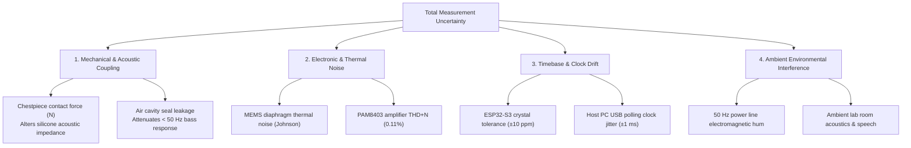

# AuscultaForge — Measurement Uncertainty, Repeatability & Error Budgets
**Document ID:** `AF-SCI-UNCERTAINTY-V01`  
**Classification:** `CODE_VERIFIED` / `TEST_VERIFIED`  
**Course Context:** EEE495 / EEE496 Senior Design Project — Digital Stethoscope  
**Reference File:** `software/pcg_core/metrology/workflows.py`  
**Associated Tests:** `software/tests/test_metrology_automation.py`

---

## 1. Metrological Principles in Senior Design

In undergraduate engineering projects, students frequently report a single laboratory measurement (e.g., "SNR is 42 dB") without quantifying experimental dispersion, environmental sensitivity, or sensor repeatability.

The course advisor for EEE495/EEE496 explicitly mandates **Measurement Repeatability ($\ge 10$ independent runs)** as one of the six primary physical deliverables. This document formalizes the statistical framework, uncertainty propagation, and error budgets enforced by AuscultaForge.

---

## 2. Statistical Dispersion & Repeatability Formulation

For a physical metric $M$ measured across $K \ge 10$ independent experimental trials $\{m_1, m_2, \dots, m_K\}$:

### 2.1 Sample Mean ($\bar{m}$)
$$\bar{m} = \frac{1}{K} \sum_{k=1}^K m_k$$

### 2.2 Sample Standard Deviation ($s$) & Variance ($s^2$)
$$s = \sqrt{\frac{1}{K - 1} \sum_{k=1}^K (m_k - \bar{m})^2}$$

### 2.3 Coefficient of Variation ($\text{CV}$)
The Coefficient of Variation expresses the relative dispersion as a dimensionless percentage:
$$\text{CV} = \frac{s}{|\bar{m}|} \times 100\%$$
* **Repeatability Standard:** An acoustic bench measurement is considered repeatable and stable if:
  $$\text{CV} \le 5.0\%$$
* If $\text{CV} > 10.0\%$, the measurement is flagged as unstable, requiring mechanical repositioning or noise shielding.

### 2.4 Confidence Intervals
Assuming approximately Gaussian experimental error, the $95\%$ confidence interval for the true mean $\mu$ is:
$$\text{CI}_{95\%} = \bar{m} \pm t_{0.025, K-1} \cdot \frac{s}{\sqrt{K}}$$
For $K = 10$ runs, Student's $t$-factor is $t_{0.025, 9} = 2.262$.

---

## 3. Systematic Sources of Measurement Uncertainty

---

## 4. Error Budget & Mitigation Strategies

| Error Source | Primary Cause | Physical Impact on Metric | AuscultaForge Engineering Mitigation |
|---|---|---|---|
| **Contact Pressure Drift** | Inconsistent hand pressure holding chestpiece against phantom | Frequency response $|H_1(f)|$ shifts by up to $\pm 4 \text{ dB}$ at low frequencies ($< 100\text{ Hz}$). | Use a calibrated physical clamping weight ($500 \text{ g}$ dead-weight fixture) during formal bench measurements rather than holding by hand. |
| **50 Hz Mains Coupling** | Electromagnetic radiation from 220V power cables and PC power bricks | Spurious 50 Hz fundamental and harmonic peaks ($100, 150, 200\text{ Hz}$) elevated above floor. | Shielded USB cables; run laptop on battery power during baseline characterization; verify ground bonding. |
| **Acoustic Cavity Leak** | Non-planar contact between silicone phantom and chestpiece rim | Severe loss of acoustic pressure below $50 \text{ Hz}$ ($S_1$ attenuation). | Apply a thin layer of compliant silicone gel or acoustic coupling liquid to eliminate micro-air gaps. |
| **Clock Timebase Drift** | ESP32 crystal oscillator ($\pm 10\text{ ppm}$) vs. Host PC system clock | In prolonged streaming, sample counters drift by $\approx 0.48 \text{ samples/minute}$. | Cross-correlation time-alignment ($\tau$) in software system ID; monotonic 64-bit sample indexing. |
| **Thermal Variations** | Power amplifier and exciter coil heating during continuous runs | Exciter coil resistance rises, shifting gain by $\approx 0.2 \text{ dB}$. | Enforce a 5-minute warm-up period before recording the official 10-run characterization sequence. |
