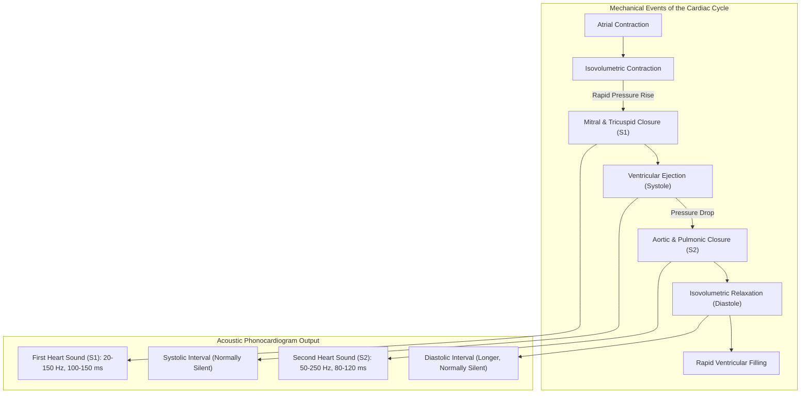

# AuscultaForge — Phonocardiography (PCG) Signal Foundations
**Document ID:** `AF-SCI-PCG-FOUNDATIONS-V01`  
**Classification:** `CODE_VERIFIED` / `TEST_VERIFIED`  
**Course Context:** EEE495 / EEE496 Senior Design Project — Digital Stethoscope  
**Scientific Registries:** `docs/research/SOURCE_REGISTRY.md` (R001–R008), `docs/research/SCIENTIFIC_CONVENTIONS.md`

---

## 1. Biophysical Genesis of Phonocardiographic Signals

Phonocardiography (PCG) is the high-bandwidth graphic recording of acoustic sounds and vibrations generated by the mechanical action of the heart. From an engineering perspective, the heart is a cyclical, four-chambered muscular pump driven by electromechanical coupling. As chambers contract and relax, blood accelerations and decelerations interact with elastic myocardial walls and valve leaflets, producing acoustic pressure waves that propagate through thoracic tissue.

---

## 2. Acoustic Characteristics of Heart Sounds ($S_1, S_2, S_3, S_4$)

### 2.1 The First Heart Sound ($S_1$)
* **Physiological Mechanism:** Coincides with the closure of the atrioventricular (AV) valves (Mitral $M_1$ and Tricuspid $T_1$) at the onset of ventricular systole.
* **Frequency Band:** Dominant spectral energy resides between **$20 \text{ Hz}$ and $150 \text{ Hz}$** (peak energy typically near $40\text{--}80 \text{ Hz}$).
* **Duration:** Typically **$100 \text{ to } 150 \text{ ms}$**.
* **Acoustic Waveform:** Low-pitched, relatively long duration, soft onset ("lub").

### 2.2 The Second Heart Sound ($S_2$)
* **Physiological Mechanism:** Coincides with the closure of the semilunar valves (Aortic $A_2$ and Pulmonic $P_2$) at the end of ventricular systole / onset of diastole.
* **Frequency Band:** Higher frequency content than $S_1$, spanning **$50 \text{ Hz}$ to $250 \text{ Hz}$** (peak energy typically near $80\text{--}140 \text{ Hz}$).
* **Duration:** Typically **$80 \text{ to } 120 \text{ ms}$**.
* **Acoustic Waveform:** Higher-pitched, crisper, shorter duration, abrupt termination ("dub").

### 2.3 Pathological & Low-Frequency Sounds ($S_3, S_4$, Murmurs)
* **Third Heart Sound ($S_3$):** Occurs early in diastole during rapid ventricular filling; very low frequency ($15\text{--}40 \text{ Hz}$), often near the threshold of human audibility.
* **Fourth Heart Sound ($S_4$):** Occurs late in diastole due to vigorous atrial contraction into a stiff ventricle ($15\text{--}30 \text{ Hz}$).
* **Cardiac Murmurs:** Turbulent blood flow through stenotic or regurgitant orifices; high-frequency spectral components spanning **$100 \text{ Hz}$ to $400 \text{ Hz}$**.

---

## 3. Why the $20\text{--}500\text{ Hz}$ Bandwidth Boundary is Enforced

AuscultaForge strictly bounds its scientific processing pipeline to the **$20\text{--}500\text{ Hz}$ band**.

### 3.1 The Low-Frequency Cutoff ($20 \text{ Hz}$)
* Acoustic energy below $20 \text{ Hz}$ is dominated by non-cardiac mechanical artefacts:
  * Hand tremors and chestpiece handling friction ($0\text{--}10 \text{ Hz}$).
  * Thoracic respiratory chest-wall excursion ($0.1\text{--}0.5 \text{ Hz}$).
  * Ambient laboratory floor vibrations and HVAC infrasound ($1\text{--}15 \text{ Hz}$).
* A 4th-order high-pass cutoff at $20 \text{ Hz}$ removes DC baseline wander and transducer saturation without attenuating $S_1$ and $S_2$.

### 3.2 The High-Frequency Cutoff ($500 \text{ Hz}$)
* Physiological heart sound energy attenuates rapidly above $400 \text{ Hz}$ due to thoracic tissue damping (acoustic low-pass filtering by muscle and subcutaneous fat).
* Signal energy above $500 \text{ Hz}$ in a stethoscope setup is almost exclusively composed of:
  * Ambient acoustic speech and room noise.
  * Electronic thermal noise from the transducer.
  * 50 Hz power mains harmonics ($550, 650, 750, \dots \text{ Hz}$).

### 3.3 Explicit Exclusion of Lung Sounds
* **Acoustic Distinction:** Vesicular and bronchial lung sounds possess diffuse, continuous spectral energy extending from **$100 \text{ Hz}$ up to $2,000 \text{ Hz}$** (stridor and wheezes reach $1,500 \text{ Hz}$).
* **Scope Decision:** Lung sound characterization requires entirely different filter topologies, acoustic coupling geometries, and spectral feature extractors. AuscultaForge is officially restricted to **cardiac PCG only**.

---

## 4. Engineering Units & Non-Clinical Metrology Policy

### 4.1 Digital Full Scale (dBFS) vs. Calibrated Pascals (Pa)
* The AuscultaForge platform operates strictly with **uncalibrated relative units (dBFS and normalized amplitude $[-1.0, +1.0)$)**.
* **Why Sound Pressure (Pa or dB SPL) is NOT Claimed:**
  * Converting digital sample words to physical Pascals ($1 \text{ Pa} = 94 \text{ dB SPL}$) requires an end-to-end calibrated acoustic chain, including a calibrated reference pressure microphone inside an impedance-matched acoustic coupler (e.g. IEC 60318 artificial ear).
  * Without an expensive acoustic calibrator in the undergraduate lab, claiming absolute physical sound pressure levels in Pascals is scientifically unsupportable.
* **Non-Clinical Boundary:** The platform assesses technical signal quality, transmission continuity, and frequency response; it provides **zero medical diagnostic interpretations**.
