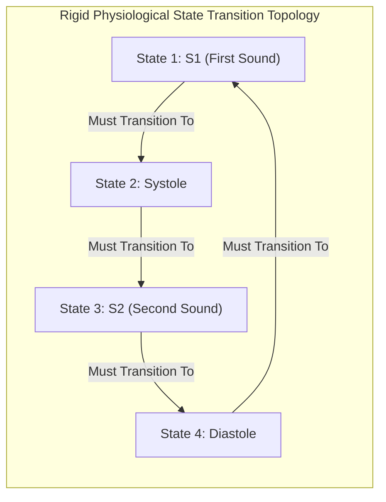

# AuscultaForge — Heart Sound Segmentation & Springer LR-HSMM Architecture
**Document ID:** `AF-SCI-SEGMENTATION-V01`  
**Classification:** `CODE_VERIFIED` / `TEST_VERIFIED`  
**Course Context:** EEE495 / EEE496 Senior Design Project — Digital Stethoscope  
**Reference Files:**
- `software/pcg_core/segmentation/springer_hsmm.py`
- `software/pcg_core/segmentation/springer_logistic.py`
- `software/pcg_core/segmentation/validation/`
**Primary Literature Foundation:**
- Springer et al., *"Logistic Regression-HSMM-based Heart Sound Segmentation,"* IEEE TBME, 2016 (Source R001).
- Schmidt et al., *"A markerless method for heart sound segmentation,"* Computers in Cardiology, 2010 (Source R002).

---

## 1. Overview of Heart Sound Segmentation

Cardiac segmentation is the automated temporal delineation of the phonocardiogram into its four fundamental physiological intervals:
1. **State 1 ($S_1$):** First heart sound (mitral/tricuspid valve closure).
2. **State 2 ($\text{Systole}$):** Ventricular ejection period between $S_1$ and $S_2$.
3. **State 3 ($S_2$):** Second heart sound (aortic/pulmonic valve closure).
4. **State 4 ($\text{Diastole}$):** Ventricular filling period between $S_2$ and the subsequent $S_1$.

---

## 2. Springer Preprocessing Pipeline & Feature Extraction

The input audio (sampled at 48,000 Hz) is preprocessed and decimated to a standardized $1,000 \text{ Hz}$ feature timebase:

### 2.1 Resampling & Bandpass Filtering
1. **Rational Resampling:** Polyphase resampling from $48,000 \text{ Hz}$ to $f_{s,\text{seg}} = 1,000 \text{ Hz}$ using `scipy.signal.resample_poly(x, 1, 48)`.
2. **Bandpass Filtering:** 2nd-order Butterworth bandpass filter spanning **$25 \text{ Hz}$ to $400 \text{ Hz}$**, preserving $S_1/S_2$ acoustic frequencies while rejecting rumble and high-frequency noise.

### 2.2 Schmidt Spike Removal Algorithm
Real-world PCG recordings frequently contain sharp, high-amplitude impulse spikes caused by sensor motion or cable collision. Naive normalization would scale genuine heart sounds down to zero.
* **Schmidt Filter (`pcg_core/segmentation/preprocessing.py`):**
  1. Computes the maximum absolute amplitude across consecutive $500 \text{ ms}$ windows.
  2. Finds the median of these window maxima: $M_{\text{med}}$.
  3. Identifies samples exceeding $3 \times M_{\text{med}}$.
  4. Linearly attenuates outlying samples, clipping spike peaks while preserving underlying acoustic waveforms.

### 2.3 The Four Springer Feature Envelopes
At each millisecond step $n$ ($f_s = 1,000 \text{ Hz}$), four distinct acoustic envelopes are extracted:
1. **Homomorphic Envelope ($F_1[n]$):** Decodes amplitude modulation by computing the exponential of the low-pass filtered log-magnitude:
   $$F_1[n] = \exp\left( \text{LPF}_{10\text{Hz}} \{ \ln(|x[n]| + \epsilon) \} \right)$$
2. **Hilbert Analytic Envelope ($F_2[n]$):** Instantaneous envelope of the analytic signal:
   $$F_2[n] = \text{LPF}_{10\text{Hz}} \{ |x[n] + j \mathcal{H}\{x[n]\}| \}$$
3. **Wavelet Energy Envelope ($F_3[n]$):** Stationary wavelet transform energy concentrated in the $40\text{--}150 \text{ Hz}$ cardiac band (Daubechies-4 / Morlet wavelet decomposition).
4. **Power Spectral Density Envelope ($F_4[n]$):** Short-time energy in the $40\text{--}250 \text{ Hz}$ sub-band computed via short sliding FFT windows.

All four feature streams are normalized to zero mean and unit variance ($\mu = 0, \sigma = 1$).

---

## 3. Hidden Semi-Markov Model (HSMM) Formulation

Standard Hidden Markov Models (HMM) assume memoryless exponential state duration distributions:
$$P(d) = (1 - a_{ii}) a_{ii}^{d-1}$$
This assumption is catastrophic for cardiac segmentation: a standard HMM predicts that the most probable duration for $S_1$ or $S_2$ is $1 \text{ ms}$, failing to capture the physical reality that valve closure requires $80\text{--}150 \text{ ms}$.

A **Hidden Semi-Markov Model (HSMM)** explicitly parameterizes the duration distribution $p_j(d)$ of each state $j$.

### 3.1 State Duration Distributions
State durations are modeled as Gaussian distributions conditioned on the subject's mean heart rate:
$$p_j(d) = \frac{1}{\sigma_j \sqrt{2\pi}} \exp\left( -\frac{(d - \mu_j)^2}{2 \sigma_j^2} \right)$$
* **$S_1$ Duration:** $\mu_{S1} \approx 120 \text{ ms}$, $\sigma_{S1} \approx 25 \text{ ms}$.
* **$S_2$ Duration:** $\mu_{S2} \approx 100 \text{ ms}$, $\sigma_{S2} \approx 20 \text{ ms}$.
* **Systolic Duration:** Strongly correlated with heart rate; $\mu_{\text{sys}} \approx 250\text{--}350 \text{ ms}$.
* **Diastolic Duration:** Varies inversely with heart rate; $\mu_{\text{dia}} \approx 400\text{--}700 \text{ ms}$.

### 3.2 Emission Probabilities via Logistic Regression
Rather than using heavy Gaussian Mixture Models (GMM), Springer et al. utilized four **One-vs-Rest (OvR) Logistic Regression Classifiers**:
$$P(q_t = j \mid \mathbf{O}_t) = \frac{1}{1 + \exp\left( -(\mathbf{w}_j^T \mathbf{O}_t + b_j) \right)}$$
By Bayes' rule, the state emission probability $b_j(\mathbf{O}_t) = P(\mathbf{O}_t \mid q_t = j)$ is evaluated as:
$$b_j(\mathbf{O}_t) \propto \frac{P(q_t = j \mid \mathbf{O}_t)}{P(q_t = j)}$$

### 3.3 Extended Viterbi Decoding with Cyclic Topology
The optimal state sequence $Q^* = \{q_1, q_2, \dots, q_T\}$ is discovered by an extended dynamic programming Viterbi algorithm.
* **Transition Matrix Constraint:**
  $$A = \begin{bmatrix}
  0 & 1 & 0 & 0 \\
  0 & 0 & 1 & 0 \\
  0 & 0 & 0 & 1 \\
  1 & 0 & 0 & 0
  \end{bmatrix}$$
  Transitions are strictly constrained to: $S_1 \to \text{Systole} \to S_2 \to \text{Diastole} \to S_1$. Any sequence deviating from this physiological cycle has probability zero ($-\infty$ in log-space).

---

## 4. CirCor Dataset Benchmark & Validation Suite

To evaluate segmentation performance scientifically, AuscultaForge integrates an automated benchmarking pipeline (`software/pcg_core/segmentation/validation/`) executing on the open-access **PhysioNet CirCor DigiScope Pediatric PCG Dataset** (Source R008).

### 4.1 Strict Subject-Level Split (Zero Data Leakage)
* **The Clinical Data Leakage Trap:** A single patient frequently has multiple recordings taken from different auscultation sites (Aortic, Pulmonic, Mitral, Tricuspid). Splitting files randomly into train/test folds leaks the patient's acoustic chest impedance into the test set, creating artificially inflated accuracy numbers.
* **AuscultaForge Policy:** Splits are strictly partitioned by **Patient ID (`subject_id`)**. All recordings from a given patient reside exclusively in either the training fold or the testing fold.

### 4.2 Event Matching Tolerance Matrix
Predicted $S_1$ and $S_2$ events are matched against physician annotations within symmetric temporal tolerance windows ($\delta = \pm 50 \text{ ms}$ and $\delta = \pm 100 \text{ ms}$):
* **True Positive ($TP$):** Predicted event center falls within $\pm \delta$ of an unmatched ground-truth annotation.
* **False Positive ($FP$):** Predicted event has no corresponding ground-truth annotation within $\pm \delta$.
* **False Negative ($FN$):** Ground-truth annotation is not matched by any predicted event within $\pm \delta$.

$$\text{Sensitivity (Recall)} = \frac{TP}{TP + FN}, \quad \text{Precision (PPV)} = \frac{TP}{TP + FP}, \quad F_1 = \frac{2 \times \text{Sensitivity} \times \text{Precision}}{\text{Sensitivity} + \text{Precision}}$$
* Verified and tested in `software/tests/test_circor_adapter.py` and `test_validation_matching.py`.
