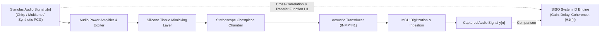

# AuscultaForge — SISO System Identification & Acoustic Phantom Metrology
**Document ID:** `AF-SCI-SYSTEM-ID-V01`  
**Classification:** `CODE_VERIFIED` / `TEST_VERIFIED`  
**Course Context:** EEE495 / EEE496 Senior Design Project — Digital Stethoscope  
**Reference Files:**
- `software/pcg_core/phantom.py`
- `software/pcg_core/scientific/system_id.py`
- `software/tests/test_phantom_system_id.py`

---

## 1. The Acoustic Phantom as a Linear Dynamic System

To characterize the fidelity of the AuscultaForge digital stethoscope without human clinical trials, the acoustic coupling chain (audio exciter, power amplifier, silicone tissue layer, chestpiece chamber, and transducer) is modeled as a **Single-Input Single-Output (SISO) Linear Time-Invariant (LTI)** dynamic system.

* **Input Signal ($x[n]$):** Electrical excitation waveform driven into the phantom exciter.
* **Output Signal ($y[n]$):** Ingested digital signal recorded from the stethoscope transducer on the host PC.
* **Add noise model:**
  $$y[n] = g \cdot (x[n - D] * h[n]) + v[n]$$
  where $g$ is the scalar path gain, $D$ is the propagation delay (latency), $h[n]$ is the impulse response of the acoustic channel, and $v[n]$ is uncorrelated observation noise.

---

## 2. Temporal Delay Estimation via Cross-Correlation

Propagation delay from electrical output to digital ingestion represents the end-to-end latency of the stethoscope.

### 2.1 Normalized Cross-Correlation Formulation
The discrete cross-correlation sequence $R_{xy}[m]$ between stimulus $x[n]$ and capture $y[n]$ is evaluated as:
$$R_{xy}[m] = \sum_{n=-\infty}^{\infty} x[n] y[n + m]$$
In `software/pcg_core/phantom.py`, cross-correlation is evaluated via FFT convolution:
$$R_{xy}[m] = \mathcal{F}^{-1} \left\{ X^*(f) \cdot Y(f) \right\}$$
The optimal sample delay $\hat{D}$ is the lag maximizing the cross-correlation:
$$\hat{D} = \arg\max_m R_{xy}[m]$$
The physical propagation latency $\tau_{\text{prop}}$ in milliseconds is:
$$\tau_{\text{prop}} = \frac{\hat{D}}{f_s} \times 1,000 \ \text{ms}$$

---

## 3. Least-Squares Gain Estimation

Once aligned by delay $\hat{D}$, the scalar gain $\hat{g}$ between the stimulus and the aligned capture $y_{\text{aligned}}[n] = y[n + \hat{D}]$ is determined by minimizing the squared error:
$$J(g) = \sum_{n=0}^{N-1} (y_{\text{aligned}}[n] - g \cdot x[n])^2$$
Setting the derivative $\frac{dJ}{dg} = 0$:
$$\frac{d}{dg} \left[ \sum_{n=0}^{N-1} y_{\text{aligned}}^2[n] - 2g \sum_{n=0}^{N-1} x[n] y_{\text{aligned}}[n] + g^2 \sum_{n=0}^{N-1} x^2[n] \right] = 0$$
$$-2 \sum_{n=0}^{N-1} x[n] y_{\text{aligned}}[n] + 2g \sum_{n=0}^{N-1} x^2[n] = 0$$
$$\hat{g}_{\text{LS}} = \frac{\sum_{n=0}^{N-1} x[n] y_{\text{aligned}}[n]}{\sum_{n=0}^{N-1} x^2[n]}$$

* **Safety Invariant:** If the input signal energy $\sum x^2[n] < 10^{-12}$, the gain estimator safely returns $0.0$, preventing division-by-zero crashes.

---

## 4. Frequency Response: The $H_1(f)$ Best-Linear Estimator

To characterize the frequency-dependent attenuation across the cardiac passband ($20\text{--}500\text{ Hz}$), AuscultaForge implements the **$H_1(f)$ Transfer Function Estimator** (`software/pcg_core/scientific/system_id.py`).

### 4.1 Cross-Spectral Density Derivation
Let $S_{xx}(f)$ be the auto-power spectral density of the stimulus, and $S_{xy}(f)$ be the cross-power spectral density between stimulus and capture.
Assuming the additive noise $v[n]$ is uncorrelated with the stimulus ($S_{xv}(f) = 0$):
$$S_{xy}(f) = S_{x(hx+v)}(f) = H(f) S_{xx}(f) + S_{xv}(f) = H(f) S_{xx}(f)$$
The $H_1$ frequency response estimator is:
$$\hat{H}_1(f) = \frac{S_{xy}(f)}{S_{xx}(f)}$$
* **Magnitude Response in dB:**
  $$|H_1(f)|_{\text{dB}} = 20 \log_{10} \left( |\hat{H}_1(f)| \right)$$
* **Advantage of $H_1$:** It is mathematically immune to additive noise present on the output transducer ($v[n]$).

---

## 5. Magnitude-Squared Coherence $\gamma_{xy}^2(f)$

To verify that the measured frequency response reflects true linear acoustic transmission rather than noise or non-linear distortion, the **Magnitude-Squared Coherence** is evaluated:
$$\gamma_{xy}^2(f) = \frac{|S_{xy}(f)|^2}{S_{xx}(f) S_{yy}(f)}$$
where $S_{yy}(f)$ is the auto-power spectral density of the capture signal.

### 5.1 Physical Interpretation of Coherence Values ($0 \le \gamma_{xy}^2(f) \le 1$):
* **$\gamma_{xy}^2(f) = 1.0$ (Ideal Linear Transmission):**
  * The system is perfectly linear, time-invariant, and zero extraneous acoustic noise is present at frequency $f$.
* **$0.8 \le \gamma_{xy}^2(f) < 1.0$ (High Quality):**
  * Minor background acoustic noise; measurement is valid and trustworthy.
* **$\gamma_{xy}^2(f) < 0.6$ (Low Coherence / Measurement Invalid):**
  * Indicates one of three failure conditions:
    1. Severe ambient acoustic room noise corrupting the microphone.
    2. Non-linear harmonic distortion (e.g. exciter clipping or diaphragm bottoming out).
    3. Severe clock drift or uncorrected phase jitter between stimulus and capture.
* **Test Verification:** Verified in `software/tests/test_phantom_system_id.py`, confirming that under clean simulated transmission, $\gamma_{xy}^2(f) = 1.0000$ across all frequency bins.
