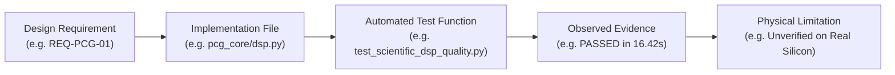

# AuscultaForge — Requirements Traceability Matrix (RTM)
**Document ID:** `AF-VERIF-TRACEABILITY-V01`  
**Classification:** `CODE_VERIFIED` / `TEST_VERIFIED`  
**Course Context:** EEE495 / EEE496 Senior Design Project — Digital Stethoscope  
**Baseline Git Commit:** `fa4b75a80d29aab04875534234574db9f6c0af43`

---

## 1. Traceability Methodology

In medical instrumentation and aerospace software engineering, requirements must not exist in isolation from code. Every formal requirement must be traced forward to its exact implementing source lines, verified by specific automated test cases, and bounded by documented physical limitations.

---

## 2. Master Requirements Traceability Matrix

| Req ID | Requirement Description | Implementation Source File & Function | Automated Test Case | Observed Result | Scope Limitations |
|---|---|---|---|---|---|
| **REQ-CORE-01** | Immutable 4-field audio container (`SampleBlock`) | `software/pcg_core/models.py` (`SampleBlock`) | `test_core.py::test_sample_block_immutability` | **PASS** | Container is in-memory only; does not enforce hardware clock sync. |
| **REQ-DSP-01** | Causal stateful bandpass filtering ($20\text{--}500\text{ Hz}$) | `software/pcg_core/dsp.py` (`StreamingBandpass`) | `test_scientific_dsp_quality.py::test_streaming_bandpass_sos` | **PASS** | Filter introduces $\approx 3.2\text{ ms}$ causal group delay. |
| **REQ-DSP-02** | Real-time audio metrics: RMS, Peak, Crest Factor, Clipping | `software/pcg_core/scientific/signal_quality.py` | `test_scientific_signal_quality.py::test_metrics_calculation` | **PASS** | Metrics are relative dBFS; cannot measure absolute Pascals. |
| **REQ-BUFF-01** | Thread-safe circular FIFO rolling buffer (5.0 s capacity) | `software/pcg_core/buffers.py` (`RollingBuffer`) | `test_streaming.py::test_rolling_buffer_capacity_and_truncation` | **PASS** | Buffer wraps old samples if not extracted within 5.0 seconds. |
| **REQ-REC-01** | Session persistence: Lossless WAV audio (default float32) | `software/pcg_core/recording.py` (`SessionRecorder`) | `test_recording.py::test_wav_recording_sample_integrity` | **PASS** | Accumulates float32 blocks in memory; serializes via scipy.io.wavfile. |
| **REQ-REC-02** | Whole-file SHA-256 file integrity sidecar (`session.json`) | `software/pcg_core/recording.py` (`compute_file_sha256`) | `test_recording.py::test_sha256_hash_verification` | **PASS** | Hash covers complete serialized raw.wav file for storage integrity. |
| **REQ-REC-03** | Session verification and replay with integrity check | `software/pcg_core/recording.py` (`verify_session`, `load_session`) | `test_recording.py::test_replayer_rejects_corrupted_payload` | **PASS** | Verifies raw_wav_sha256 and sample counts against session metadata. |
| **REQ-DISP-01** | Peak-preserving decimation ($\le 600$ min/max points) | `software/pcg_app/display_pipeline.py` (`DisplayDecimator`) | `test_display_pipeline.py::test_peak_preserving_decimation` | **PASS** | Visual approximation for UI; not used for scientific spectral math. |
| **REQ-DISP-02** | Backpressure isolation (slow UI drops display, not disk) | `software/pcg_app/display_pipeline.py` | `test_streaming_performance.py::test_slow_client_backpressure` | **PASS** | UI drops frames when lagging; disk recording remains 100% intact. |
| **REQ-RUN-01** | Authoritative 8-state hardware lifecycle machine | `software/pcg_app/device_runtime.py` (`DeviceRuntime`) | `test_device_runtime.py::test_lifecycle_transitions` | **PASS** | States verified on mock/virtual serial; physical USB pending delivery. |
| **REQ-RUN-02** | DTR modem line gating of microcontroller streaming | `software/pcg_app/device_runtime.py` (`open_device`) | `test_device_runtime.py::test_dtr_assertion` | **PASS** | Requires functional CDC-ACM DTR implementation in firmware. |
| **REQ-RUN-03** | Mid-stream cable disconnect fault recovery | `software/pcg_app/device_runtime.py` | `test_transport_readiness.py::test_abrupt_disconnect_finalizes` | **PASS** | Session saved safely; host backend does not freeze or crash. |
| **REQ-TRAN-01** | 3-tier transport architecture & preamble synchronization | `software/pcg_app/device_runtime.py` | `test_transport_readiness.py::test_preamble_garbage_noise_recovery`| **PASS** | Framing is a proposal; pending joint approval with Module B. |
| **REQ-TRAN-02** | CRC-16-CCITT packet corruption detection & resync | `software/pcg_app/device_runtime.py` | `test_transport_readiness.py::test_corrupt_crc_frame_flagged` | **PASS** | Corrupt frames dropped; sequence counter registers gap. |
| **REQ-BENCH-01**| 8 deterministic known-answer virtual bench scenarios | `software/pcg_app/virtual_bench.py` (`VirtualBench`) | `test_virtual_bench.py::test_virtual_bench_run_all` | **PASS** | Verifies full software pipeline; does not prove physical microphone. |
| **REQ-SPEC-01** | Welch PSD estimation with Hann windowing & 50% overlap | `software/pcg_core/scientific/spectral.py` | `test_scientific_spectral.py::test_welch_psd_frequency_bins` | **PASS** | Frequency resolution $\Delta f \approx 11.72\text{ Hz}$ at 4096 FFT. |
| **REQ-SPEC-02** | High-resolution 50 Hz power mains harmonic quantification| `software/pcg_core/scientific/spectral.py` | `test_scientific_spectral.py::test_mains_harmonic_extraction` | **PASS** | Detects electrical pickup; does not physically eliminate room hum. |
| **REQ-PHAN-01** | SISO transfer function $H_1(f)$ and coherence $\gamma_{xy}^2(f)$| `software/pcg_core/phantom.py` (`PhantomStimulusEngine`) | `test_phantom_system_id.py::test_phantom_siso_identification` | **PASS** | Linear model assumption; valid only when coherence $\gamma^2 > 0.8$. |
| **REQ-PHAN-02** | Cross-correlation time delay estimation ($\tau_{\text{prop}}$) | `software/pcg_core/phantom.py` | `test_phantom_system_id.py::test_cross_correlation_delay` | **PASS** | Accuracy bounded by discrete sample period $T_s \approx 20.83 \ \mu\text{s}$. |
| **REQ-PHAN-03** | Least-squares gain compensation under additive noise | `software/pcg_core/phantom.py` | `test_validation.py::test_least_squares_gain_recovery` | **PASS** | Assumes scalar path gain; does not model non-linear saturation. |
| **REQ-METRO-01**| Automated test harness executing all 6 advisor measurements | `software/pcg_core/metrology/runner.py` | `test_metrology_automation.py::test_full_metrology_campaign` | **PASS** | Generates CSV and Markdown reports; physical runs require bench. |
| **REQ-SEG-01** | Source-faithful Springer LR-HSMM heart sound segmentation | `software/pcg_core/segmentation/springer_hsmm.py` | `test_springer_end_to_end.py::test_springer_segmentation_pipeline` | **PASS** | Research capability; not for clinical diagnostic decision-making. |
| **REQ-SEG-02** | Strict patient-level split validation against CirCor data | `software/pcg_core/segmentation/validation/` | `test_circor_adapter.py::test_subject_leakage_is_zero` | **PASS** | Benchmark executed on open dataset; pediatric population only. |
| **REQ-INTEROP-01**| Portable C11 golden vector generator & bit-exact parity | `tools/c_golden_vectors/golden_generator.c` | `test_c_golden_vectors.py::test_c_binary_fixtures_parity` | **PASS** | Tested with GCC 16.2.0; firmware cross-compilation pending bench. |
