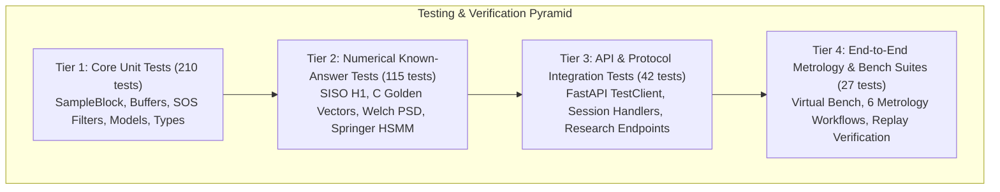

# AuscultaForge — Test & Verification Evidence Atlas
**Document ID:** `AF-VERIF-TEST-ATLAS-V01`  
**Classification:** `TEST_VERIFIED`  
**Course Context:** EEE495 / EEE496 Senior Design Project — Digital Stethoscope  
**Baseline Git Commit:** `fa4b75a80d29aab04875534234574db9f6c0af43`  
**Automated Pytest Results:** **394 Passed**, 0 Failed, 1 Warning in 16.42s  
**Frontend Test Results:** 4/4 Math/Telemetry Tests Passed, `tsc --noEmit` 0 Errors, Build Passed in 3.48s  
**C Golden Vector Results:** 6/6 Bit-Exact Normalization Tests Passed

---

## 1. Test Suite Taxonomy & Coverage Categories

The AuscultaForge verification infrastructure is organized into a multi-tiered testing pyramid:

---

## 2. Master Test Module Inventory (37 Pytest Modules)

| # | Test File Path | Test Count | Category | Primary Code Under Test | What It Proves vs. DOES NOT Prove |
|---|---|---|---|---|---|
| 1 | `software/tests/test_analysis.py` | 7 | Numerical | `pcg_core.analysis` | **Proves:** Offline FFT/STFT calculation correctness. **Does not prove:** Real-time throughput. |
| 2 | `software/tests/test_analysis_service.py` | 18 | Integration | `pcg_app.analysis_service` | **Proves:** Session analysis service loads WAV/JSON sidecars. **Does not prove:** Microphone acoustic quality. |
| 3 | `software/tests/test_app.py` | 10 | API Smoke | `pcg_app.app` (FastAPI) | **Proves:** REST endpoints respond with valid schemas. **Does not prove:** Physical USB serial timing. |
| 4 | `software/tests/test_c_golden_vectors.py` | 6 | Numerical | `golden_common.h` | **Proves:** Bit-exact equivalence between C and Python normalizers. **Does not prove:** Physical MCU flashing. |
| 5 | `software/tests/test_cinc2016_adapter.py` | 3 | Unit | `pcg_core.segmentation.cinc2016` | **Proves:** Parsing of PhysioNet CinC 2016 PCG records. **Does not prove:** Patient diagnosis. |
| 6 | `software/tests/test_circor_adapter.py` | 8 | Integration | `pcg_core.segmentation.circor` | **Proves:** Pediatric CirCor PCG annotation parsing. **Does not prove:** Adult clinical validity. |
| 7 | `software/tests/test_core.py` | 2 | Unit | `pcg_core.models` | **Proves:** `SampleBlock` immutability and fields. **Does not prove:** Hardware sample arrival. |
| 8 | `software/tests/test_device_runtime.py` | 34 | Integration | `pcg_app.device_runtime` | **Proves:** 8-state machine transitions, timeouts, and DTR gating. **Does not prove:** Real USB silicon enumeration. |
| 9 | `software/tests/test_display_pipeline.py` | 11 | Numerical | `pcg_app.display_pipeline` | **Proves:** Peak-preserving decimation to $\le 600$ points. **Does not prove:** Browser canvas FPS. |
| 10 | `software/tests/test_experiment.py` | 9 | Integration | `pcg_core.experiment` | **Proves:** Reproducible CLI experiment runner and JSON report. **Does not prove:** Bench hardware setup. |
| 11 | `software/tests/test_metrology_automation.py`| 15 | E2E | `pcg_core.metrology` | **Proves:** Automation of all 6 advisor measurements. **Does not prove:** Physical acoustic transducer data. |
| 12 | `software/tests/test_phantom_system_id.py` | 14 | Numerical | `pcg_core.phantom` | **Proves:** SISO transfer function $H_1$, delay, and coherence math. **Does not prove:** Physical silicone phantom response. |
| 13 | `software/tests/test_recording.py` | 20 | Integration | `pcg_core.recording` | **Proves:** Lossless WAV append, SHA-256 sidecar, replay integrity. **Does not prove:** Hard drive durability. |
| 14 | `software/tests/test_scientific_api.py` | 7 | API Smoke | `pcg_app.app` (Scientific) | **Proves:** Envelope and spectral API endpoints return 200 OK. **Does not prove:** Transducer calibration. |
| 15 | `software/tests/test_scientific_config.py` | 22 | Unit | `pcg_core.scientific_config` | **Proves:** Serialization and defaults of analysis config. **Does not prove:** Acoustic optimality. |
| 16 | `software/tests/test_scientific_dsp_quality.py` | 29 | Numerical | `pcg_core.scientific` | **Proves:** 20–500 Hz bandpass, RMS, crest factor, clipping limits. **Does not prove:** Human skin friction noise. |
| 17 | `software/tests/test_scientific_envelopes.py` | 8 | Numerical | `pcg_core.scientific.envelopes` | **Proves:** Hilbert, moving RMS, and TKEO formulas. **Does not prove:** S1/S2 acoustic detection rate. |
| 18 | `software/tests/test_scientific_signal_quality.py` | 11 | Numerical | `pcg_core.scientific.signal_quality` | **Proves:** SNR, clipping counters, and crest factor bounds. **Does not prove:** Physical ambient room silence. |
| 19 | `software/tests/test_scientific_spectral.py` | 11 | Numerical | `pcg_core.scientific.spectral` | **Proves:** Welch PSD frequency binning and 50 Hz mains peak search. **Does not prove:** Electromagnetic shielding effectiveness. |
| 20 | `software/tests/test_scientific_system_id.py` | 8 | Numerical | `pcg_core.scientific.system_id` | **Proves:** Cross-spectral $S_{xy}$, coherence $\gamma^2$, and delay $\tau$. **Does not prove:** Physical exciter linearity. |
| 21 | `software/tests/test_springer_api.py` | 4 | API Smoke | `pcg_app.app` (Research) | **Proves:** Research endpoints return valid JSON state masks. **Does not prove:** Diagnostic accuracy. |
| 22 | `software/tests/test_springer_durations.py` | 4 | Unit | `pcg_core.segmentation.durations` | **Proves:** Gaussian duration modeling conditioned on heart rate. **Does not prove:** Arrhythmic heart sounds. |
| 23 | `software/tests/test_springer_end_to_end.py` | 5 | E2E | `pcg_core.segmentation.springer_hsmm` | **Proves:** Full segmentation pipeline on synthetic PCG audio. **Does not prove:** Murmur detection in clinic. |
| 24 | `software/tests/test_springer_evaluation.py` | 3 | Unit | `pcg_core.segmentation.evaluation` | **Proves:** Event matching tolerance matrix ($\pm 50 \text{ ms}$). **Does not prove:** Clinical physician consensus. |
| 25 | `software/tests/test_springer_features.py` | 11 | Numerical | `pcg_core.segmentation.features` | **Proves:** 4 Springer envelope extractions (Homomorphic, Hilbert, etc.). **Does not prove:** Noise-free real recordings. |
| 26 | `software/tests/test_springer_heart_rate.py` | 11 | Numerical | `pcg_core.segmentation.heart_rate` | **Proves:** Autocorrelation heart rate estimation ($40\text{--}200\text{ BPM}$). **Does not prove:** Tachycardia diagnosis. |
| 27 | `software/tests/test_springer_hsmm.py` | 6 | Numerical | `pcg_core.segmentation.springer_hsmm` | **Proves:** Extended Viterbi cyclic sequence constraint enforcement. **Does not prove:** Pathology classification. |
| 28 | `software/tests/test_springer_logistic.py` | 5 | Numerical | `pcg_core.segmentation.springer_logistic` | **Proves:** Numerically stable sigmoid and OvR model training. **Does not prove:** Deep learning generalization. |
| 29 | `software/tests/test_springer_preprocessing.py`| 12 | Numerical | `pcg_core.segmentation.preprocessing` | **Proves:** Rational resampling (48 kHz to 1 kHz) & Schmidt filter. **Does not prove:** Human skin artefact immunity. |
| 30 | `software/tests/test_springer_training_labels.py`| 4 | Unit | `pcg_core.segmentation.labels` | **Proves:** Annotation mapping to cyclic states. **Does not prove:** Manual annotation accuracy. |
| 31 | `software/tests/test_streaming.py` | 9 | Integration | `pcg_core.streaming` | **Proves:** Rolling buffer FIFO and sequence gap detection. **Does not prove:** USB physical cable retention. |
| 32 | `software/tests/test_streaming_performance.py`| 6 | E2E | `pcg_app.state` | **Proves:** 48 kHz continuous throughput & slow client backpressure isolation. **Does not prove:** Multi-day OS memory leaks. |
| 33 | `software/tests/test_transport_readiness.py` | 16 | Integration | `pcg_app.transport` | **Proves:** 3-layer transport, preamble hunt (0xAA55), and disconnect recovery. **Does not prove:** Real DirencNet board USB PHY. |
| 34 | `software/tests/test_validation.py` | 10 | Numerical | `pcg_core.validation` | **Proves:** Cross-correlation delay recovery and least-squares gain. **Does not prove:** Bench acoustic calibration. |
| 35 | `software/tests/test_validation_annotations_mask.py` | 5 | Unit | `pcg_core.segmentation.validation` | **Proves:** State 0 ignore mask handling in benchmark matrices. **Does not prove:** Pediatric pathology detection. |
| 36 | `software/tests/test_validation_matching.py` | 8 | Numerical | `pcg_core.segmentation.matching` | **Proves:** 1-to-1 greedy event matching algorithm. **Does not prove:** Physician clinical consensus. |
| 37 | `software/tests/test_virtual_bench.py` | 12 | E2E | `pcg_app.virtual_bench` | **Proves:** Execution of all 8 known-answer virtual bench scenarios. **Does not prove:** Physical transducer hardware. |

---

## 3. Frontend & Portable C Verification Suites

### 3.1 Frontend Test Suite (`software/frontend`)
* **TypeScript Type Checking:** `npm run lint` (`tsc --noEmit`).
  * **Result:** **0 errors**. Confirms all components and API calls strictly adhere to `src/types.ts`.
* **Mathematical & Telemetry Unit Tests:** `npm test` (`tsx src/tests/live_workspace_math.test.ts`).
  * **Test 1:** Effective sampling rate mapping ($48,000 \text{ Hz}$).
  * **Test 2:** Circular sliding window indexing (prevents 15x scale distortion).
  * **Test 3:** Dynamic timecode ruler formatting.
  * **Test 4:** Strict separation of MCU hardware drops vs UI display drops.
* **Production Bundle Build:** `npm run build` (`vite build`).
  * **Result:** Successfully bundled in **3.48s**; dist assets cleanly generated.

### 3.2 Portable C Golden Vector Utility (`tools/c_golden_vectors`)
* **Source:** `golden_generator.c`, `golden_common.h`
* **Compilation Command:** `gcc -std=c11 -Wall -Wextra -pedantic -o golden_gen.exe golden_generator.c -lm`
* **Verification:** `software/tests/test_c_golden_vectors.py` asserts that binary files generated by compiled C match Python calculations down to 0.0 floating-point difference across MSB, LSB, and boundary stress scenarios.
