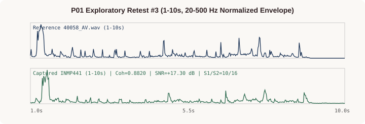
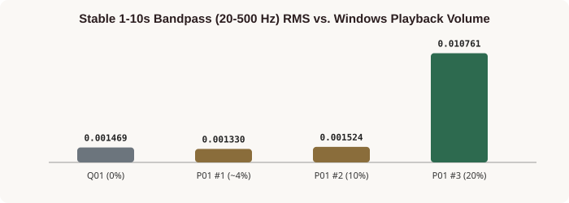

# AuscultaForge — First Successful Physical PCG Phantom Proof of Concept | 25 November 2026

> **Milestone Statement:**
> On November 25, 2026, the AuscultaForge team successfully demonstrated an integrated physical PCG phantom proof of concept. A reference heart-sound recording was reproduced through an exciter, support plate and silicone phantom, then acquired through a stethoscope-coupled INMP441 and ESP32-S3 system. Exploratory measurements showed strong frequency-domain coherence, while formal validation and acquisition stability remain ongoing engineering tasks.

---

## 1. Executive Summary & Acceptance Classification

This document records the November 25, 2026 physical laboratory milestone for the AuscultaForge Smart Digital Stethoscope senior design project (`egecagintepe/ausculta-forge`). Following prior firmware G2 readiness, desktop software integration, and RTV-2 silicone phantom fabrication, the team assembled and tested the complete electro-acoustic-to-digital acquisition chain in the laboratory.

In accordance with engineering truthfulness and quality-assurance rules, formal verification gates are kept strictly separate from exploratory proof-of-concept acceptance:

| Classification | Status | Basis & Scope |
| :--- | :--- | :--- |
| **`PROTOTYPE_POC_ACCEPTED`** | **YES** | Internal engineering milestone: end-to-end physical PCG transmission demonstrated |
| **`PHYSICAL_PCG_TRANSMISSION_DEMONSTRATED`** | **YES** | Supported by exploratory trial `trial_20261125_095717_275ae8` (1–10 s stable window) |
| **`DIGITAL_CAPTURE_INTEGRITY`** | **PASS** | `0` in-stream drops, `0` CRC errors, `480,000` samples @ `48 kHz` on all valid captures |
| **`STETHOSCOPE_COUPLING_DIAGNOSTIC`** | **PASS** | `3/3` diaphragm taps detected in `session_20261125_083848_02ff521c` and `session_20261125_100542_a818e843` |
| **`OFFICIAL_Q01`** | **FAIL** | `session_20261125_093843_959d7eb0` failed full-file RMS/clipping due to `0–1 s` I²S startup transient |
| **`OFFICIAL_P01`** | **NOT YET ACCEPTED** | Formal NCC (`< 0.35`), S1/S2 (`< 70%`), and Q01 prerequisite gates remain unresolved |
| **`DIRECT_SILICONE_SIDEQUEST`** | **INCONCLUSIVE** | `trial_20261125_100205_921544` and `trial_20261125_100747_443db6` recorded `480,000` exact zeros |
| **`CLINICAL_VALIDATION`** | **NOT CLAIMED** | Engineering characterization on uncalibrated phantom only |

---

## 2. Objectives and Scope

1. Verify real-time I²S acquisition on ESP32-S3 (`COM10`, G2 firmware `1.1.0`, `source_mode=0`, `48 kHz`) with the INMP441 MEMS microphone without modifying firmware.
2. Verify acoustic coupling from the stethoscope diaphragm through sealed Y-tubing to the INMP441 sound port.
3. Assemble the physical excitation chain (PC Realtek AUX $\rightarrow$ PAM8403 $\rightarrow$ 12 Ω exciter $\rightarrow$ suspended cardboard support plate $\rightarrow$ cured RTV-2 silicone phantom) and characterize quiet baseline (Q01) and PCG stimulus transmission (P01).
4. Integrate and verify live laboratory recording, guided protocol cues, and offline CLI session import in the desktop application.
5. Preserve all raw WAVs, metadata, SHA-256 hashes, and failure evidence without fabricating or altering results.

---

## 3. Team Contributions

* **Ege Çağın Tepe** (`egecagintepe@gmail.com`): Host software orchestration, FastAPI/React Lab Live Recording UI integration, guided 3-tap diagnostic runner (`run_guided_coupling_diagnostic.py`), startup-transient & post-settling `1–10 s` signal analysis, evidence archiving, and GitHub release engineering.
* **Kaan** (`kaan0443-crypto`, `kaan.0443@gmail.com`): Silicone phantom handling, mechanical assembly of the suspended cardboard support plate, exciter mounting, stethoscope diaphragm-to-phantom coupling, Y-tubing sealing with electrical tape, and collaborative milestone documentation review.
* **Ozan** (`0zan0`): PAM8403 BTL amplifier power and signal wiring, independent regulated 5 V/2 A supply setup, 12 Ω exciter integration, AUX TRS conductor identification via multimeter, and electrical safety verification.

---

## 4. Hardware & Signal-Path Architecture

```text
PC (40058_AV.wav @ 48 kHz)
  └─► Kulaklıklar (2- Realtek(R) Audio) 3.5 mm AUX TRS
        └─► PAM8403 Class-D BTL Amplifier (Independent 5V/2A DC)
              └─► 30 mm / 12 Ω Acoustic Exciter
                    └─► Suspended Cardboard Support Plate
                          └─► Cured RTV-2 Silicone Phantom
                                └─► Dual-Head Stethoscope Diaphragm & Sealed Y-Tubing
                                      └─► INMP441 MEMS Microphone (GPIO 4/5/6, L/R=GND)
                                            └─► ESP32-S3 (G2 FW 1.1.0, source_mode=0)
                                                  └─► USB CDC (COM10, 48 kHz, S32_LE 24-bit)
                                                        └─► Host Analyzer & Evidence Archive
```

Full wiring, pin mappings, power isolation, and safety procedures are documented in [HARDWARE_AS_BUILT.md](HARDWARE_AS_BUILT.md).

---

## 5. Chronological Laboratory Timeline (25 November 2026, UTC / TRT)

| # | Time (TRT, UTC+3) | Event / Experiment | Session / Trial ID | Key Observation & Verdict |
| :--- | :--- | :--- | :--- | :--- |
| 1 | `10:41` | INMP441 initial check (`MIC_DIAGNOSTIC`) | `session_20261125_074126_5317e121` | `480,000` exact zeros (`SCK` was wired to `GPIO3` instead of `GPIO4`). |
| 2 | `10:52` | Rewired `SCK` to `GPIO4`; standalone mic check | `session_20261125_075205_9923da49` | **479,784** nonzero samples, `0` drops/CRC, `rms=0.078581 FS`. |
| 3 | `11:26` | Stethoscope Y-tubing coupled with tape (unguided) | `session_20261125_082614_a84648cb` | `479,791` nonzero samples, but continuous ambient disturbance prevented isolating 3 taps. |
| 4 | `11:38` | Guided 3-tap acoustic coupling diagnostic | `session_20261125_083848_02ff521c` | **`COUPLING_VERIFIED`**: `3/3` taps detected (`143x`, `176x`, `108x`), silence RMS `0.004013 FS`. |
| 5 | `12:38` | PAM8403 (5V/2A), AUX TRS (multimeter-checked), cardboard plate & silicone phantom assembled; Official Q01 attempt | `session_20261125_093843_959d7eb0` | **`OFFICIAL_Q01: FAIL`** due to `0–1 s` I²S startup transient (`254` clips, `0.0529%`). Stable `1–10 s` `20–500 Hz` RMS = `0.001469 FS` (clean). |
| 6 | `12:41` | Root-cause investigation of `0–1 s` transient & 12 s protocol limit | — | Verified `i2s_channel_enable` triggers `~1 s` settling; `G1_TARGET_SAMPLES=480000U` blocks 12 s single-shot capture without FW change. |
| 7 | `12:43` | Exploratory P01 #1 (~3–5% Windows volume) | `trial_20261125_094357_0309bb` | `1–10 s` `20–500 Hz` RMS `0.001330 FS` (`-0.86 dB` vs Q01 `1–10 s`), `NCC=0.0081`, `coh=0.1911` (`INCONCLUSIVE`). |
| 8 | `12:48` | Exploratory P01 #2 (10% Windows volume) | `trial_20261125_094850_1d84e4` | `1–10 s` `20–500 Hz` RMS `0.001524 FS` (`+0.32 dB`), `NCC=0.0930`, `coh=0.0226` (`INCONCLUSIVE`). |
| 9 | `12:55` | 120 Hz `-18 dBFS` calibration tone check (20% vol) | — | Tactile vibration confirmed through exciter, cardboard plate, and silicone phantom. |
| 10 | `12:57` | **Exploratory P01 #3 (20% Windows volume, cardboard plate)** | **`trial_20261125_095717_275ae8`** | **Strong PCG transmission in `1–10 s`:** `20–500 Hz` RMS `0.010761 FS`, **contextual SNR `+17.30 dB`**, **`coh=0.8820`**, `NCC=0.1772`, **`10/16` S1/S2 matches (62.5%)**, jitter `16.47 ms`. |
| 11 | `13:02` | Side Quest: cardboard plate removed (direct silicone) #1 | `trial_20261125_100205_921544` | Failed: `480,000` exact zeros (`DIGITAL_SILENCE_OR_CONSTANT_SIGNAL`). |
| 12 | `13:03` | Recovery coupling check #1 | `session_20261125_100347_bec2d02b` | Failed: `480,000` exact zeros. |
| 13 | `13:05` | Wiring reseated; guided 3-tap recovery check #2 | `session_20261125_100542_a818e843` | **`COUPLING_VERIFIED`**: `3/3` taps detected, silence RMS `0.001110 FS`, `0` drops/CRC. |
| 14 | `13:07` | Side Quest: direct silicone retest #2 | `trial_20261125_100747_443db6` | Failed: `480,000` exact zeros (`DIGITAL_SILENCE_OR_CONSTANT_SIGNAL`). Cause unresolved. |
| 15 | `13:16` | Internal PoC Milestone Acceptance & Release | — | `PROTOTYPE_POC_ACCEPTED: YES`, `OFFICIAL_Q01: FAIL`, `OFFICIAL_P01: NOT YET ACCEPTED`. |

---

## 6. Primary Positive Result (`trial_20261125_095717_275ae8`)



* **Full `0–10 s` Window:** `480,000` samples @ `48 kHz`, `0` in-stream drops, `0` CRC errors, `post_target_drain=256`. Full-file `raw_rms = 0.107210 FS`, `clip_098 = 243` (`0.0506%`, all within `0–1 s` startup transient).
* **Stable `1–10 s` Post-Settling Window (`432,000` samples):**
  * `20–500 Hz` RMS: **`0.010761 FS`** (`peak = 0.170828 FS`, `0` clipping samples)
  * Contextual comparison vs. Q01 `1–10 s` (`0.001469 FS`): **`+17.30 dB` (`7.33x`)**
  * Mean `20–250 Hz` coherence: **`0.8820`** (strong linear spectral transfer)
  * Normalized cross-correlation (NCC): **`0.1772`** at estimated lag **`+142.08 ms`**
  * S1/S2 matched events: **`10 / 16` (`62.5%`)**, mean timing jitter **`16.47 ms`**



---

## 7. Limitations, Known Failures & Evidence Inventory

1. **Startup Transient (`0–1 s`):** `i2s_channel_enable()` in `firmware/main/i2s_source.c` restarts I²S clocks on every `START`, producing a `~1 s` settling transient (`254` clipped samples in Q01 `session_20261125_093843_959d7eb0`). `G1_TARGET_SAMPLES = 480000U` currently prevents a 12 s (`2 s` warm-up + `10 s` Q01) single-shot capture without a firmware update.
2. **Low NCC (`0.1772`) & Sub-Threshold S1/S2 (`62.5%`):** While `20–250 Hz` coherence (`0.8820`) and `+17.30 dB` contextual SNR demonstrate genuine PCG transmission, phase/frequency shaping by the exciter–cardboard–silicone chain reduced time-domain NCC below `0.35` and S1/S2 matching below `70%`.
3. **Intermittent All-Zero Captures:** Both direct-silicone trials (`trial_20261125_100205_921544`, `trial_20261125_100747_443db6`) and `session_20261125_100347_bec2d02b` produced `480,000` exact zeros; the root cause (intermittent jumper/breadboard contact vs. mechanical/electrical disturbance) remains unresolved.
4. **Uncalibrated Phantom & Contextual SNR:** All measurements are relative Full Scale (`FS`) units; contextual SNR uses Q01's `1–10 s` region rather than an accepted full-10s Q01 baseline.

See [EXPERIMENT_RESULTS.md](EXPERIMENT_RESULTS.md), [EVIDENCE_MANIFEST.json](EVIDENCE_MANIFEST.json), [KNOWN_ISSUES_AND_NEXT_STEPS.md](KNOWN_ISSUES_AND_NEXT_STEPS.md), and [photos/README.md](photos/README.md) for complete artifact registers and photographic import status.
